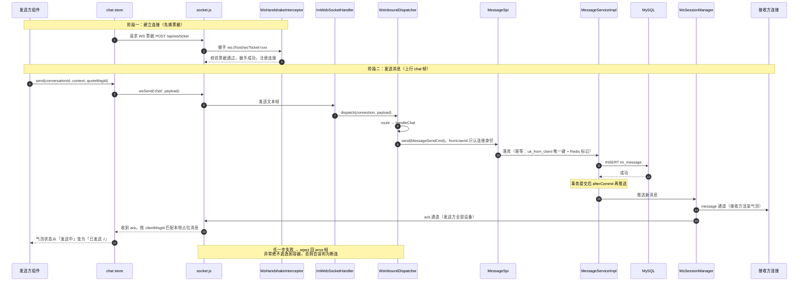
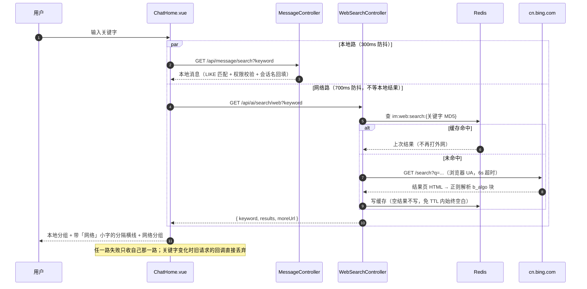

# 详细开发内容

## 文档

| 文档                                                         | 内容                                                         |
| ------------------------------------------------------------ | ------------------------------------------------------------ |
| [`md/项目启动流程.md`](md/项目启动流程.md)                   | 从零跑起来的分步流程（对应本文「三 ~ 七」章）                |
| [`md/架构与请求链路图.md`](md/架构与请求链路图.md)           | 三层架构、HTTP / WebSocket 链路、登录鉴权、文件上传下载、远程控制、AI、直播，以及**举报与后台链路（第十二节）**等专项时序图 |
| [`md/多端入口与缓存全链路图.md`](md/多端入口与缓存全链路图.md) | 四端入口（手机浏览器 / 安卓 APK / PC 浏览器 / Electron，另加第五个入口管理后台 `im-admin-ui`）+ 端侧 IndexedDB·本地 SQLite·服务端 L1 Caffeine + L2 Redis + L3 MySQL 全链路 |
| [`md/直播.md`](md/直播.md)                                   | 直播选型对比与 HLS 推 / 拉流细节、Nginx 生产配置             |
| [`md/图片内容审核接入指南.md`](md/图片内容审核接入指南.md)   | 图片 NSFW 审核：为何把推理放前端、阈值调法、审计日志、血腥 / 暴力模型的投放与三个坑 |
| [`md/监控告警部署指南.md`](md/监控告警部署指南.md)           | 三期监控：Actuator/Prometheus 端点保护、Prometheus 抓取与告警规则样例、Grafana 接入、慢接口阈值 |
| [`md/手机真机调试HTTPS配置指南.md`](md/手机真机调试HTTPS配置指南.md) | 手机真机联调远程控制的自签证书配置                           |
| [`im-ui/README.md`](im-ui/README.md)                         | 聊天端前端工程详细说明                                       |
| [`im-admin-ui/README.md`](im-admin-ui/README.md)             | 管理后台前端工程说明（端口与 CORS、登录链路、部署四事）      |
| [`im-website/README.md`](im-website/README.md)               | 官网前端工程说明（端口 5373、下载产物投放与 fetch-downloads 脚本） |
| `http://localhost:8080/doc.html`                             | Knife4j 聚合接口文档（入参 / 出参、在线调试；分组按 `@Tag` 增长，不写死个数） |
| [`md/CHANGELOG.md`](md/CHANGELOG.md)                         | 版本变更记录                                                 |

---

## 

## 一、技术栈与版本

后端版本全部锁定在根 `pom.xml` 的 `<properties>` 里，升级只需改一处；前端依赖版本在 `im-ui/package.json`，管理后台在 `im-admin-ui/package.json`，官网在 `im-website/package.json`，桌面端在 `electron/package.json`。

| 类别 | 组件 | 版本 | 说明 |
|---|---|---|---|
| 运行时 | JDK | 21 | 实测路径 `D:\software\jdk\jdk21` |
| 框架 | Spring Boot | 4.0.8 | knife4j-next 基线 4.0.7、mybatis-plus 基线 4.0.1，取 4.0.8 兼容性最好 |
| 持久层 | MyBatis-Plus | 3.5.17 | 用 `mybatis-plus-spring-boot4-starter`；分页插件 3.5.9+ 已拆分，需显式引入 |
| 数据库 | MySQL | 8.x | 库名默认 `im_db` |
| 缓存 | Redis | 5+ | Sa-Token 会话、验证码、在线状态、消息序号、全网检索结果 |
| 鉴权 | Sa-Token | 1.46.0 | `sa-token-spring-boot4-starter` + `sa-token-jwt` |
| 接口文档 | Knife4j | 5.6.0 | 官方停更于 4.5.0，Boot 4 用维护分支 `knife4j-next` |
| 对象存储 | MinIO | 8.6.0 | 可选，默认走本地磁盘 |
| HTTP 客户端 | OkHttp | 5.1.0 | **必须显式声明**，见下方「已知坑」 |
| JWT 工具 | Hutool | 5.8.47 | WS 连接票据、文件访问票据 |
| 密码加密 | spring-security-crypto | 7.0.7 | 只取加密算法，不引入整个 Spring Security |
| 加密算法 | BouncyCastle | 1.86 | Argon2id 依赖 |
| 前端框架 | Vue | 3.5.42 | 组合式 API + `<script setup>` 单文件组件 |
| 前端构建 | Vite | 7.3.6 | dev server 与代理（`/api`、`/ws`、`/hls`）；插件 `@vitejs/plugin-vue` 6.0.8 |
| 前端 UI | Element Plus | 2.14.5 | 组件库；图标集 `@element-plus/icons-vue` 2.3.2 |
| 前端状态 | Pinia | 3.0.4 | 全局状态管理，按域拆分的多个 store（会话 / 消息 / 好友 / 群 / 设置 / 收藏 / 举报 / 连麦 / 通话 / 群通话…） |
| 前端路由 | Vue Router | 4.6.4 | Web 走 history，Electron 走 hash |
| 前端 HTTP | axios | 1.20.0 | 拦截器统一注入 token、按业务 `code` 判错（失败也是 HTTP 200） |
| 前端本地存储 | sql.js | 1.13.0 | 端侧 SQLite（WASM），消息「本地优先」缓存 |
| 前端媒体 | hls.js | 1.7.3 | 直播 HLS 拉流播放 |
| 前端媒体 | @ffmpeg/ffmpeg + @ffmpeg/util | 0.12.15 / 0.12.2 | 浏览器内 WASM ffmpeg（前端音视频处理） |
| 前端工具 | spark-md5 | 3.0.2 | 大文件分片算 MD5（秒传 / 断点续传） |
| 前端工具 | marked + dompurify | 18.0.14 / 3.4.16 | Markdown 渲染 + HTML 净化（XSS 防护） |
| 前端工具 | dayjs | 1.11.23 | 时间格式化 |
| 桌面端 | Electron + electron-builder | 37.10.3 / 25.1.8 | `electron/` 前端壳连远程后端，打 Windows NSIS 安装包（内置被控端 Agent 与裁剪 JRE） |
| 证书工具 | node-forge | 1.4.0 | devDep，`npm run gen:cert` 生成内网自签证书（手机真机联调用） |

---

## 二、模块结构与依赖关系

### 模块结构

一、业务模块（11 个，星型依赖 im-common，跨模块只走 SPI）

| 模块            | 功能                                                         |
| --------------- | ------------------------------------------------------------ |
| im-user         | 用户注册 / 登录、资料、权限角色（PermissionProvider）、在线状态、验证码 |
| im-friend       | 好友关系、好友申请、黑名单（单向阻断）                       |
| im-conversation | 会话与成员、未读数、已读位点、会话摘要                       |
| im-message      | 消息收发、撤回、已读 / 送达回执、离线补推、分页、幂等发号、Reaction / 投票 / 精华 / **收藏**、导出 |
| im-group        | 群组、群成员、群权限、转让 / 解散                            |
| im-file         | 文件上传（单请求 + 分片 + 秒传 + 断点续传）、票据下载、MinIO / 本地存储 |
| im-websocket    | 长连接、心跳、在线状态、消息推送（WsSessionManager）         |
| im-ai           | AI 面试官：BM25 知识库检索增强 + SSE 流式对话（DashScope）   |
| im-remote       | 远程控制服务端：会话状态机、中继、UDP 打洞反射、审计         |
| im-live         | 直播：房间管理、弹幕 WS /ws/live、HLS 播放地址签名、心跳结算、ENDED 聊天模式、弹幕房管、连麦 PK、回放存档（VOD 清单 + Redis 入口标记）、主播数据面板（零 DDL 读聚合） |
| im-admin        | 管理后台服务端：举报受理与工单状态机（`im_report`）、后台用户管理、数据看板；**自己不 import 任何业务 Mapper**，处置与指标全部经 `ReportTargetSpi` / `AdminUserSpi` / `AdminMetricsSpi` 交回归属模块 |

二、公共 / 装配模块（2 个）

| 模块         | 功能                                                         |
| ------------ | ------------------------------------------------------------ |
| im-common    | 公共依赖：三级缓存、SPI 契约、RedisKeys、JWT 加解密、全局异常、Sa-Token 配置、Result |
| im-bootstrap | 唯一启动模块，把上述业务 + 公共模块聚合成 im-server.jar      |

三、独立程序（1 个，不进主 jar）

| 模块            | 功能                                                         |
| --------------- | ------------------------------------------------------------ |
| im-remote-agent | 被控端桌面 Agent，独立 fat jar（Swing 授权弹窗 + Robot 抓屏 / 注入），不被 im-bootstrap 依赖 |

### **依赖关系是星型而非网状**

```
        im-user ─┐
       im-friend ┤
  im-conversation┤
      im-message ┼──► im-common ◄──┐   （SPI 契约 + 工具类）
        im-group ┤                 │
         im-file ┤                 │
    im-websocket ┤                 │
           im-ai ┤                 │
       im-remote ┤                 │
        im-live  ┤
       im-admin  ┘                 │
                                   │
              im-bootstrap ────────┴──► 依赖全部 12 个模块，负责装配启动
```

`im-remote-agent` 不在星型图里：它是跑在被控机器上的独立进程，与 `im-remote` 只通过
WS 协议通信，没有任何编译期依赖，所以能单独拷走运行。

业务模块之间**从不直接依赖**。跨模块调用一律走 `im-common` 里定义的 SPI 接口，
由目标模块提供实现，调用方用 `ObjectProvider` 注入（拿不到就降级，不报启动失败）

### SPI契约

| SPI 契约（im-common） | 实现方 | 用途 |
|---|---|---|
| `UserQuerySpi` | im-user | 按 ID 批量查用户、判断用户是否存在 |
| `UserProfileSpi` | im-user | 昵称/头像等展示信息，改资料时反向刷新会话快照 |
| `OnlineStatusSpi` | im-user | 在线状态的读写（Redis） |
| `PermissionProvider` | im-user | 供 `StpInterfaceImpl` 查角色与权限点 |
| `FriendRelationSpi` | im-friend | 是否好友、是否拉黑（会话创建的前置校验） |
| `ConversationSpi` | im-conversation | 建会话、刷未读数、更新最后一条消息 |
| `MessageSpi` | im-message | 系统消息落地（如「XX 撤回了一条消息」） |
| `GroupSpi` | im-group | 群成员查询、群内禁言校验 |
| `PushSpi` | im-websocket | 向指定用户/设备推送 WS 报文、踢下线 |
| `FileStorageSpi` | im-file | 文件元数据登记，供消息模块组装可访问 URL |
| `ReportTargetSpi` | im-user / im-message / im-live / im-group | 后台按 `targetType()` 找实现：`resolve` 抓证据快照 + 反查责任人，`dispose` 执行处置（**默认拒绝，只有真能改动对象状态的模块才覆写**；群聊就只实现 resolve） |
| `AdminUserSpi` | im-user | 后台的封禁 / 恢复（im-admin 不碰 `im_user` 表） |
| `AdminMetricsSpi` | im-user / im-message / im-live / im-websocket | 数据看板的分区指标：注入 `List` 后按 `source()` 收 Map，**没有实现就少一个分区而不是显示 0** |

> 一句话总结：**14 个 Maven module** = 11 个业务模块 + im-common（公共）+ im-bootstrap（启动装配）+ im-remote-agent（独立被控端）。其中真正打进 im-server.jar 一起启动的是前 13 个；im-remote-agent 单独打包分发。

> 每个业务模块内部统一分层：
> `controller` / `service`(+`impl`) / `mapper` / `entity` / `dto`(req+vo) / `convert` / `spi` / `config`。

---

## 三、环境准备

只跑「后端 + Web 前端」时，装齐下面**必需**的 6 项即可；**可选**那几个只在做对象存储、直播 / 远程控制硬编、桌面端 / 安卓打包时才需要。分步启动见 [`md/项目启动流程.md`](md/项目启动流程.md)。

### 必需

| 依赖 | 要求 | 检查命令 | 用途 |
|---|---|---|---|
| JDK | 21 | `java -version` | 运行后端 `im-server.jar`（实测路径 `D:\software\jdk\jdk21`）；被控端 Agent 也需 JRE 21 |
| Maven | 3.9+ | `mvn -v` | 后端多模块聚合构建（`mvn clean package`） |
| MySQL | 8.x，已建库或允许建库 | `mysql --version` | 主数据库，库名默认 `im_db`（`im_schema.sql` 头部带 `CREATE DATABASE IF NOT EXISTS`） |
| Redis | 5+，本地 6379 | `redis-cli ping` | Sa-Token 会话、验证码、在线状态、消息序号、直播在线数/心跳、全网检索缓存；**没起后端会启动失败** |
| Node.js | ≥ 20（实测 v24.16.0） | `node -v` | 前端构建与 dev server（不参与 Maven 构建） |
| npm | ≥ 10（实测 11.13.0） | `npm -v` | 前端依赖安装（`npm install`） |

### 可选（按功能）

| 依赖 | 何时需要 | 说明 |
|---|---|---|
| MinIO | 想用对象存储而非本地磁盘时 | ★ `im.file.storage` 的默认值是 **`minio`**（`application.yml` L370），而 `MinioFileStorage` 连不上桶会抛 `IllegalStateException` 让启动 fail-fast。因此**要么装 MinIO（不需额外设变量），要么显式设 `IM_FILE_STORAGE=local`**（文件落 `${user.home}/im-files`），两个都不做后端起不来 |
| ffmpeg | 直播推流 / 远程控制 H.264 硬件编码 | Electron 桌面客户端已内置（`electron/bin`）；被控端 Agent 与本机自测直播需本机可执行 `ffmpeg`（缺失时远控自动回落 JPEG，直播则无法推流） |
| Android Studio + SDK | 打包安卓 APK 时 | Capacitor 方案，见 [`md/打包/打包为EXE和Android指南.md`](md/打包/打包为EXE和Android指南.md) |

> 文档里的命令以 **Windows PowerShell** 为主（语句分隔用 `;` 而非 `&&`）；Linux / macOS 换对应写法，且 `IM_LOG_HOME` 等路径类环境变量必须覆盖成本机路径。

---

## 四、环境变量

**数据库凭据只从环境变量读取，代码与配置文件里不含任何明文密码。**
所有变量都有默认值，本地开发只需设置 `MYSQL_USER` 和 `MYSQL_PASSWORD` 两个。

| 变量 | 默认值 | 说明 |
|---|---|---|
| `MYSQL_HOST` | `127.0.0.1` | |
| `MYSQL_PORT` | `3306` | |
| `MYSQL_DATABASE` | `im_db` | |
| `MYSQL_USER` | `root` | **建议显式设置** |
| `MYSQL_PASSWORD` | 空 | **必须设置**（除非本地 root 真的无密码） |
| `REDIS_HOST` | `127.0.0.1` | |
| `REDIS_PORT` | `6379` | |
| `REDIS_PASSWORD` | 空 | |
| `REDIS_DATABASE` | `0` | |
| `SERVER_PORT` | `8080` | |
| `SPRING_PROFILES_ACTIVE` | `dev` | `dev` 会在响应里回显验证码明文，**生产必须改成 `prod`** |
| `IM_JWT_SECRET` | 内置开发用长串 | Sa-Token 的 JWT 签名密钥，**生产必须替换** |
| `IM_TICKET_SECRET` | 内置开发用长串 | WS 连接票据 / 文件访问票据的签名密钥，**生产必须替换** |
| `IM_FILE_STORAGE` | `minio` | `local` 或 `minio`。默认是 `minio`，没装 MinIO 又没改成 `local` 会让启动 fail-fast |
| `IM_SMS_PROVIDER` | `mock` | 短信下发通道。`mock` 只写日志不发真短信；接真实服务商时改成对应实现名（如 `aliyun`），**生产必须替换** |
| `MAIL_USERNAME` | 空 | 完整邮箱地址（如 `123456@qq.com`），邮箱验证码的发件人 |
| `MAIL_PASSWORD` | 空 | QQ 邮箱的 **SMTP 授权码**，不是 QQ 登录密码（用登录密码会 535 认证失败）。两者都不配时邮箱登录与邮箱找回密码不可用 |
| `IM_FILE_DIR` | `${user.home}/im-files` | 仅 `local` 模式生效 |
| `MINIO_ENDPOINT` | `http://127.0.0.1:9000` | 仅 `minio` 模式生效 |
| `MINIO_ACCESS_KEY` | `minioadmin` | |
| `MINIO_SECRET_KEY` | `minioadmin` | |
| `MINIO_BUCKET` | `im-files` | 启动时自动创建，无需手动建桶（桶名须≥3字符符合 S3 规范） |
| `IM_UPLOAD_TMP_DIR` | `${user.home}/im-upload-tmp` | 分片上传的本地临时目录（断点续传 / 秒传）；**无论 storage 是 local 还是 minio，分片都先落这里**，所在磁盘必须可读写 |
| `IM_LOG_HOME` | `D:/rizi1/IM` | 日志目录，见「六、启动后端 → 日志输出与目录」；Linux 下必须覆盖成对应路径（如 `/data/logs/im`） |
| `ALI_BABA_API_KEY` | 空 | AI 面试官的百炼（DashScope）API Key；未设置时仅面试功能不可用，其余功能照常 |
| `AI_MODEL_NAME` | `qwen-flash` | 百炼模型名（也可换 qwen-plus / qwen-max） |
| `AI_ASR_MODEL_NAME` | `qwen3-asr-flash` | 面试语音转写（ASR）模型名，与主管线同 key 不同模型 |
| `AI_TTS_MODEL_NAME` | `qwen3-omni-flash` | 面试电话模式朗读（TTS）模型名；神经音色按输出 token 计费 |
| `AI_TTS_VOICE` | `Cherry` | 神经音色名（必须在所配 omni 模型的音色表内：`qwen3-omni-flash` 实测认 Cherry/Serena/Ethan/Chelsie/Bella，不认 Tina）；系统音色档不经这里 |
| `IM_AI_KNOWLEDGE_DIR` | `D:/资料/知识库/面试官` | AI 面试知识库目录，递归扫 `.md`/`.txt`，内容增删改后自动重建索引 |
| `IM_LIVE_ENABLED` | `true` | 直播总开关；关掉则开播/观看接口与 `/ws/live` 弹幕端点全部拒绝服务 |
| `IM_LIVE_PLAY_BASE_URL` | `/hls` | 观众播放基址（相对路径，前端按访问源补全：Web 同源、Electron 取「后端 host + 8088」）；生产换成 Nginx 播放口绝对地址 |
| `IM_LIVE_PUSH_BASE_URL` | `http://127.0.0.1:8088/hls` | ffmpeg `-method PUT` 推流基址（写回环的前提是「推流端与媒体服务器同机」；桌面端装在另一台机器时，前端 `remapPushUrl()` 会把回环 host 换成后端 host，也可以直接在这里配成绝对地址） |
| `IM_LIVE_SIGN_SECRET` | `im-live-dev-secret-change-me` | 播放地址签名密钥，须与 Nginx `secure_link_md5` 逐字一致，**生产必须替换** |
| `IM_LIVE_ENDED_ROOM_VISIBLE_MINUTES` | `60` | 已结束直播间在大厅列表的可见时长（分钟）；关播超过它就不再显示，配 `0` 或负数=不过滤 |
| `IM_LIVE_ENDED_CHAT_MINUTES` | `60` | 关播后聊天室保留时长（分钟，ENDED 聊天模式）；配 `0` 或负数=关播立即全断 |
| `IM_DIRECT_ENABLED` | `false` | 远程控制直连（P2P）服务端总开关；开启后被控机会常开 TCP 18924 / UDP 18925，需部署方显式决定并放行端口（见「十二」） |
| `IM_DIRECT_PUNCH_HOST` | 空 | UDP 打洞反射服务的公网可达地址；留空=放弃打洞档，只剩局域网直连与中继 |
| `IM_DIRECT_PUNCH_PORT` | `8947` | 反射服务监听的 UDP 端口，需单独放行 UDP 入站 |
| `IM_CALL_GROUP_ENABLED` | `true` | **群通话总开关**：关掉则聊天端群聊 header 两个入口消失、服务端拒绝建房（一对一通话不受它影响，它由 `im.call.enabled` 管） |
| `IM_CALL_GROUP_MAX_SLOTS` | `4` | **一路群通话的人数上限（含自己）**；服务端硬夹 `[2,6]`，配 10 也只用 6——mesh 拓扑下每人要上行 `N-1` 路编码，调大这个数字不会让大会更稳，只会让视频必崩（要 >6 人得换 SFU） |

> 通话与直播连麦还有一组 `IM_TURN_*` / `im.call.*` / `im.linkmic.*` 旋钮（公网 STUN/TURN 中继、振铃超时、最大时长等）**不在本表**：它们是同一套通话能力的子项，完整清单与取值口径只维护在 [`md/语音视频通话接入指南.md`](md/语音视频通话接入指南.md) §5 与 §13，避免两处各抄一份各自漂移。群通话两个新旋钮改完需重启后端。

PowerShell 设置示例：

```powershell
$env:MYSQL_USER = 'root'
$env:MYSQL_PASSWORD = 'your-password'
$env:SPRING_PROFILES_ACTIVE = 'dev'
```

Bash 设置示例：

```bash
export MYSQL_USER=root
export MYSQL_PASSWORD=your-password
```

---

## 五、数据库初始化

`sql/` 下两个脚本，**先 `im_schema.sql` 建表、后 `im_data.sql` 灌数据**，各跑一次即可：

| 脚本 | 作用 | 规模 | 重跑安全性 |
|---|---|---|---|
| `im_schema.sql` | 建库 + 建表 + 索引 + 虚拟生成列 | `im_db` 库、**34 张表**（分属 10 个模块） | ⚠️ 头部 `DROP TABLE` 会清空数据，**仅限全新库** |
| `im_data.sql` | 灌演示种子数据 | 写入 **16 张表**，其余 18 张建好即空 | ✅ 只删自己的种子 ID 段，**可安全重跑** |

> ⚠️ **`im_schema.sql` 头部是 `DROP TABLE IF EXISTS` + 重建，重跑一次就会清空全库数据**。
> 它的「幂等」指的是重复执行得到同一套表结构，不是「不会动你的数据」。
> 已经有数据的库不要重跑这个脚本，改用本节末尾的「已有库的增量升级」方式。

### 执行步骤

```powershell
# 凭据见「四、环境变量」，PowerShell 下先设好再执行
$env:MYSQL_USER = 'root'
$env:MYSQL_PASSWORD = 'your-password'

# 1. 建表（含索引、虚拟生成列）——仅限全新库
mysql -u $env:MYSQL_USER -p --default-character-set=utf8mb4 im_db -e "source sql/im_schema.sql"

# 2. 灌入演示数据
mysql -u $env:MYSQL_USER -p --default-character-set=utf8mb4 im_db -e "source sql/im_data.sql"
```

### 34 张表分属 10 个模块

| 模块 | 表 |
|---|---|
| 用户权限与钱包（im-user） | `im_user` `im_role` `im_permission` `im_user_role` `im_role_permission` `im_user_wallet` `im_gift` `im_wallet_transaction` |
| 好友（im-friend） | `im_friend` `im_friend_request` |
| 会话（im-conversation） | `im_conversation` `im_conversation_member` |
| 消息（im-message） | `im_message` `im_message_read` `im_message_delete` `im_message_reaction` `im_message_vote` `im_message_essence` `im_message_favorite` |
| 群组（im-group） | `im_group` `im_group_member` `im_group_join_request` `im_group_robot` |
| 文件（im-file） | `im_file` |
| 远程控制（im-remote） | `im_remote_device` `im_remote_session` `im_remote_audit_log` |
| AI 面试（im-ai） | `im_interview_session` `im_interview_message` `im_interview_event` |
| 直播（im-live） | `im_live_room` `im_live_video` `im_gift_record` |
| 管理后台（im-admin） | `im_report` |

> 消息模块那四张 `im_message_*` 附属表都是「标记 / 互动」的载体，**唯一键按可见维度选**：Reaction / 投票 / 收藏挂人（一人一行、各人可见范围不同），精华挂消息（一群一行、全群共享）。逐表字段与选型理由见 [`md/数据库表解析.md`](md/数据库表解析.md) §7.4 ~ §7.7。

### `im_data.sql` 灌了哪些演示数据

- **3 个账号**（密码统一 `123456`）：`admin`（超管，持全部权限点；`user_id=1000`、绑 `admin` 角色）/ `alice`（userId 1001）/ `bob`（userId 1002）
- **4 个角色 + 11 个权限点 + 21 条角色权限绑定**（admin 全量 11 点；user 除「撤回任意消息」「系统管理」外 5 点；moderator 2 点；operator 3 点）；另有 4 条用户角色绑定（admin、alice、bob 及两个后台示范角色挂载）
- **alice ↔ bob 一对好友**（双向 2 行）+ 1 条已同意的历史申请
- **1 个单聊会话**：3 条消息（seq 1~3）+ 送达/已读回执（bob 留 1 条未读，用于演示未读角标）
- **4 场 AI 面试演示会话**（id 2301~2304）：覆盖 status 四种取值（进行中 / 正常结束 / 违规达阈值强制结束 / 未完成），含逐轮问答与违规事件流水，计数列与事件流水严格对账

> 其余 **18 张表**（消息附属五表、群组四表、文件、远程三表、直播两表、钱包流水与送礼流水、举报工单）**建好即空**，运行期由业务写入，脚本不预置任何数据。

> ⚠️ **PowerShell 5.1 不要用 `<` 重定向导入 SQL**：它不识别 `<`（报
> *Missing file specification after redirection operator*），而换成 `Get-Content -Raw xx.sql | mysql`
> 又会被管道的 ASCII 编码把中文一律转成 `?`，数据“导入成功”但满屏乱码。`-e "source 文件"` 让
> mysql 客户端自己去读文件，不经过 shell 管道，是唯一不会损字符的写法（Git Bash / cmd 下用 `<` 没问题）。

> ⚠️ **`im_data.sql` 可以安全地跑在有真实数据的库上**：它的清理段只删自己的种子 ID 段
> （`id < 10000` 与面试三表的 2300~9399），运行期写入的雪花 ID（19 位）不受影响。早期版本
> 是 `DELETE FROM im_user` 这种整表清空，跑一次就把已注册账号、会话、聊天记录全清了。
> 真误删了不要慌：本机 MySQL 开着 ROW 格式 binlog，用
> `mysqlbinlog -vv --base64-output=DECODE-ROWS --start-datetime=... --stop-datetime=...`
> 能把被删行的前像反解出来，转成 INSERT 回灌（注意生成列不能出现在列表里，
> 且 PowerShell 的 `>` 重定向会把中文转成 UTF-16，要直接用二进制落盘或用 Python 读取）。

如果 `im_db` 库还不存在，先建：

```sql
CREATE DATABASE im_db DEFAULT CHARACTER SET utf8mb4 COLLATE utf8mb4_0900_ai_ci;
```

> 也可以直接 `source sql/im_schema.sql`，脚本头部已带 `CREATE DATABASE IF NOT EXISTS` 与 `USE`。

### 已有库的增量升级

本项目没有引入 Flyway / Liquibase，增量靠手工跑 `sql/migration_*.sql`。⚠️ **“幂等”要拆两句话说**：新建表的那几个里，只有 `migration_missing_tables.sql` 用的是 `CREATE TABLE IF NOT EXISTS`（可重跑）；`migration_message_favorite.sql` 与 `migration_report.sql` 开头带 `DROP TABLE IF EXISTS`，**表里有数据后再跑一次等于清空**（当时那么写是因为表还不存在，为的是重跑不报错）。已部署的库升到当前代码：

| 脚本 | 引入的变更 | 不跑会怎样 |
|---|---|---|
| `migration_quote_message.sql` | `im_message.quote_msg_id` 列 + 索引 | 发带引用的消息报 `Unknown column 'quote_msg_id'` |
| `migration_linkmic_gift.sql` | 虚拟积分与礼物四表（`im_user_wallet` `im_gift` `im_wallet_transaction` `im_gift_record`） | 充值 / 签到 / 送礼 / 转账 / 红包接口报缺表（连麦本身的状态走 Redis，不依赖本脚本） |
| `migration_message_favorite.sql` | 新表 `im_message_favorite` | ⚠️ **不是「只有收藏不好用」，而是消息列表接口整片 500**——历史分页 / 离线拉取 / 消息检索 / 群相册都要走 `toViewList → attachFavorites`，那一步对新表做一次 `IN` 查询，表不存在直接抛 `SQLException` |
| `migration_report.sql` | 新表 `im_report` | 只影响举报与后台：提交举报、工单队列、看板里的举报分区都报 `Table 'im_db.im_report' doesn't exist`；**聊天、登录、直播等其余功能不受影响**（这张表只有 im-admin 读）——所以没建表也能启动，只是举报不可用 |
| `migration_user_ban_duration.sql` | 后台四期·第三批：`im_user.disable_until` 列 + `idx_disable_until` 索引（**本批唯一 DDL**，零 RBAC 改动、因此不需清权限缓存） | ★ **不是「少了限时封禁」而是整条登录链路一起挂**：实体 `User` 带上这一列后 MyBatis-Plus 生成的 SELECT 清单就含它，库里没有就报 `Unknown column 'disable_until'`（登录校验、用户列表、举报处置都走这张表）。MySQL 没有 `ADD COLUMN IF NOT EXISTS`，**不能无脑重跑**（重跑报 1060 且会中断后面那条 `ADD KEY`），先跑脚本第 1 段的 `information_schema` 只读预检 |
| `migration_admin_system_config.sql` | 后台四期·第四批：三张新表 `im_config` / `im_sensitive_word` / `im_announcement` + 权限点 118 `system:announcement`（与 admin 绑定） | 三张表都只被 im-admin 读，**没跑就是「这一屏不能用」而不是功能残缺**：配置页拿不到覆盖信息、在线词库读不到（**文件词库照常生效、聊天不受影响**）、公告页与聊天端补拉都报表不存在；后端不会以失败启动（读取失败只记 warn、按当前运行态接着跑）。★ **与上一批相反，本批必须清一次 `im:auth:*` 权限缓存**（新开了权限点 118，`PermissionProviderImpl` 按用户缓存 30 分钟且登录动作不刷新），不清就是「插了权限行却处处 1003」。建表段用 `CREATE TABLE IF NOT EXISTS`、权限段全 `INSERT IGNORE`，可重跑 |
| `migration_admin_wallet_interview_group_message.sql` | 后台四期·第五批：四个权限点 119~122（`system:wallet` / `system:interview` / `system:group:manage` / `system:message:manage`）+ admin 绑定 6019~6022。**★ 全批零 DDL**：四屏读的全是早已存在的业务表（`im_user_wallet` / `im_wallet_transaction` / `im_gift` / `im_gift_record` / `im_interview_*` / `im_group*` / `im_message`），连「这条是后台撤的」那个问责标记都没补列——它写在 `im_message.extra` 这个 JSON 列的 `recalledByAdmin` 键上 | 四个新页面整页 1003（HTTP 仍是 200），**其余后台一切如旧**；`im-admin-ui` 的菜单与路由守卫按同一个点判，所以表现是「菜单自动少四项」而不是四项全灰。★ 与第四批同一口径：**跑完必须清一次 `im:auth:*`**（新开四个点，`PermissionProviderImpl` 按用户缓存 30 分钟且登录动作不刷新）。权限段全 `INSERT IGNORE`、可重跑；但脚本第 0 段那条「119~122 / 6019~6022 主键位是否空闲」的只读预检**不能跳**：这几个号若被本库自己占用过（例如手工插过别的点），`INSERT IGNORE` 会静默跳过那一行，得到「跑了但没生效」这种最难查的现象 |
| `migration_missing_tables.sql` | **对账补丁**：一次补齐 `im_message_reaction` / `im_message_vote` / `im_message_essence` / `im_message_favorite` / `im_group_join_request` / `im_group_robot` / `im_report` 七张表，与 `im_group` 的 `invite_code` + `join_approval` 两列一索引 | ⚠️ 同样**不是「只有这几个功能不好用」**：表情回应 / 投票 / 群精华都挂在 `toViewList` 的末尾，缺任意一张表就会把历史分页 / 离线拉取 / 消息检索 / 群相册一起打成 1007；而 `im_group` 缺 `invite_code` 列会让**所有群查询**报 `Unknown column`（MyBatis-Plus 按实体列生成 SELECT 清单）。这几项当初只更新了全量 `im_schema.sql`、没留增量脚本，而全量那份开头是一串 `DROP TABLE`（跑它等于清库），所以补了这个汇总包。**跑过它之后就不要再去跑上面 `migration_message_favorite.sql` / `migration_report.sql`** |
| `migration_admin_phase2.sql` | **数据补丁**：补后台二期的四个权限点（`im_permission` 108~111）、给 admin 角色绑定它们（`im_role_permission` 6008~6011），并补上 `moderator` / `operator` 两个示范角色与它们的授权行 | 后台存成一期权限数据的库上，admin 登录会**提示成功却处处 1003**：后端四个控制器已细化到 `system:dashboard` 等四个点，而 Sa-Token 里 `system:manage` 是精确串不是通配，匹配不上；前端却仍认伞权限（它比后端宽），所以菜单四项全部可见、点进去全部被拦。★ 补完**必须清一次 Redis 权限缓存**（`im:auth:perm:{userId}` / `im:auth:role:{userId}`，TTL 30 分钟且登录动作不刷新）—— 退登重登不管用，只能 `redis-cli DEL` 或等 TTL），否则看起来像「补了没生效」；不必重启后端。另注意这个症状可能叠加 `migration_missing_tables.sql` 的缺口（库里也没 `im_report`），那种情形下工单屏补完权限仍会报表不存在 |

> ⚠️ **执行顺序**：**先跑 SQL、再启动新版后端**（旧版后端不认这张表，所以先跑 SQL 不影响正在跑的旧版，可以先备库再发版）。回滚反过来：**先把后端退回旧版、再 `DROP TABLE im_message_favorite`**；先 DROP 会让旧版后端正常、新版一启就炸列表接口。`migration_report.sql` 同理且后果轻一个量级：`im_report` 只被 im-admin 读，无论先删表还是先退后端，影响面都只到举报与后台。
>
> 收藏没有做成「零 DDL」（放 Redis 或塞 `extra`）是有意选定的，理由（永久数据不该挤 Redis、两种访问模式都要索引、已有同构先例）写在下述表解析 §7.7。

下面这一条是早期还没有迁移脚本时的手工 `ALTER`，已部署过旧版且未跑过的库仍需补上：

```sql
-- 远程审计新增「触发方」列（inviter 控制端 / invitee 被控端 Agent / system 服务端流程事件）
-- 不加这一列，写入审计会直接报 Unknown column 'actor'；加列前的历史记录该列为 NULL，前端显示「—」
ALTER TABLE `im_remote_audit_log`
    ADD COLUMN `actor` VARCHAR(16) DEFAULT NULL
    COMMENT '触发方：inviter 控制端 / invitee 被控端 Agent / system 服务端流程事件' AFTER `detail`;
```

---

## 六、启动后端

```powershell
# 编译打包（跳过单元测试，本次交付不含测试用例）
mvn clean package -DskipTests
# 启动
java -jar im-bootstrap/target/im-server.jar
# 这样启动每次修改都要返回上层目录进去编译打包 ，只在im-bootstrap目录下即可
mvn -f ..\pom.xml install -DskipTests
# 注意：spring-boot:run 只跑 im-bootstrap 一个模块，跨模块依赖（im-common 等）是从本地
# 仓库 ~/.m2 解析的，不是从源码目录。所以改过 im-common 里的任何文件（包括
# logback-spring.xml）都必须先重新 install，否则跑的还是旧 jar——而且不会报错，
# 只看得到旧行为（典型现象：改了日志配置但 D:/rizi1/IM 下不生成文件）。
mvn spring-boot:run
# 应用还在跑时不要加 clean：im-server.jar 被占用会让删失败
```

启动成功的标志是控制台打出这段横幅（由 `ImApplication#logStartupSummary` 打印，
端口、profile、存储实现都取自实际生效的配置，不靠猜）：

```
----------------------------------------------------------
  IM 即时通讯系统启动完成
  生效 Profile : dev
  接口文档     : http://localhost:8080/doc.html
  WebSocket    : ws://localhost:8080/ws
  文件存储     : local
----------------------------------------------------------
```

横幅之前还会有一条 `Sa-Token 启用 JWT 简单模式（StpLogicJwtForSimple），loginType=login`
——看到它说明鉴权用的是正确的 JWT 模式（详见「已知坑」第 2 条）。

| 地址 | 用途 |
|---|---|
| http://localhost:8080/doc.html | Knife4j 接口文档，按模块分成 9 个分组（01-09，含 AI 面试与远程控制） |
| http://localhost:8080/v3/api-docs | OpenAPI 3 原始 JSON |
| ws://localhost:8080/ws | WebSocket 端点（需先取票据） |
| http://localhost:8080/api/ | 全部 REST 接口 |

### 直播媒体服务器（可选，仅用直播时启动）

直播的**媒体面**不归 Java 后端管：后端（`im-live`）只处理房间状态、播放地址签名、弹幕 WS，**一个媒体字节都不碰**；真正收发 HLS 分片的是一个独立的 HTTP 文件服务器。**本机自测**没有 Nginx 时，用仓库里零依赖的 `electron/live-media-server.js` 顶上（生产换 Nginx，见 [`md/直播.md`](md/直播.md) §10）：

```powershell
node electron/live-media-server.js     # 在仓库根目录执行；监听 0.0.0.0:8088，可选 PORT=xxxx 覆盖端口
```

- 收 ffmpeg 的 `PUT /hls/{roomId}/{streamKey}/{file}` 落盘到 `electron/live-data/hls/…`（先写 `.part` 再原子 rename），观众端 `GET` 静态返回（带 CORS、Range，m3u8 不缓存）。
- 与后端 `im.live` 默认配置对齐：`push-base-url=http://127.0.0.1:8088/hls`（本机推流）、`play-base-url=/hls`（观众经前端 vite 代理同源拉流）。
  ★ 这两个默认值只适用于「客户端与媒体服务器同机」的自测拓扑：桌面端装在另一台机器上时，它们会被前端的
  `livePlayBase()` / `remapPushUrl()` 校正成后端所在机器的 host（旧版本写死 `127.0.0.1`，跨机直播必挂，见 [`md/已踩坑.md`](md/已踩坑.md) 第 20 条）。
- 局域网自测**不校验签名**，防盗链靠路径里不可猜的 `streamKey` 兜底；上生产必须换回 Nginx 的 `secure_link`。
  ★ 签名**只作用于主清单 `/index.m3u8`**：hls.js 拉各档变体清单时不会带上主清单的 query，对 `\.m3u8$` 全部签名会让多档直播直接 403 黑屏（写法见 [`md/直播.md`](md/直播.md) §10.5）。

> 只在**要用直播**时才需要启动它；不启动不影响聊天、好友、文件、远程控制等其它功能。完整的开播→观看自测步骤见「十四、直播」与 [`md/直播.md`](md/直播.md) §11。

### 日志输出与目录

配置在 `im-common/src/main/resources/logback-spring.xml`（**不在 im-bootstrap**：放在
common 的 classpath 根下，打单 jar 后位于 `BOOT-INF/lib/im-common-*.jar` 内）。
目录由 `im.log.home` 决定（可用环境变量 `IM_LOG_HOME` 覆盖），落地布局：

| 文件 | 内容 | 滚动与保护 |
|---|---|---|
| `DEBUG.log` | 控制台输出的一份完整镜像（dev 下含本项目的 DEBUG：SQL、出入参） | **每次启动清空**，只装本次运行；溢出部分滚到 `DEBUG-yyyy-MM-dd.N.log.gz` |
| `info.log` | **只有 INFO**（不含 warn/error） | 当天写满 50MB 或跨天后，旧内容滚到 `info-yyyy-MM-dd.N.log`；保留 30 天、总量 5GB |
| `warn.log` | **只有 WARN** | 同上 |
| `error.log` | **只有 ERROR** | 同上，但归档保留 60 天（出错现场留得更久） |
| `SQL/slow-sql.log` | 执行耗时 > `im.log.slow-sql-millis`（默认 100ms）的语句，参数已内联可读 | 跨天滚到 `SQL/slow-sql-yyyy-MM-dd.N.log`，同 30 天 |

当天在目录里看到的就是上面这五个固定名字，日期只出现在跨天后的归档名里。

几个刻意的设计，改之前先看注释：

- **三档互不交叉**靠 `LevelFilter + onMismatch=DENY`，不是 `ThresholdFilter`——后者是「及以上」，
  会让 error 同时出现在 info 和 warn 里。
- **异步落盘**（`AsyncAppender`，`discardingThreshold=0`）：`discardingThreshold` 默认值会「队列
  只剩 20% 时先丢 INFO/DEBUG」，与上面「info 档必须有 INFO」直接冲突，必须显式关。
  取舍按档分：DEBUG/INFO/控制台 `neverBlock=true`（宁可丢日志也不拖慢业务），
  WARN/ERROR/慢 SQL `neverBlock=false`（这几条不能丢）。
- **`append=false` 在 `RollingFileAppender` 上是无效的**——logback 无条件强制改回 true 并打一条
  `Append mode is mandatory...`。所以「重启清空」由本项目的
  `com.im.common.log.TruncatingRollingFileAppender` 实现（启动时先删活动文件）；同机多实例共用
  目录时删除会失败并警告，此时保住别人的现场而不是静默截断。
- **慢 SQL 由 `com.im.common.mybatis.SlowSqlInterceptor` 拦截**（MyBatis `Executor` 的 query/update），
  写独立 logger `com.im.slowsql` 且 `additivity=false`，因此它不会重复出现在 warn / DEBUG.log 里；
  password / token / ticket 一类参数按字段名打码（清单与请求日志切面共用 `ImConstants.SENSITIVE_KEY_WORDS`）。
- **`root` 固定在 INFO**，本项目的 DEBUG 由 dev profile 的 `com.im: debug` 单独打开。抬 root 会把
  Tomcat / Netty / Spring 的内部 DEBUG 一并放进来，刷屏到看不出自己的日志。
- prod 与 dev 的差别只有两处：日志分级（prod 无 `com.im: debug`）与慢 SQL 是否同时进控制台。

---

## 七、启动前端

前端是**完全独立的工程**，不参与 Maven 构建。

```powershell
cd im-ui
npm install
npm run dev
```

访问 **http://localhost:5173**。

Vite 会把 `/api` 与 `/ws` 代理到 `http://localhost:8080`，所以**必须先启动后端**。
`vite.config.js` 里设了 `strictPort: true`——5173 被占用时直接报错退出，
而不是悄悄换个端口，避免代理配置和浏览器书签对不上。

#### 手机真机访问（USB 共享网络 / 同一热点）

`vite.config.js` 里设了 `server.host: true`，dev server 监听所有网卡而不只是 localhost，
启动后控制台会多打一行 `Network: http://<电脑IP>:5173/`，**手机浏览器直接打开这个地址即可**。
电脑 IP 用 `ipconfig` 查（USB 共享网络时看「Remote NDIS Compatible Device」那块网卡）。

有两处配置是真机访问的前提，缺一不可：

1. **`server.host: true`**：Vite 默认只听 `localhost`，不改的话手机拿到 IP 也是「无法访问此网站」。
2. **`im.cors.allowed-origins` 里的 `http://*.*.*.*:5173`**：手机用 IP 打开页面后，Origin 变成
   `http://<电脑IP>:5173`。Vite 代理的 `changeOrigin` 只改 `Host` 头不改 `Origin` 头，而 Spring
   判定 CORS 请求只看有没有 `Origin` 头，所以照样会走白名单校验。不放行的表现很隐蔽——
   **页面能打开、GET 可能也正常，但登录这类 POST 全部 403 `Invalid CORS request`**，
   因为 Chrome 对同源 POST 也会带 `Origin` 头，而同源 GET 往往不带。

   写成 `*.*.*.*` 而不是 `*`：实测四段通配只匹配 IPv4 形式的 origin，
   `http://evil.example.com:5173` 这类域名仍被拒（403），端口也锁死在 5173/4173。
   **部署到公网前必须把这两条换成真实域名。**

WebSocket 不需要额外配置：`WebSocketConfig` 用的是 `setAllowedOriginPatterns("*")`，
而前端 `socket.js` 按 `window.location.host` 动态推导连接地址，手机访问时自动指向同一台机器。
Windows 防火墙方面，首次运行 `node.exe` 与 `java.exe` 时弹窗点了「允许访问」就已放行，
专用与公用两种网络配置文件都覆盖，热点网络无论被识别成哪种都能通。

> USB 共享网络下这个 IP 由手机分配，**重插 USB 或手机重启后可能变化**，届时以 Vite 控制台
> 打印的 `Network` 行为准。

#### 手机与电脑通话报「P2P 连接失败」：浏览器入站 UDP 没被放行

页面能打开、信令能到、振铃与接听都正常，但一通上就报 P2P 失败 —— 这不是链路坏了，而是
**上面那句「防火墙已放行」只对 `node.exe` 与 `java.exe` 成立，对浏览器不成立**：WebRTC 的媒体与
ICE 探活走 UDP，端口由浏览器随机取用，而 Windows 防火墙里 `msedge.exe` / `chrome.exe` 默认只有
一条 `Microsoft Edge (mDNS-In)`（UDP 5353）入站放行规则，媒体端口的入站包全被默默丢掉。
于是典型现场很具欺骗性：**电脑拨手机能通（本端先发包，回包被当作已有会话的响应放行），
手机拨电脑不通（手机发的 ICE 探活对电脑是「非请求入站」）**。以管理员执行一次即可（两个浏览器都加）：

```powershell
New-NetFirewallRule -DisplayName "IM WebRTC media (Edge)" -Direction Inbound -Action Allow -Protocol UDP -Program "C:\Program Files (x86)\Microsoft\Edge\Application\msedge.exe" -Profile Any
New-NetFirewallRule -DisplayName "IM WebRTC media (Chrome)" -Direction Inbound -Action Allow -Protocol UDP -Program "C:\Program Files\Google\Chrome\Application\chrome.exe" -Profile Any
```

另一类常见原因是**两端其实不在同一网段**：电脑插两张网卡（或一张是有线上网、一张是手机 USB 共享）时，
两个网段之间没有路由，host 候选互相不可达（本项目 `im.call.stun-urls` 默认为空，只做局域网直连，
没有公网候选兼顶）。把手机和电脑放到同一个路由器 Wi-Fi / 同一台手机热点下再试。

到底属于哪一种不用猜：通话浮层上的失败提示已经带上一行 ICE 诊断（本端/对端候选数与类型、
是否 `.local` mDNS 名、`connectionState` 轨迹、最终选通的候选对），两端各截一张图就能定位。
采集与排版在 `im-ui/src/utils/webrtc.js`（`iceSummary` / `iceDetail` / `selectedPairText`）与
`stores/call.js`（`reportIceFailure`），完整现场另进 console（开 `dlog` 时）。

#### 手机真机联调远程控制：需要 HTTPS

用手机浏览器以 `http://<电脑IP>:5173` 访问时，**远程控制会报「当前环境不支持 WebCrypto」**——
不是 bug，而是浏览器的**安全上下文**限制：`crypto.subtle`（远程控制做 AES-GCM 解密用）只在
localhost、https、Electron 下暴露，`http + 局域网IP` 拿不到它（普通聊天不碰 WebCrypto 所以照常）。
解法是给 dev server 上一张内网自签证书：

```powershell
cd im-ui
npm run gen:cert     # 纯 Node（node-forge）生成根 CA + 服务器证书到 im-ui/certs/，SAN 含本机全部 IP
npm run dev          # 证书存在即自动 https，Network 行变成 https://<电脑IP>:5173/
```

再把 `im-ui/certs/ca.pem` 传到手机装成受信任的 CA（Android：加密与凭据→安装 CA 证书；
iOS 装完描述文件后还需在「证书信任设置」里开启全信任），手机用 **`https://<电脑IP>:5173`** 打开即可。
WS 地址由前端按页面协议自动推导成 wss，`/api`、`/ws` 代理与后端都不用改。删掉 `certs/` 就回落 http，
不影响 Web 部署与 Electron 构建。根因、换网段重签、两系统装证书的分步操作与排错，
见 [`md/手机真机调试HTTPS配置指南.md`](md/手机真机调试HTTPS配置指南.md)。

生产构建：

```powershell
cd im-ui
npm run build      # 产物在 im-ui/dist
npm run preview    # 本地预览构建产物
```

前端详细说明见 [`im-ui/README.md`](im-ui/README.md)。

#### 打包为 Windows 桌面客户端（Electron）

前端可用 **Electron** 打包成独立的 Windows 桌面 exe（**只打前端**，后端仍远程部署、客户端连之）。
项目根 `electron/` 已配好主进程、preload 与 electron-builder；前端做了「浏览器 / Electron 两用」适配——
同一份代码，Web 部署走同源相对路径 + history 路由，桌面端自动切到后端绝对地址 + hash 路由 + 相对 `base`，
靠 `utils/env.js` 的 `isElectron()` 判断，互不影响。

```powershell
cd im-ui; npm run build:electron          # 相对 base './' + hash 路由；直接产出到 ../electron/dist（emptyOutDir 自动清空，无需手动拷贝）
cd ..\electron; npm install; npm run build
# 产物：electron\release\IM通讯 Setup 1.0.0.exe（约 160MB，含内置裁剪 JRE 与被控端 Agent）
```

> ⚠️ **后端地址不必在打包前写死**：桌面端改为运行期三层回落（`electron/server-config.js`）——
> `userData/server-config.json` > 环境变量 `IM_SERVER_BASE` > 内置默认 `http://localhost:8080`。
> 装好后若连不上后端，登录页右下角的「开发调试」入口可填地址并点「测试连接」验证，
> 保存后页面自动重载生效（登录后的设置页「后端地址」行是同一个弹窗），**不必重打安装包**。
> 内置默认值也是 `localhost` 的原因：开发机本机起后端时零配置可用（历史行为不变）。
> 安装包经 `extraResources` 内置 `im-remote-agent` 的 fat jar 与 jlink 裁剪 JRE，桌面端启动时
> 自动后台拉起被控端 Agent（双击 `resources\启动被控端.bat` 亦可），被控机**无需安装任何 Java**；
> 见 [`md/打包/Electron打包指南.md`](md/打包/Electron打包指南.md) 十二节。
> 完整的环境准备、打包流程图、踩坑（SSL 证书拦截、`file://` 白屏、大文件下载）与注意事项，
> 见 [`md/打包/Electron打包指南.md`](md/打包/Electron打包指南.md)。

---

## 八、演示账号

种子数据里 3 个账号，密码统一 **`123456`**（数据库存的是 Argon2id 哈希）。

| 账号 | 用户 ID | 昵称 | 角色 | 备注 |
|---|---|---|---|---|
| `admin` | 1000 | 系统管理员 | `admin` | 拥有全部权限点 |
| `alice` | 1001 | 爱丽丝 | `user` | 与 bob 互为好友，已有 1 个会话和若干历史消息 |
| `bob` | 1002 | Bob | `user` | alice 给他的备注是「Alice」，分组「同事」 |

登录页在 `dev` profile 下会**把短信与邮箱验证码明文回显在表单下方**，不用去翻收件箱或等短信。
这两个开关（`im.captcha.expose-sms-code` / `expose-email-code`）**只在 `application-dev.yml` 里为 `true`**，
主配置 `application.yml` 与 `application-prod.yml` 一律 `false`——
这样即使哪天忘了切 profile，也不会把生产环境的验证码校验废掉。
图形验证码（`expose-image-code`）三个环境都是 `false`：它是发信前的闸门，页面上直接看图输入即可，
回显答案等于把这道闸门拆掉。
前端不需要判环境：`debugCode` 字段为空时那段提示自然就不渲染。

开发机没有 QQ 邮箱 SMTP 授权码时，`dev` 还开了 `im.captcha.mock-mail-when-unconfigured: true`：
邮件验证码不真发信，只写日志 + 按 `expose-email-code` 回显，但**验证码照常写进 Redis 并参与校验**，
所以邮箱登录与邮箱找回密码的代码路径和生产完全一致，只是最后一步没出网。
生产该开关为 `false`，SMTP 没配就老老实实报 `MAIL_NOT_CONFIGURED`。

> ⚠️ **同一个账号开两个浏览器标签页会互相顶下线。**
> 这是设计行为：`AuthServiceImpl#kickSameDevice` 按「用户 + 设备类型」顶号，
> 而两个标签页的 `deviceId` 都是 `web`，归一化后属于同一设备。
> 想同时挂 alice 和 bob，请用**两个不同的浏览器**或一个正常窗口 + 一个隐身窗口。
> 被顶下线的一方会收到 WS `kickout` 报文并看到明确的中文提示，不是莫名的「登录失效」。

---

## 九、接口一览

统一前缀 `/api`，统一返回体：

```json
{ "code": 200, "message": "操作成功", "data": {}, "success": true,
  "timestamp": 1789222068125, "traceId": "web-mtygmfe7-pxqigz4k" }
```

**所有失败也是 HTTP 200**，靠 `code` 区分（`GlobalExceptionHandler` 上没有 `@ResponseStatus`）。
鉴权失败 `code=1002`（`UNAUTHORIZED`），权限不足 `code=1003`（`FORBIDDEN`）——两者由 `GlobalExceptionHandler` 把 Sa-Token 的 `NotLoginException` / `NotPermissionException` 映射而来；业务错误码见 `ResultCode` 枚举
（1xxx 通用 / 2xxx 用户 / 3xxx 好友 / 4xxx 会话 / 5xxx 消息 / 6xxx 群组 / 7xxx 文件 /
8xxx 长连接 / 9xxx 远程控制；直播无独立段位，复用 1xxx 通用码）。

token 通过请求头 `satoken: <JWT>` 传递（`is-read-header=true`，Cookie 与 body 读取都已关闭）。

下面按模块列出**主要接口**（方法 + 路径 + 功能）。标 ✅ 的模块免登录，其余均需带 token；
**完整清单（含入参 / 出参、在线调试）见 `http://localhost:8080/doc.html`（Knife4j 聚合的接口文档）。**

### 认证 `/api/auth` —— ✅ 免登录（`logout` / `refresh` / `me` 需登录）

| 方法 | 路径 | 功能 |
|---|---|---|
| POST | `/register` | 注册（成功后直接返回登录态，无需再登录一次） |
| POST | `/login` | 账号密码登录（`loginType=phone` 时 account 传手机号） |
| POST | `/login/sms` | 短信验证码登录（手机号未注册时自动建号） |
| POST | `/login/email` | 邮箱验证码登录（邮箱未注册时自动建号） |
| POST | `/password/sms-code`·`/password/email-code` | 发送找回密码验证码（短信 / 邮箱） |
| POST | `/password/reset` | 凭验证码重置密码 |
| POST | `/logout` | 注销当前设备 |
| POST | `/refresh` | 续签：换发新 token 并注销旧 token |
| GET | `/me` | 当前登录用户资料 |

### 验证码 `/api/captcha` —— ✅ 免登录

| 方法 | 路径 | 功能 |
|---|---|---|
| GET | `/image` | 图形验证码（返回 Data URI PNG，点击可刷新） |
| POST | `/sms` | 发送短信验证码（注册 / 登录 / 绑定 / 找回密码等场景） |
| POST | `/email` | 发送邮箱验证码 |

### 用户 `/api/user` —— 需登录

| 方法 | 路径 | 功能 |
|---|---|---|
| GET | `/profile` | 本人资料（含手机号、角色、权限码） |
| PUT | `/profile` | 修改本人资料（只更新非 null 字段） |
| PUT | `/password` | 修改密码（`logoutAll=true` 时全设备重新登录） |
| PUT | `/phone` | 绑定 / 换绑手机号（凭短信验证码） |
| GET | `/{id}/card` | 他人资料卡片（不含手机 / 邮箱，附好友 / 拉黑关系） |
| GET | `/search` | 搜索用户（账号 / 昵称模糊，手机号 `exact=true` 全等，排除自己） |
| GET | `/online` | 批量查询在线状态（单次 ≤ 200） |

### 好友 `/api/friend` —— 需登录

| 方法 | 路径 | 功能 |
|---|---|---|
| GET | `/list` | 好友列表（含资料 / 在线 / 备注 / 分组，`keyword` 过滤） |
| GET | `/groups` | 好友分组名列表（默认分组置顶） |
| GET | `/blacklist` | 黑名单列表（存服务端，多端同步） |
| GET | `/{friendId}/card` | 好友资料卡片（带备注与拉黑状态，非好友 3001） |
| PUT | `/{friendId}/remark` | 修改好友备注（留空清除） |
| PUT | `/{friendId}/group` | 移动好友分组 |
| DELETE | `/{friendId}` | 删除好友（双向解除，会话与历史消息保留） |
| PUT | `/{friendId}/block` | 拉黑（单向生效，对方列表不受影响） |
| DELETE | `/{friendId}/block` | 取消拉黑 |

### 好友申请 `/api/friend/request` —— 需登录

| 方法 | 路径 | 功能 |
|---|---|---|
| POST | `/apply` | 发起好友申请 |
| GET | `/received` | 我收到的申请（分页，`status` 过滤） |
| GET | `/sent` | 我发出的申请（分页） |
| GET | `/pending-count` | 待处理申请数（入口红点） |
| PUT | `/{id}/accept` | 同意申请 |
| PUT | `/{id}/reject` | 拒绝申请 |

### 会话 `/api/conversation` —— 需登录

| 方法 | 路径 | 功能 |
|---|---|---|
| GET | `/list` | 会话列表 |
| GET | `/unread/total` | 未读消息总数（Redis 缓存，变动时失效） |
| GET | `/{id}` | 会话详情（非成员 4002） |
| POST | `/single` | 创建单聊会话 |
| PUT | `/{id}/read` | 标记会话已读 |
| PUT | `/{id}/top` | 置顶 / 取消置顶 |
| PUT | `/{id}/mute` | 消息免打扰开关（不影响未读累计） |
| PUT | `/{id}/hide` | 隐藏 / 恢复会话（对方再发消息自动解除隐藏） |
| DELETE | `/{id}` | 删除会话（等价隐藏本端，记录与对方列表不受影响） |
| GET | `/quick-reply` | 我的常用语清单（按写入顺序，未配过为空数组） |
| PUT | `/quick-reply` | **整表替换**常用语（传空数组即清空；去空去重保序，超长或超 20 条报错不静默截断；只存 Redis，零 DDL） |

### 消息 `/api/message` —— 需登录（`/forward` 另需发消息权限）

| 方法 | 路径 | 功能 |
|---|---|---|
| POST | `/send` | 发送消息（文本 / 图片 / 语音 / 文件，`clientMsgId` 幂等） |
| GET | `/history` | 历史消息分页 |
| GET | `/export` | 导出会话聊天记录（txt / csv / json） |
| GET | `/search` | 消息内容检索（`conversationId` 可选：指定则会话内检索，为空则跨我参与的全部会话；聊天窗口已接搜索条，命中行可点直接定位） |
| GET | `/offline` | 离线消息（`PUT /offline/clear` 清除离线标记） |
| PUT | `/{id}/recall` | 撤回消息（默认 2 分钟内，本人 / 群主 / 管理员） |
| PUT | `/{id}/edit` | 编辑本人已发出的文本消息（时限内，全员同步并标「已编辑」） |
| POST | `/{id}/to-text` | 语音转文字（`SpeechToTextSpi` → im-ai 的 `DashScopeSpeechToTextSpi`，按 fileId 直读存储字节走百炼 `qwen3-asr-flash`；未配 key 时降级为提示） |
| POST | `/{id}/translate` | 文本翻译（依赖 `TranslationSpi`，同上） |
| POST | `/{id}/reaction` | 表情回应（贴 / 取消，`{emoji, remove}`）；★ **一人对一条消息只保留最后一个**表情（换表情顶掉旧的，被顶掉的列进通知的 `replaced`），重复点同一个幂等；回包带最新权威聚合视图。前端只在 **PC 端**（`(pointer: fine)`）给入口与渲染 chip，手机浏览器 / APP 不显示此功能但数据照常存 |
| POST | `/{id}/vote` | 投票（`{options, close}`：整体替换旧票、空集合撤回本人、`close=true` 发起人截止） |
| GET | `/group-media` | 群文件 / 群相册（`msgType=2` 图片 / `3` 文件，仅群成员） |
| GET | `/group-essence` | 群精华消息分页（按标记时间倒序，仅群成员） |
| PUT | `/{id}/essence` | 设为 / 取消精华（仅群聊、仅群主与管理员；推 `essence-notify` 给全群） |
| GET | `/favorites` | **我的收藏**（按收藏时间倒序分页；`conversationId` 为空则跨全部会话，只能看到自己的） |
| PUT | `/{id}/favorite` | **收藏 / 取消收藏**（用户维度私人标记，单聊群聊都可收、无需权限；只推 `favorite-notify` 给本人） |
| DELETE | `/{id}` | 删除消息（仅当前用户不可见，同时清掉本人对该消息的收藏行） |
| DELETE | `/clear/{conversationId}` | 清空会话记录（仅当前用户） |
| PUT | `/read` | 已读上报（写回执 + 清未读，单次 ≤ 500） |
| POST | `/delivered` | 送达上报（点亮单勾，单次 ≤ 200） |
| POST | `/{id}/flash-view` | 查看闪照（每人各看一次；全员消费后逻辑删原图记录，同一用户幂等） |
| POST | `/forward` | 转发消息到目标会话（附件复用原文件） |

> 这里原先还有 `GET · PUT /sensitive-filter`（全局敏感词过滤状态 / 开关），四期已删：它只要求登录，
> 任何账号都能关掉全服遮罩。这两个端点现在在后台的 `/api/admin/config/sensitive-filter`，
> 要 `system:config`（见「十八、管理后台 › 7. 四期 · 系统配置」）。

### 群组 `/api/group` —— 需登录

| 方法 | 路径 | 功能 |
|---|---|---|
| POST | `/create` | 创建群组（创建者自动成群主） |
| GET | `/my` | 我的群聊（入群时间倒序） |
| GET | `/{id}` | 群详情（非成员也能看群名与公告） |
| PUT | `/{id}` | 修改群资料（群主 / 管理员） |
| DELETE | `/{id}` | 解散群聊（仅群主） |
| POST | `/{id}/members` | 邀请成员（群主 / 管理员，已在群的跳过） |
| GET | `/{id}/members` | 群成员列表（分页，群主 / 管理员靠前） |
| DELETE | `/{id}/members/{userId}` | 移除成员 |
| PUT | `/{id}/members/{userId}/role` | 设置成员角色（仅群主） |
| PUT | `/{id}/members/{userId}/mute` | 单人禁言（`minutes` 空为无限期） |
| PUT | `/{id}/mute-all` | 全员禁言开关 |
| POST | `/{id}/quit` | 退出群聊（群主需先转让，否则 6005） |
| PUT | `/{id}/transfer/{userId}` | 转让群主（仅群主，原群主降为普通成员） |
| PUT | `/{id}/my-nickname` | 修改我的群昵称（留空回退账号昵称） |

### 文件 `/api/file` —— 需登录（下载可用一次性票据）

| 方法 | 路径 | 功能 |
|---|---|---|
| POST | `/upload` | 上传文件（`bizType`：avatar / chat_image / chat_file / chat_voice） |
| POST | `/avatar` | 上传头像（成功后同步写入本人资料） |
| POST | `/upload/init`·`/upload/chunk`·`/upload/merge` | 大文件分片上传（MD5 秒传 + 断点续传 + 合并核对） |
| GET | `/{id}` | 文件元数据（需对该文件有访问权） |
| GET | `/{id}/url` | 临时访问地址（MinIO 预签名时为对象存储直链） |
| GET | `/download/{id}` | 下载（`satoken` 头或 URL `ticket`；带 `If-None-Match` 命中返回 304） |
| GET | `/moderation/policy` | 图片审核策略下发（总开关 + 各类别阈值，供发送端本机识别用） |
| POST | `/moderation/report` | 审核命中上报（图片已被本机拒发，只落审计通道，服务端不采信其结论） |

### WS 票据 `/api/ws` —— 需登录

| 方法 | 路径 | 功能 |
|---|---|---|
| POST | `/ticket` | 获取 WebSocket 连接票据（默认 60 秒有效，握手时作 `ticket` 参数；重连需重新申请） |

### AI 面试 `/api/ai/interview` —— 需登录

| 方法 | 路径 | 功能 |
|---|---|---|
| POST | `/chat` | 面试对话（SSE 流式，事件 `delta` / `done` / `error`；限流 20 次/分钟） |
| POST | `/asr` | 语音转文字（multipart `file`，16k 单声道 WAV ≤4MB；限流 30 次/分钟） |
| POST | `/tts` | 文字合成朗读（JSON `{text}` ≤800 字；直接返回 `audio/wav` 字节流；限流 30 次/分钟） |
| GET | `/status` | 面试官状态（知识库概况 + 监考 `proctor` 策略） |
| POST | `/session/start`·`/turn`·`/events`·`/session/end` | 面试会话：建会话 / 落一轮问答 / 批量上报监考事件 / 结束 |
| GET | `/session/page` | 我的面试记录分页 |
| GET | `/session/{id}` | 单场面试复盘 |

### 全网检索 `/api/ai/search` —— 需登录

| 方法 | 路径 | 功能 |
|---|---|---|
| GET | `/web` | 全网关键字检索（返回标题 / 地址 / 来源 / 摘要；限流 20 次/分钟） |

### 远程控制 `/api/remote` —— 需登录（凭识别码邀请也要求登录）

| 方法 | 路径 | 功能 |
|---|---|---|
| GET | `/devices` | 我的设备列表 |
| POST | `/session/invite` | 发起远程邀请（自己名下设备） |
| POST | `/session/invite-by-code` | 凭识别码发起邀请（跨账号，ToDesk 式） |
| GET | `/session/{id}` | 会话详情（轮询授权进度、取凭证） |
| POST | `/session/{id}/end` | 结束远程会话 |
| GET | `/session/page` | 我的远程会话分页（补齐设备名 / 对端昵称 / 时长等） |
| GET | `/session/{id}/audit` | 会话审计分页（可按 `action` 过滤，供导出 CSV） |

### 直播 `/api/live` —— 需登录（类级 `@SaCheckLogin`）

| 方法 | 路径 | 功能 |
|---|---|---|
| POST | `/start` | 开播（建房下发 `streamKey` + 签名播放地址） |
| POST | `/{roomId}/stop` | 关播（房间已结束则幂等成功） |
| POST | `/{roomId}/abort` | 撤销未推流的直播（建房成功但 ffmpeg 没起来） |
| POST | `/{roomId}/heartbeat` | 推流心跳（15 秒一次，续命 + 结算超时） |
| GET | `/{roomId}` | 房间详情（签名播放地址 + 弹幕端点，进房现取现用） |
| GET | `/page` | 房间分页（直播中恒排最前，其次开播时间倒序） |
| GET | `/mine` | 我的直播（最近一场，用于恢复现场） |
| POST | `/{roomId}/gift` | 送礼（`{giftId,count}`，经 WalletSpi 原子扣款 + 飘屏广播，`@RateLimit` 防刷） |
| POST | `/{roomId}/linkmic/request` | 观众申请上麦（返回 callId，主播侧收到 linkmic 请求信令） |
| POST | `/linkmic/{callId}/respond` | 主播应答上麦申请（accept/reject） |
| POST | `/linkmic/{callId}/stop` | 结束一次连麦（嘉宾下麦 / 主播下麦） |
| GET | `/{roomId}/linkmic` | 当前在麦嘉宾列表 |
| GET | `/{roomId}/linkmic/config` | 连麦配置（`enabled` / `maxSlots` / `iceServers`） |
| POST | `/pk/start` | 发起连麦 PK（`{targetUserId, durationSeconds}`，**对方必须此刻也在直播**；5 次/分钟） |
| GET | `/pk/current?roomId=` | 房间当前 PK 快照（进行中或刚结束的定格结果），无则 `null` |
| POST | `/pk/{pkId}/vote?side=A\|B` | 观众投票站队（一人一票，改票即覆盖；10 次/分钟） |
| POST | `/pk/{pkId}/stop` | 对阵主播提前结束（按当时热度定胜负） |
| GET | `/moderation/mutes` | 主播房管：本场（或按 `anchorId` 跨场）禁言名单 |
| POST | `/moderation/mute` | 禁言观众（body `{userId, minutes, roomId?}`；`minutes` 取 5/30/60，**0 或负数 = 永久**；带 `roomId` 时给那人在线连接即时推一帧提示；60 次/分钟） |
| DELETE | `/moderation/mute/{userId}?roomId=` | 解禁（幂等：不在名单里也返回成功） |
| GET | `/moderation/words` | 主播自定义屏蔽词列表 |
| PUT | `/moderation/words` | 屏蔽词**整表替换**（超长 / 超量报错而非静默截断） |
| POST | `/{roomId}/replay` | 回放上报（推流端关播后报 `{segmentCount, durationSeconds, bytes}`；服务端夹量后写 Redis 入口标记，10 次/分钟） |
| GET | `/{roomId}/replay` | 取回放：**现签**一份 VOD 清单地址 + 时长/体积；无入口时返回 `null`（不报错） |
| GET | `/replays?anchorId=&limit=` | 可回看场次（按关播时间倒序，`limit` 夹到 [1,20]；**不随带地址**，签名有有效期） |
| POST | `/{roomId}/unlock` | 密码直播解锁（body `{password}`，SHA-256 比对；错回 11019，非密码房 11020；解锁后重取 detail 带 playUrl；10 次/分钟） |
| POST | `/{roomId}/pay` | 付费直播解锁（经 WalletSpi 扣观众积分 `live_pay`；余额不足/非付费房 11021；主播本人免扣、已解锁幂等；10 次/分钟） |

> 连麦协商信令走主 `/ws` 长连接（`linkmic` / `linkmic-signal`，子类型 `linkAction`：request/accept/reject/offer/answer/ice/leave）；礼物飘屏、连麦上下麦（`linkmic`）与 PK 进度（`pk`，每秒一帧同时扇出给对阵两个房间）走 `/ws/live` 广播。
>
> 禁言名单、屏蔽词、PK 会话、**回放入口标记**（`im:live:replay:{roomId}`）与**门禁配置/解锁态**（`im:live:gate:{roomId}` / `im:live:unlock:{roomId}:{userId}`）都只存 Redis、**零 DDL**；回放的可播性不依赖 Redis（VOD 清单在媒体服务器盘上，键丢了照样能播），但**门禁靠的就是 Redis**（gate 键丢了房间自动降为公开房），详见 `md/直播.md` §13 / §14 / §15 / §17。注：回放的**入口寿命与画面寿命共用 `retention-days`（默认 1 天）**，到期后源文件由媒体侧清理任务整目录删除（`md/直播.md` §10.7），不再是一入口消失就永久占盘。

### 钱包 `/api/wallet` —— 需登录

| 方法 | 路径 | 功能 |
|---|---|---|
| GET | `/` | 我的钱包（余额 + 礼物目录，供礼簿渲染） |
| POST | `/recharge` | 充值（`{amount}`；本轮走模拟支付桩 `MockPaymentSpi`，接真实支付以 `@Primary` 覆盖） |
| POST | `/checkin` | 每日签到（按 `sign_last_date` 去重，赠固定积分） |
| POST | `/transfer` | 用户间转账（`{conversationId, amount, memo}`；**仅单聊、仅好友**，扣款+入账+转账消息同一事务；返回余额与那条 `msgType=12` 的消息体，前端直接上屏） |
| POST | `/packet` | 发红包（`{conversationId, amount, count, greeting}`；群聊拼手气、单聊恒 1 份；**先扣钱后建池**） |
| GET | `/packet/{packetId}` | 红包详情与领取名单（状态 `unclaimed` / `claimed` / `empty` / `expired`；**会变化的东西不存消息里**，点开时现取） |
| POST | `/packet/{packetId}/claim` | 拆红包（`HSETNX` 一人一份闸门 + `HINCRBY` 抢名额；20 次/10 秒） |

> 转账与红包都是「先动钱、后发消息」：`MsgType.TRANSFER(12)` / `RED_PACKET(13)` 只允许服务端 `internal=true` 产生，客户端伪造直接拒；两类消息**发出后不能收回，也不能转发**（`MONEY_MESSAGE_FORBIDDEN(13027)`）。零 DDL：资金变动全走既有 `im_wallet_transaction`（新增 `transfer` / `packet` / `refund` 三种 `type`，**无需改表**），红包领取态在 Redis Hash `im:wallet:packet:{packetId}`，过期没人领的余额由 `RedPacketRefundTask` 按**账本求和**退回发送人（退过即归零，自动退出扫描集）。

> 弹幕走独立 WS `/ws/live`（见「十、协议」）。

**钱包配置**（`im.wallet.*`，逐项注释见 `application.yml`；转账与红包用独立开关，线上想收紧时可以只关这一项而保留送礼与充值）：

| 配置 | 环境变量 | 默认 | 说明 |
|---|---|---|---|
| `enabled` | `IM_WALLET_ENABLED` | `true` | 钱包总开关，关掉则充值/签到/送礼/转账/红包全拒 |
| `transfer-enabled` | `IM_WALLET_TRANSFER_ENABLED` | `true` | **用户之间转积分**的独立开关（送礼是向平台买服务，转账/红包是用户之间倒腾积分，可能被用来对倒刷量、变相赌博，风险面不同） |
| `transfer-min` / `transfer-max` | — | `1` / `10000` | 单笔转账的下上界 |
| `packet-max` / `packet-max-count` | — | `10000` / `20` | 单个红包总额与份数上限（夹住前端传入的 count 防刷） |
| `packet-expire-hours` | — | `24` | 无人领的红包保留时长，到期由 `RedPacketRefundTask` 退余额；**它同时是退款扫描的判定口径**，改动会让存量在飞红包的到期时间跟着变 |
| `checkin-bonus` / `max-gift-count` / `recharge-min` / `recharge-max` | — | `20` / `99` / `1` / `100000` | 原有四项，语义不变 |

> 一个请求从前端发出到拿到响应的完整链路（Vite 代理 → `TraceIdFilter` → Sa-Token 鉴权 → Controller / Service / Mapper → 异常统一转 `Result` → axios 响应拦截器解包），以及三层架构、登录鉴权、文件上传下载、远程控制、直播等专项链路图，见 [`md/架构与请求链路图.md`](md/架构与请求链路图.md)。

---

## 十、协议

不同功能域对传输的诉求差别很大——聊天要**必达且落库**、弹幕要**高吞吐可丢**、直播要**大流量分发**、远程桌面要**低延迟直连**、AI 要**逐字流式**，所以本项目没有用一种协议包打天下，而是按场景各选各的。全项目实际用到的协议一览：

| 协议 | 用在哪 | 承载 / 格式 | 传输层 | 详见 |
|---|---|---|---|---|
| **HTTP/HTTPS + JSON** | 全部 REST 接口（登录、好友、会话、消息、群组、文件…） | `Result` 统一返回体（失败也 HTTP 200，靠 `code` 区分） | TCP（TLS） | 「九」 |
| **WebSocket（WS / WSS）** | 聊天实时收发、直播弹幕、远程控制信令与中继 | JSON 文本帧 + 定长头二进制帧 | TCP（TLS） | 本节 ↓ |
| **SSE**（Server-Sent Events） | AI 面试官流式对话 `POST /api/ai/interview/chat` | `text/event-stream`，事件 `delta` / `done` / `error` | HTTP 单向长响应 | 「十三」 |
| **HLS**（HTTP Live Streaming） | 直播**下行**拉流（观众端 hls.js / iOS 原生 `<video>`） | m3u8 清单 + fMP4 分片 | HTTP GET | 「十四」 |
| **HTTP PUT**（WebDAV 语义） | 直播**上行**推流（ffmpeg 切片 → 媒体服务器 :8088） | 每档 `init_{档}.mp4` / `seg_{档}_{n}.m4s` / `index_{档}.m3u8` + 主清单 `index.m3u8` | HTTP PUT | 「十四」 |
| **DXP**（自定义直连协议） | 远程桌面直连：画面 + 输入 + 文件三条流量 | `[12B 头][body]` + AES-256-GCM，UDP 档带 Go-Back-N 重传 | 局域网 TCP / UDP 打洞 / 中继 WS（三档阶梯） | 「十二」 |

**两处刻意的「不用」**：

- 直播**不用 RTMP / SRT**：切片落盘即 HTTP 上传，省掉流媒体服务器的协议栈与转码；代价是延迟略高，靠 `-hls_time 1` + 播放器 `liveSyncDurationCount` 压到几秒（选型对比见 [`md/直播.md`](md/直播.md)）。
- 远程桌面**不用 WebRTC**：自研 DXP 三档直连——浏览器开不了原始 UDP，也顺带省掉 ICE / STUN / TURN 那套依赖（原理对比见 [`md/其他控制软件和远程会议实现原理.md`](md/其他控制软件和远程会议实现原理.md)）。

**跨协议复用的安全与编码约定**：

- **JWT**：登录态 `satoken`、文件下载票据、WS 握手票据都是短时 JWT，用 `purpose` 区分用途防止互相挪用。
- **AES-256-GCM**：远程会话字节加密，密钥只存在于服务端内存与 `session-start` 帧，不落库、不进 Redis。
- **HMAC-SHA256**：DXP 直连握手双向互证身份，proof 带 nonce 防重放。
- **H.264 / AAC**：直播与远程画面的音视频编码，用 fMP4 封装。

### WebSocket

连接流程是**两段式**的，因为浏览器原生 `WebSocket` 不能自定义请求头：

1. `POST /api/ws/ticket`（带 `satoken` 头）→ 拿到一个 60 秒有效的一次性 JWT 票据
2. `ws://localhost:8080/ws?ticket=<票据>&deviceId=web` → `WsHandshakeInterceptor` 验票后放行

票据 TTL 由 `im.jwt.ticket-ttl-seconds` 控制（默认 60 秒）。

除了这个通用端点，系统还有三条**相互独立**的 WS 端点，各有独立的握手拦截器与帧协议，互不影响：

| 端点 | 用途 | 握手凭证 | 详见 |
|---|---|---|---|
| `/ws/live` | 直播弹幕 / 点赞（高频、可丢弃、不落库，刻意不复用聊天通道） | — | 「十四、直播」 |
| `/ws/remote/agent` | 远程控制被控端 Agent | sa-token 登录 token | 「十二、远程控制」 |
| `/ws/remote/control` | 远程控制端（文本信封 + 定长头二进制帧） | 一次性 ticket | 「十二、远程控制」 |

报文类型定义在 `im-common` 的 `WsMessageType` 枚举里，客户端发与服务端推是两套：

| 方向 | 类型 | 含义 |
|---|---|---|
| 客户端 → 服务端 | `ping` | 心跳 |
| | `chat` | 发消息（也可走 HTTP `/api/message/send`） |
| | `delivered` / `read` | 上报送达 / 已读 |
| | `recall` | 撤回 |
| | `pull-offline` | 拉取离线消息 |
| 服务端 → 客户端 | `pong` | 心跳响应 |
| | `ack` | 对客户端报文的确认 |
| | `message` | 新消息推送 |
| | `delivered-notify` / `read-notify` | 把送达/已读状态推回发送方 |
| | `recall-notify` | 撤回通知 |
| | `edit-notify` | 发送者改了正文，推新文本给全员（气泡标「已编辑」） |
| | `reaction-notify` | 表情回应增量（`{messageId, conversationId, userId, emoji, remove, replaced?}`），推给会话全员含本端；`replaced` 只在非空时下发，列出本次被顶掉的旧表情（一人只留最后一个），各端先逐个减旧、再处理本条 |
| | `vote-notify` | 投票权威票数（有人投 / 改票或发起人截止），推给会话全员 |
| | `essence-notify` | 群精华标记变更，推给全群 |
| | `favorite-notify` | 收藏标记变更（`{messageId, conversationId, favorite}`），**只推给操作者本人**（同一账号的多端同步） |
| | `flash-notify` | 闪照已销毁通知（`{messageId, conversationId, viewerId}`，前端只标 viewerId 本人的设备） |
| | `notify` | 系统/业务通知（好友申请、入群等） |
| | `kickout` | 多端登录被顶下线 |
| | `online-state` | 好友在线状态变更 |
| | `unread` | 会话未读数变更 |
| | `error` | 错误响应 |

断线后前端按指数退避重连，重连时会重新取票据（旧票据 60 秒就过期了，不可能复用）。

**消息链路：实时收发**

连接建立走「先 HTTP 换票据、再握手」；发消息是上行 `chat` 帧，落库后由**写库的那一方**
在事务提交后推送：接收方走 `message` 通道、发送方走 `ack` 通道（推给发送者的全部设备，实现多端同步）。



### SSE（AI 面试官流式对话）

**服务器单向推流**：面试是一问一答，只需服务器持续往客户端吐字、不需要双向，所以用 SSE 而不是 WebSocket。

- **端点**：`POST /api/ai/interview/chat`，`produces = text/event-stream`，`SseEmitter` 超时 300 秒，限流 20 次/分钟。
- **前端不用 `EventSource`**：它只支持 GET、也带不了自定义请求头（`satoken`），改用 `fetch` + `ReadableStream`——`response.body.getReader()` 按空行切事件块，逐块 `JSON.parse`（见 `im-ui/src/api/ai.js`）。
- **后端在虚拟线程上推流**：`SseEmitter` 立即返回、释放 Tomcat 线程；上游每来一段增量就 `sendDelta` 包成**单行 JSON** 再 `emitter.send`（裸文本里的换行会被前端误判成多个事件）。鉴权 / 限流 / 参数校验都必须在进虚拟线程**之前**做完，否则进了线程池就没有 Servlet 上下文了。
- **中止即止损**：用户点「停止」→ `AbortController.abort()` → 连接断开 → `sendDelta` 抛 `ClientAbortException` → 跳出上游读取循环，不再白耗 token。

三种事件：

| 事件 | 含义 | 前端处理 |
|---|---|---|
| `delta` | 一段增量文本（单行 JSON） | 打字机式追加 |
| `done` | 本轮回答结束 | Promise `resolve` |
| `error` | 失败原因（JSON） | 提示并 `reject` |

> 完整链路（BM25 按轮检索增强 → 上游大模型 SSE → 逐 token 回传）见「十三、AI 能力」与 [`md/架构与请求链路图.md`](md/架构与请求链路图.md) 第八节。

### HLS（直播：HTTP PUT 上行 + HLS 下行拉流）

抖音式「**推流端上传切片、观众端拉 HLS**」，媒体面与控制面彻底分离：Java 后端（`im-live`）只管房间状态、播放地址签名、弹幕 WS，**一个媒体字节都不碰**。

- **上行（HTTP PUT，不是 RTMP/SRT）**：只有 Electron 桌面端能开播。主进程 `spawn` ffmpeg 采集本机（屏幕 `gdigrab` / 摄像头 `dshow`）→ H.264 硬编（NVENC > QSV > AMF，缺驱动回落 `libx264`）+ AAC → 切 **HLS fMP4**、每 1 秒一片（`-hls_time 1`）落到本机临时目录；Node 上传泵 `fs.watch` 到新文件就 `PUT /hls/{roomId}/{streamKey}/{file}` 到媒体服务器（本机自测 `:8088`，生产换 Nginx）。
- **落盘原子性**：媒体服务器先写 `{file}.part`、收完再 `rename`，保证 GET 永远看到**完整文件或 404**，绝不会读到半截分片（成功回 201）。
- **下行（HLS over HTTP GET）**：观众端 `hls.js`（桌面 / Web）或 iOS 原生 `<video>`，经前端同源代理拉 `index.m3u8` 与分片；`m3u8` 滚动更新**绝不缓存**（`no-store`），分片不可变可长缓存（`max-age=3600`）。
- **防盗链签名**：播放地址带 `?expire=&sign=`，`sign = base64url(md5(uri + expire + secret))`，与 Nginx `ngx_http_secure_link_module` 的 `secure_link_md5 "$uri$arg_expire$secret"` 逐字对应，`expire` 过期即失效。局域网自测的 `live-media-server.js` **不校验签名**，靠路径里不可猜的 `streamKey`（每场随机、关播作废）兜底。
- **延迟**：HLS 固有延迟比 RTMP 高，靠 `-hls_time 1` + 播放器 `liveSyncDurationCount 2` 把端到端压到几秒。弹幕不在这条链路，走独立 WS `/ws/live`（高频、可丢、房间级广播）。

> 完整链路（开播建房 → ffmpeg 推流 → 观众进房 → 关播 / abort）见「十四、直播」、[`md/直播.md`](md/直播.md) 与 [`md/架构与请求链路图.md`](md/架构与请求链路图.md) 第十一节。

### DXP（远程桌面自定义直连协议）

远程桌面既要**低延迟**又要扛**大流量**（一个屏幕脏块就几十 KB），而浏览器开不了原始 UDP、也不想引 WebRTC 那套 ICE/STUN/TURN 依赖，于是自研 **DXP** 直连协议。

**三档阶梯**（逐消息实时选路，中继全程常开兜底）：

| 档位 | 通道 | 可用场景 | 端口 |
|---|---|---|---|
| `tcp` | 局域网 WebSocket（被控端自实现 RFC6455） | 同网段的浏览器与 Electron，不需打洞 | TCP 18924 |
| `udp` | UDP 打洞 + Go-Back-N | 仅 Electron 桌面端（浏览器开不了原始 UDP，手机浏览器永远享受不到） | UDP 18925 |
| `relay` | 原有中继 WS | 始终可用，兼作兼容底线 | 经服务端 8080 |

- **报文格式**：统一 `[12B 头][body]`，头里是 `type / channel / flags / msgId / seq`（`seq` 在第 8–11 字节，`UInt32BE`）；body 复用 `RemoteFrame` 的 13B 帧头 + **AES-256-GCM** 加密。
- **可靠性分级**：画面走**不可靠**通道（丢了等下一帧、不重传），指令 / 信封 / 文件块走**可靠**通道；UDP 档自实现 **Go-Back-N**（窗口 `WINDOW=64`、`RTO` 250ms 起翻倍封顶 1000ms、可靠队列 = 窗口 ×2），ACK 携带 `lastContiguousSeq`。
- **打洞**：NAT 后的两端看不到自己对外的 `ip:port`，靠反射服务回答「我看起来是谁」，需服务端配 `IM_DIRECT_PUNCH_HOST` 并放行 **UDP 8947** 入站。
- **握手鉴权两道门**：一次性 `directToken` + 会话 `aesKey` 的 **HMAC-SHA256** `proof`（带 nonce 防重放）双向互证；`aesKey` 只在服务端内存与 `session-start` 帧里，不落库、不进 Redis。
- **失败即退回**：直连失败**永远不是错误**——防火墙拒连、对称 NAT、没开开关都是常态，任一档失败只把 `linkPath` 记为 `relay` 加一行日志，中继兜住，表现与不开直连完全一致。

> 完整链路（控制面授权 → 数据面绑定 → 直连阶梯 → 帧中继与记账）见「十二、远程控制」与 [`md/架构与请求链路图.md`](md/架构与请求链路图.md) 第七节。

## 十一、文件存储：local / MinIO 切换

默认 `IM_FILE_STORAGE=minio`（不是 local）：配了 MinIO 就直接用，没配又没改成 `local` 的话，启动阶段建桶失败会抛 `IllegalStateException`、**进程根本起不来**（刻意 fail-fast，不是 bug）。想不装 MinIO 跑通上传下载，显式设 `IM_FILE_STORAGE=local`，文件落在 `${user.home}/im-files`。

反过来，从 `local` 切回 MinIO 只需两步（默认已是 `minio`，显式设这个变量只是为了盖住你之前设过的 `local`，以及把它连同端点一起写清楚）：

```powershell
# 1. 启动 MinIO（Windows）
minio.exe server D:\minio\data --console-address ":9001"
# 控制台 http://127.0.0.1:9001，默认账号 minioadmin / minioadmin

# 2. 改一个环境变量后重启后端
$env:IM_FILE_STORAGE = 'minio'
$env:MINIO_ENDPOINT  = 'http://127.0.0.1:9000'
java -jar im-bootstrap/target/im-server.jar
```

**桶不需要手动创建**：`MinioFileStorage#ensureBucket` 在初始化时会检查 `MINIO_BUCKET`（默认 `im-files`），
不存在就自动建。这里刻意让「连不上 MinIO」直接导致启动失败——
既然显式选了 MinIO，继续启动只会把问题推迟到第一次上传，那时更难排查。

无论哪种实现，对外暴露的都是 `/api/file/download/{id}` 这种**受控地址**：
下载时校验登录态与访问权限，再签发一个 30 分钟有效的文件票据
（`im.jwt.file-ticket-ttl-seconds`），不存在裸的对象存储直链。

前端下载**不把整文件读成 blob**（大文件在手机上会超时 + 撑爆内存，表现为「点了没反应」），
而是先用 `/api/file/{id}/url` 换取带票据的直链，再交给 `<a download>` 让浏览器 / Electron
原生下载器流式接管——不占内存、不受 axios 超时限制，1GB 大文件也能正常下（见 `utils/media.js`）。

### 秒传与断点续传（分片上传）

大文件不再走单请求 `/api/file/upload`（受 `byte[]` 与 multipart 内存上限约束，默认 100MB），
而是走三段式分片通道，前端 `uploadFileSmart` 按 **5MB 阈值**自动选路，对上层透明：

| 端点 | 作用 |
|---|---|
| `POST /api/file/upload/init` | 上报整文件 MD5：命中**秒传**直接返回文件记录（零字节上传）；否则下发权威分片大小、会话 ID 与已收分片下标（**断点续传**） |
| `POST /api/file/upload/chunk` | 逐片上传，「临时文件 + 原子改名」落盘，重复投递同一分片幂等 |
| `POST /api/file/upload/merge` | 合并落库：服务端**重读全部分片、重算 MD5 与大小并与声明值核对**，对不上直接拒绝 |

- 会话状态落在临时目录 `im.file.upload.tmp-dir`（默认 `${user.home}/im-upload-tmp`），
  **不引入 Redis**：断点续传要的就是「进程重启后分片还在」，磁盘天然满足。
  `uploadId = userId + "-" + md5`，天然幂等；每个写操作都核对 meta 里的 `uploaderId`，别人拿到 ID 也无法操作。
- 走分片通道的整体上限由 `im.file.upload.max-size` 控制（默认 **2GB**），与普通上传的 `im.file.max-size`（100MB）刻意分开。
- 过期会话（默认 24 小时未更新）由 `ChunkUploadServiceImpl#cleanExpiredSessions` 定时回收。
- 合并出的可信内容仍交回 `FileService#storeMerged`，走与普通上传**完全相同**的类型白名单 / 大小 / 秒传校验，不存在「分片能绕过白名单」的口子。

> ⚠️ 秒传会采信客户端上报的 MD5（能报出某文件 MD5 的前提是本地真的持有它），
> 且要求 `size` 与已有记录一致才判定命中，以此收窄碰撞与谎报空间。
> 前端计算 MD5 依赖 `spark-md5`，首次拉取代码后需在 `im-ui` 下 `npm install`。

**前端体验**：`uploadFileSmart` 的进度条按阶段渲染——「计算文件中」（MD5，0~15%）、「上传中 N/M 片」
（分片并发上传，15~95%）、「合并中…」（96~100%），命中秒传时直接显示「秒传完成」。
前端选文件的总上限已对齐后端的 2GB（`ChatWindow.vue` 的 `MAX_UPLOAD_BYTES`）；类型白名单覆盖常见
文档 / 图片 / 音视频 / 压缩包与 Windows 安装包（exe/msi），而高风险后缀（安装包 / 证书私钥 / 凭据库）
还要前端二次确认才发（`utils/riskFile.js`）。要传更大文件，需同时调大后端 `im.file.upload.max-size`、
`max-chunks` 与前端这个常量。

### 聊天附件的三个入口（选 / 拖 / 粘）与待发送托盘

`ChatWindow.vue` 里三条入口**都不直接发送**，而是先放进输入框上方的「待发送托盘」（`stageFile` → `tray`），
点「发送」才按「先文字、后附件」一批批发出（`sendMessage`）。校验（权限 / 禁言 / 空文件 / 体积 /
高风险格式确认）只在 `stageFile` 这一处写，所以三个入口行为完全一致——否则会出现
「同一个文件点着进能过、拖着进绕过风险提示」这种不一致。

| 入口 | 触发方式 | 说明 |
|---|---|---|
| 图标选文件 | 点「添加图片 / 添加文件」 | 隐藏 `<input type=file multiple>`，`showPicker` 优先（见 `utils/picker.js`）；`input.value` 必须清空，否则连着选同一个文件不再触发 change |
| 拖拽 | 把文件拖进聊天窗口 | 仅 PC 浏览器 / Electron（手机没有 HTML5 拖放，`acceptsDrop` 里已排除）；提示文案为「松开即可添加到待发送」 |
| 粘贴 | 窗口内 Ctrl+V / 手机长按粘贴 | 绑在 `document` 而不是输入框的 `@paste`：截完图回到窗口直接 Ctrl+V 时焦点多半不在输入框上，绑输入框会表现为「粘贴没反应」；焦点在其他可编辑区域（会话内搜索框等）时让开不抢 |

托盘的行为细节：

- 一次最多 9 个（`MAX_PENDING_FILES`），放不下时按剩余容量取前 N 个并提示；
- 托盘在**输入框上方**，整行两栏（`.chat-window__tray` 是 `flex`）：左边 `.chat-window__tray-list`
  （`flex: 1` + `min-width: 0`）一个挨着一个横向排，超过宽度就 `overflow-x: auto` 内部滚；
  右边 `.chat-window__tray-side`（`flex: none`，右对齐）竖排放「待发送 N / 9」与「清空」。
  右侧不参与压缩，所以卡片区宽度只随窗口变、不随名字长短变；
- 一项一卡：图片给 68px 方形缩略图（**点开走与消息气泡同一个图片放大弹窗**），其余给 132×68 的
  类型卡片（图标 + 名字 + 体积，名字 `im-ellipsis` 截断、悬停 `title` 看全名）；
- **移除用的 ✕ 默认 `opacity: 0`，鼠标移到那张卡片上才显形**（`position: absolute` 但偏移是
  `top/right: 2px` 的**卡片内部正值**——压到卡片外面会被 `overflow-x: auto` 裁掉半截）；
  卡片因此要留 `padding-right: 20px`，否则名字末尾被按钮压住；隐藏时必须同时
  `pointer-events: none`，否则看不见也能被点到，变成「没看到叉却把文件删了」；
  触屏没得 hover，`@media (hover: none)` 下恢复常显；
- 风险确认在入托盘时做完，**发送时不再弹任何确认框**，一批文件不会被弹窗逐个打断；
- 与草稿同一套「按会话暂存」（模块级 `Map` + `ChatHome` 的 `:key` 重挂载），切会话再回来，挑了一半的附件还在；
- 缩略图的 `objectURL` 是唯一要手动 `revokeObjectURL` 的东西（移除 / 清空 / 发送后都释放），不 revoke 会一直占着那份文件字节；
- 附件严格串行发送：`uploadAndSend` 自带占位气泡与单槽进度条，并行会互相搅乱；
  发送失败不回摆托盘——File 已存进 store，气泡上的红叹号「重发」直接复用。

粘贴这一路有三个坑：① 富文本复制（Word / 网页）会同时带 `text/plain` 与图片，只有没文字时才
`preventDefault`，有文字则「文字留在框里、图片进托盘」（与微信一致）；② 资源管理器里复制的文件，
浏览器通常只给文件名不给字节，读不到 `file` 项时退化成普通文字粘贴，不弹「粘贴失败」这种无能为力的提示；
③ 部分系统的截图 File 名字里没扩展名，而后端类型白名单按后缀放行（判不出类型就判不出风险），
所以前端按 MIME 补一个 `粘贴图片_20260927-153012.png` 这样的名字再入托盘。

**聊天附件的类型白名单（`FileBizType` 四个常量）**：

| 分类 | 放行扩展名 |
|---|---|
| `avatar` / `chat_image` | `jpg` `jpeg` `png` `gif` `webp` `bmp` `avif` `jfif` |
| `chat_voice` | `mp3` `wav` `aac` `m4a` `ogg` `opus` `amr` `flac` |
| `chat_file` | 文档 / 代码 / 压缩包（`zip` `rar` `7z` `gz` `tar` `tgz`）/ 音视频 / 安装包与高风险后缀（需前端二次确认）；图片扩展名也在列，因为 `bizType` 是前端按 MIME 选的，部分安卓文件管理器只给 `application/octet-stream`，退化成普通文件后若不放行就成了「图明明选了却传不上去」 |

两条易踩的规则：

- **新增能在站内展示/播放的类型，`FileBizType` 与 `FileConvert.CONTENT_TYPES` 两处要一起改**。
  只放白名单不补 MIME，会落到 `application/octet-stream` + `attachment`，表现为「能传上去但图片卡片
  渲染不出来 / 语音只弹下载框」。`CONTENT_TYPES` 里没有的类型一律归 octet-stream，
  这是故意的安全默认（宁可弹下载框，也不能让未知内容在本站的源里渲染）。
- **扩展名取的是最后一个点之后的部分**（`TextUtil.extension`），所以 `a.tar.gz` 解析出的是 `gz`、
  早就放行了，**不要往白名单里加 `tar.gz`**（列了也永不命中，反而让人以为支持复合后缀匹配）；
  真正会漏的是 `a.tgz`（解析出 `tgz`）与 `avif`/`jfif`/`opus` 这类新格式。
  `jfif` 的字节就是 JPEG、`opus` 装在 Ogg 容器里（MIME 同 `ogg`）、`avif` 是部分系统的截图默认格式，
  不支持 avif 的浏览器会退到点卡片下载，也比伪造成 png 存进去好（实际字节仍是 avif，存下来就是坏图）。

---

## 十二、远程控制（远程桌面）

类 ToDesk 的分工：**服务端只中继、不解密**，画面与输入流在控制端与被控端之间端到端加密。三个部件：

| 部件 | 位置 | 职责 |
|---|---|---|
| 中继服务端 | `im-remote` | 会话状态机、两条 WS 端点、脏块转发、只读策略、审计与限流 |
| 被控端 Agent | `im-remote-agent` | 独立 fat jar（纯 JDK 零依赖）：截屏、输入注入、文件操作、授权弹窗 |
| 控制端 | `im-ui` 的 `Remote.vue` | 画面渲染（关键帧定尺寸 + 脏块按坐标贴图）、输入采集、工具面板 |

**连接链路**（控制方必须登录；被控方可免账号走识别码模式）：

1. Agent 长连 `/ws/remote/agent`：带账号 token 则绑定该账号的设备；不带 token 则进入**识别码模式**
   （userId=0，凭 6-12 位大写字母数字识别码跨账号路由），被控机无需注册账号；
2. 控制端发起邀请（`/api/remote/session/invite` 或凭识别码 `invite-by-code`，后者限流 5 次/分/用户）→
   Agent 弹确认框（可把 operate 降档为 readonly）→ 同意后会话 `inviting → active`；
3. 控制端轮询 `/api/remote/session/{id}` 拿一次性 ticket → 连 `/ws/remote/control` 发 `control-ready`
   消费票据 → 中继双向绑定，并经各自已鉴权通道下 `session-start` 帧下发会话 AES 密钥；
4. 画面走二进制帧 `[1B 类型][8B 会话ID][4B 元数据长度][元数据JSON][载荷]`，载荷为 AES-256-GCM 密文
   （12B IV + 密文 + 16B Tag，与 WebCrypto 互相兼容）；中继只解析信封头做路由与策略，**看不到画面内容**。

会话状态机 `inviting → active → ended / rejected`，库里的状态是唯一事实，WS 帧只是它的投影；
超时巡检收尾悬空的 inviting 会话。流量在内存绑定里计数，收尾时一次性落库。

**会话历史与审计**：`GET /api/remote/session/page` 返回的是已补齐的展示视图而不是裸实体——
设备名（批量查 `im_remote_device`，沿用 detail() 的归属优先级：先按被控方配对、退回控制方、再退回 deviceId）、
我的角色（我控对方 / 对方控我）、对端昵称（批量走 `UserQuerySpi`，识别码接入无账号时前端显示「匿名设备」）、
时长、平均码率与审计条数，全部在这一页里算好（每页固定几次批量 SQL，与条数无关），列表不再逐行回查；
进行中会话的流量从内存绑定取实时值（库里那一行要到收尾才写）。可按 `status` 筛选。

`GET /api/remote/session/{id}/audit` 是分页审计流水，只增不改不删，每条带 `actor` 标明触发方
（`inviter` 控制端 / `invitee` 被控端 Agent / `system` 服务端流程事件）——超时、掉线、被新邀请顶替
这些系统收尾记 `system` 而不是随便挑一方，否则事后追责会把人冤枉。前端把动作分三档配色
（红＝删文件/重命名/结束进程/执行命令/电源这类不可逆操作），detail 解析成键值对并可展开看全文
（裸命令文本不拆，按原样等宽展示），支持按 `action` 模糊过滤、每页 20/50/100、导出 CSV
（前端循环翻页拉全量拼 Blob，不另开导出接口）。抽屉顶部还带一个会话概要头，交代「这是哪一次会话」。

> 审计覆盖的动作：服务端写 `invite` / `accept` / `reject` / `control-bound` / `session-end` / `input-blocked`
> （只读模式下被拦的输入帧）/ `direct-*`；Agent 自报 `agent-ready` / `file-get` / `file-put` /
> `file-rm` / `file-rename` / `file-mkdir` / `ps-kill` / `ps-run` / `exec` / `power` / `clip-sync` /
> `input-blocked` / `direct-rejected` / `danger-denied`（高危开关未开时的拒绝）。

**录屏审计（仅桌面端）**：设置 →「远程控制录屏审计」里可开关会话录屏、自定义存储目录
（默认系统「视频」\IM远程录屏）、决定是否附带操作审计。开启后每次远控会话都从画面 canvas 取流，
录成 `远控录屏_<设备名>_<时间戳>.webm`（vp9 / 15fps / 2Mbps，约 15MB/分钟）；MediaRecorder 每秒切一片，
经 IPC 交主进程**串行追加写盘**，因此内存占用有界、进程被强杀也只丢最后一片。同名 `.json` sidecar
记录会话元信息（sessionId、设备名、权限、链路类型、编码、操作者、起止时间）与该会话的全部敏感操作事件。
录像**只落本机、不上传**，与服务端 `im_remote_audit_log` 互补：前者是操作者本地的举证材料，后者是跨端可查的台账。
浏览器端三项控件置灰并标「需桌面版」——Web 没有 preload 拿不到主进程录制桥，也不应在用户不知情下往磁盘落录像。
录像用浏览器或 VLC 打开（`.webm` 不支持 Windows 自带播放器）；会话结束时弹「录屏已保存」通知，
里面直接带「打开录像」按钮（走 `shell.showItemInFolder` 在资源管理器里选中文件），不用手拷路径。

**直连（P2P）：绕开中继的第三条通路**。建会话后两端的候选地址经中继交换（`direct-candidates`），
控制端按阶梯逐级尝试，**画面、输入、文件三条流量一起走直连**，哪档通了就走哪档：

| 档位 | 通道 | 可用场景 | 实现位置 |
|---|---|---|---|
| `tcp` | 局域网 WebSocket | 同网段的浏览器与 Electron（被控端自己实现了 RFC6455，不需打洞） | `DirectTcpServer.java` / `directChannel.js` |
| `udp` | UDP 打洞 | 仅 Electron 桌面端（浏览器开不了原始 UDP，**手机浏览器永远享受不到这一档**） | `DirectUdpServer.java` / `electron/direct.js` |
| `relay` | 原有中继 WS | 始终可用，兼作兼容底线 | `RemoteRelayService.java` / `remoteWs.js` |

报文统一用 DXP（`[12B 头][body]`，与 `RemoteFrame` 的 13B 帧头 + AES-256-GCM 完全复用），
UDP 档自带 Go-Back-N 重传与分片重组（画面走不可靠通道、丢了等下一帧，指令/信封/文件块走可靠通道）；
鉴权是「一次性票据 + 会话密钥证明」两道门，`token` 与 `aesKey` 都只随 `session-start` 下发。
监听口固定 TCP 18924 / UDP 18925（被控机首次启动会弹 Windows 防火墙确认框）；
打洞靠反射服务回答「我看起来是谁」，需服务端配 `IM_DIRECT_PUNCH_HOST` 并放行 UDP 8947 入站。
**直连失败永远不是错误**：防火墙拒连、对称 NAT、没开开关都是常态，中继全程另开一条兜住，
表现退回与不开直连时完全一致。

**硬件编码（H.264）**：`screen-start` 可带 `codec: h264`，被控端用 ffmpeg 的 `gdigrab + nvenc/qsv/amf`
直推 Annex-B，控制端用 WebCodecs `VideoDecoder` 硬解；任一环节不具备条件（无 GPU/无 ffmpeg/
浏览器不支持解码）一律回落 JPEG，工具栏里会显示当前链路与实际生效的编码。

**本机识别码面板**：Agent 在 `127.0.0.1:18923/local-info`（`local.infoPort` 可配）绑一个只读回环接口，
浏览器「远程」页探测到就展示绿色「本机识别码」面板——本机跑着 Agent 就能直接看到码，不用去 Agent 窗口抄。

**被控机零 Java**：桌面安装包经 `extraResources` 内置 `agent/im-remote-agent.jar` 与 jlink 裁剪 JRE（约 74MB），
桌面端启动时自动后台拉起 Agent（已在运行则跳过），或双击 `resources\启动被控端.bat`；详见
[`md/打包/Electron打包指南.md`](md/打包/Electron打包指南.md) 十二节与 [`md/远程控制Agent使用说明.md`](md/远程控制Agent使用说明.md)。

主要配置（`im.remote.*`）：`enabled` 总开关、`aes` 端到端加密开关、`invite-timeout-seconds` 授权超时、
`control-ticket-ttl-seconds` 票据 TTL、`max-frame-bytes` 单帧上限；直连子节 `im.remote.direct.*`
（`enabled` / `lan-enabled` / `udp-enabled` / `punch-host` / `punch-port` / `mtu`）默认关闭，
需与被控端 Agent 自己的「允许直连」勾选两道门都打开才生效，端口放行命令见
[`im-bootstrap/src/main/resources/application.yml`](im-bootstrap/src/main/resources/application.yml) 里该节的注释。

---

## 十三、AI 能力：面试官（知识库 RAG）与全网检索

基于本地知识库 RAG 的「后端 Java 全栈」模拟面试，前端是 `Interview.vue`「面试」页。

**模型接入**：阿里云百炼 DashScope（OpenAI 兼容协议），配置复用 `spring.ai.openai.*` 坐标
（im-ai 模块未引入 Spring AI 依赖，用自己的 `AiProperties` 读取，将来切真 Spring AI 时 yml 不用改）：

| 配置 | 环境变量 | 默认 | 说明 |
|---|---|---|---|
| `spring.ai.openai.api-key` | `ALI_BABA_API_KEY` | 空 | 未设置时面试接口返回明确的「API Key 未配置」，**不影响其余功能** |
| `spring.ai.openai.chat.options.model` | `AI_MODEL_NAME` | `qwen-flash` | 百炼模型名 |
| `im.ai.knowledge-dir` | `IM_AI_KNOWLEDGE_DIR` | `D:/资料/知识库/面试官` | 知识库目录，递归扫 `.md`/`.txt` |

**接口**：`POST /api/ai/interview/chat` 返回 **SSE 流**（事件 `delta`/`done`/`error`；模型逐 token 生成，
等全文再返回意味着候选人盯着空屏等十几秒），请求体携带完整对话历史（空数组 = 开始新面试）；
按用户限流 20 次/分钟——每次调用都是一次真实的大模型计费请求。进入流之前的失败仍走全局异常处理器的
HTTP 200 + Result JSON，前端按 Content-Type 区分两条路径。`GET /api/ai/interview/status` 返回知识库
目录、文件数、片段数，供前端状态条展示。

**RAG 的 R 用 BM25 关键词检索而非向量检索**，是几百文件规模下的刻意取舍：不依赖 embedding 模型
（少一个网络调用、少一份计费、少一种失败模式）、索引纯内存构建、文件变更后秒级重建（热更新不用重启）；
面试查询与文档用词高度重合，正是关键词检索最擅长的分布。实现要点（`KnowledgeBaseService`）：
中文不引分词器、按二元组切，英文/数字按连续词切；分块目标 500 字、超 900 硬切、Markdown 标题强制开新块；
每轮检索前对比目录签名（相对路径+大小+修改时间），变了才重建并受 30 秒限频；每轮注入 top-4 片段、
总计 ≤6000 字进提示词，历史消息防御性裁剪 30 条 / 单条 4000 字。知识库为空时面试照常进行，只是没有检索增强。

### 全网检索：消息搜索框的「网络」分组

首页搜索框（占位文案「搜索全部会话/网络」）背后是两个并行请求：`GET /api/message/search`
（跨全部会话的本地消息，300ms 防抖）与 `GET /api/ai/search/web`（全网检索，700ms 防抖）。
本地结果永远排在上面，下面用一条带「网络」小字的分隔横线隔开（仿微信搜一搜的分节线），
网络条目右侧标「网络」，点击在新标签页打开。聊天窗口内的「仅当前会话」搜索不受影响。



**实现是抓取搜索引擎的结果页再解析 HTML**，而不是接搜索 API：主流的网页搜索接口都要密钥与配额。
Bing 在国内可直连、结果页结构近年稳定。配置项（`im.ai.web-search`）：

| 配置 | 默认 | 说明 |
|---|---|---|
| `enabled` | `true` | 关掉就不打外网，前端的分隔线与「网络」栏直接不出现 |
| `endpoint` | `https://cn.bing.com/search` | 抓取入口，换引擎只改这一处（`moreUrl` 由它拼出，前端不写死地址） |
| `timeout-seconds` | `6` | 单次抓取超时，超时按空结果处理 |
| `max-results` / `max-keyword-chars` / `max-snippet-chars` | `10` / `60` / `200` | 返回条数、关键字截断长度（整句话不适合打搜索引擎）、摘要截断长度 |
| `cache-seconds` | `600` | 同一关键字的结果缓存时长（需 Redis） |

代价是解析规则绑在对方的 class 名（`b_algo` / `b_lineclamp`）上，对方改版就取不到结果——
因此**所有失败路径都收敛成空结果**（抓取超时、被限流、解析不到、Redis 不可用）：
前端只是不渲染「网络」这一栏，本地消息的检索不能被外网拖死。

**限流与兜底**：接口按用户限流 20 次/分钟（`@RateLimit`）——每一个未命中的关键字都是一次真实的跨网抓取；
`results` 为空时返回体仍带 `moreUrl`，前端据此渲染「在浏览器中打开搜索」兜底入口。
文档里该接口落在路径前缀 `/api/ai/**` 对应的分组（Knife4j 按路径分组，不新增分组数），Tag 为「10-全网搜索」。

---

## 十四、直播（桌面端屏幕分享 → HLS → 浏览器/手机观看）

主播用 **Electron 桌面端**开播（屏幕分享 / 摄像头），ffmpeg 采集编码切成 **HLS(fMP4)** 分片推流；观众用**浏览器 / 手机**进房，hls.js 拉流播放，弹幕走 WebSocket。前端是 `Live.vue`（大厅列表 + 直播间两形态）。

**控制面与媒体面彻底分离**（与远程控制同一套哲学）：

- **控制面（`im-live` Java 模块）**：只管房间生命周期、播放地址签名、弹幕 WS 中继，**一个媒体字节都不碰**；
- **媒体面（独立 HTTP 文件服务器）**：真正收发 HLS 分片。生产用 **Nginx**（`secure_link_md5` 校验签名 + HTTPS，见 `md/直播.md §10`）；本机自测用零依赖脚本 **`electron/live-media-server.js`**（8088：PUT 落盘 / GET 静态返回，不校验签名，靠不可猜的 streamKey 兜底，见 `md/直播.md §11`）。

```
桌面端 ffmpeg ──PUT /hls/{roomId}/{streamKey}/…──►  媒体面（Nginx / live-media-server.js:8088）
观众 浏览器/手机 ──hls.js GET（相对 /hls，前端同源代理）──►  同上
观众 浏览器/手机 ──弹幕 WS /ws/live──►  im-live（控制面：签发播放地址、房间状态、心跳超时结算）
```

**接口**（`/api/live/**`，均需登录）：

| 方法 & 路径 | 作用 |
|---|---|
| `POST /api/live/start` | 开播：建房 + 下发 roomId / streamKey（只此一次）/ pushUrl / playUrl / heartbeatSeconds / danmakuWs |
| `POST /api/live/{roomId}/stop` | 关播（幂等） |
| `POST /api/live/{roomId}/heartbeat` | 推流心跳续期；返回 false = 房间已结束，推流端必须停 ffmpeg |
| `GET /api/live/{roomId}` | 房间详情（含签名播放地址，仅直播中），进房现取现用 |
| `GET /api/live/page` | 房间分页：直播中恒排最前；**已结束且关播超阈值（默认 60 分钟）的房间不返回** |
| `GET /api/live/mine` | 我的最近一场（直播中优先），供开播面板恢复现场 |
| `POST /api/live/{roomId}/gift` | 送礼：经 WalletSpi 原子扣款→写送礼流水→事务后广播飘屏帧 |
| `POST /api/live/{roomId}/linkmic/request` | 观众申请上麦（返回 callId） |
| `POST /api/live/linkmic/{callId}/respond` / `…/stop` | 主播应答 / 结束一次连麦 |
| `GET /api/live/{roomId}/linkmic` / `…/config` | 在麦嘉宾列表 / 连麦配置（enabled/maxSlots/iceServers） |
| `POST /api/live/pk/start` / `GET …/pk/current` / `POST …/pk/{pkId}/vote` / `…/stop` | 连麦 PK：发起（对方必须在播）/ 房间当前快照 / 观众站队 / 提前结束 |
| `GET /api/live/moderation/mutes` / `POST …/mute` / `DELETE …/mute/{userId}` | 主播房管：禁言名单 / 禁言（`minutes` 0=永久）/ 解禁 |
| `GET /api/live/moderation/words` / `PUT …/words` | 主播自定义屏蔽词：读取 / **整表替换** |
| `POST /api/live/{roomId}/replay` / `GET …/replay` / `GET /api/live/replays` | 直播回放存档：推流端关播后上报统计 / 现签一份 VOD 清单地址 / 可回看场次列表（零 DDL，入口标记在 Redis，机理见 `md/直播.md` §15） |
| `GET /api/live/anchor/stats` | 主播数据面板：只看自己的——时间窗内概览 + 逐场明细 + 金主榜 / 礼物种类榜 + 本场实时（零 DDL，机理见 `md/直播.md` §16；`?days=` 服务端夹到 [1,366]，默认 30） |
| `POST /api/live/{roomId}/unlock` / `POST …/pay` | 付费 / 密码直播解锁：密码比对 / 经 WalletSpi 扣观众积分（零 DDL，门禁与解锁态存 Redis，机理见 `md/直播.md` §17） |
| `WS /ws/live` | 弹幕 / 点赞 / 在线人数 / 礼物飘屏（`gift`）/ 连麦上下麦（`linkmic`）/ PK 进度（`pk`）通道 |

**播放地址签名**：`md5(path + expire + secret)`，与 Nginx `secure_link_md5 "$uri$arg_expire$secret"` 逐字对应；streamKey 是能力凭证（每场随机、关播作废），绝不出现在任何列表接口里。

**IP 免配**（自测痛点根治）：`push-base-url=http://127.0.0.1:8088/hls`（本机推流，回环恒定）+ `play-base-url=/hls`（相对路径，前端 `livePlayBase()` 按访问源补全 + vite `proxy['/hls']→8088` 同源转发）——换网 / DHCP 换 IP 都不用改配置，且播放与页面同源、复用 dev server 证书，不触发 mixed content。

★ 这套默认值隐含一个前提：**媒体服务器与客户端同一台机器**。桌面端装在另一台机器上时，回环地址指向的是“客户端自己”，跨机直播会全挂（而登录/互动/礼物/点播走注入的后端绝对地址，于是症状只能是“只有直播坏”）。现在 `env.js` 不再写死 `127.0.0.1`：`livePlayBase()` 从注入的后端 host 推导媒体 host（`<scheme>//<backendHost>:8088`，拿不到才回落本机），`remapPushUrl()` 只把 pushUrl 的**回环** host 换成同一个媒体 host（已是绝对域名/局域网地址则不插手），path 与 query 逐字保留。归因过程见 [`md/已踩坑.md`](md/已踩坑.md) 第 20 条。

**多屏选择**：`gdigrab -i desktop` 默认抓整个虚拟桌面（多屏会拼接错位）；桌面端开播前枚举显示器，选定后用 `-offset_x/-offset_y/-video_size` 只抓该屏。渲染端只传 `displayId`（纯量），主进程按 id 现查 bounds，避免响应式对象过 IPC 克隆失败。

**连麦模式**（链路细节见 [`md/直播.md`](md/直播.md) §12）：主播↔嘉宾走 1:1 WebRTC，协商信令复用主 `/ws`。主播端把「主播画面 + 嘉宾画面」用离屏 canvas 合成成**左右分屏**（左主播、右嘉宾：1 位占满、2 位上下、3~4 位 2×2，格内 contain 等比居中 + 左下角昵称名牌），`AudioContext` 混音后经 `MediaRecorder` 出 WebM 分片 `PUT` 到同源媒体端点；观众端从 hls.js 切到 MSE 播 `webm/manifest.json`，麦位清空时服务端扇出 `linkmic active=false`，观众自动切回 HLS。主播与嘉宾本地看到的是 `Live.vue` 里与 canvas 同构的分屏 `<video>`，其中**对端那一格不静音**——那是本地能听到的唯一出口（composer 内部的 `<video>` 离屏且静音，只负责取帧；`gain → destNode` 只是录制那一路）。主播端「断开连麦」逐路发 `leave`，嘉宾「下麦」只断自己那一路。因合成与上传都在渲染层 fetch 完成，**连麦时 Web 端也能开播**（非连麦开播仍仅桌面端）。

**弹幕房管**（零 DDL，机理详见 [`md/直播.md`](md/直播.md) §13）：主播可禁言观众（5 分钟 / 30 分钟 / 1 小时 / 永久）并维护自己的屏蔽词。两份状态**按 anchorId 而非 roomId 存在 Redis**（`im:live:mute:{anchorId}` Hash + `im:live:words:{anchorId}` Set）——房间一行=一场，挂房间等于每场重新点一遍黑名单。判定插在 `onDanmaku` 的「限流之后、广播之前」，顺序为禁言→房间屏蔽词→全局敏感词遮罩；**主播豁免前两项但全局遮罩仍生效**。屏蔽词拒发**不回传命中了哪个词**（否则观众二分法就能把词表量出来）；禁言判定**每次实读 Redis** 不缓存，屏蔽词走 5s 本机缓存。入口：主播侧观众昵称可点→就地弹禁言菜单，工具条「🛡 房管」开面板（禁言名单 / 屏蔽词两页签）。

**连麦 PK**（零 DDL，机理详见 [`md/直播.md`](md/直播.md) §14）：两个**都在直播**的房间在时间窗内比**热度增量**（开场那一刻采一次基线，之后每拍用「当前计数 - 基线」，负数截零；直接比累计值等于奖励先开播的人）。热度 = 礼物增量 × `gift-weight` + 点赞增量 × `like-weight` + 票数 × `vote-weight`（默认 `10/1/2`，礼物占主导、免费点赞给得小）。会话与票数全在 Redis（`im:pk:session` / `im:pk:room` / `im:pk:running` / `im:pk:vote`），礼物热度沿用 `GiftServiceImpl` 早已埋的 `im:live:gift:heat`，点赞总量由 `LiveDanmakuService.flushLikes` 每 2 秒冲刷时顺手 `INCRBY` 落一份。`LivePkTask` **每秒一拍**把同一帧扇出给两个房间（帧里带 `roomA`/`roomB`，前端按自己所在 roomId 认领左右，否则进度条镜像颠倒）；倒计时在前端做锚点校准（漏帧只重算锚点、不逐帧减一秒），到 0 停表等服务端 `end` 帧。结算三种原因：`time` / `manual`（只有对阵主播能停）/ `room-ended`（任一方关播即按当时热度定格）。

**付费 / 密码直播**（零 DDL，机理详见 [`md/直播.md`](md/直播.md) §17）：主播开播时可选填「房间密码」或「入场积分价」（两者都给按**密码优先**），未解锁的观众既拉不到画面、也进不了弹幕。门禁配置存 Redis JSON `im:live:gate:{roomId}`（`{mode,pwdHash,price}`）、解锁态存 `im:live:unlock:{roomId}:{userId}`，TTL 12h 随直播心跳 `touch` 续期（与 PK/房管/回放同为「Redis 存可变态」）。**真正的闸门是 `toVO()` 只对已解锁/主播本人下发 `playUrl`+`danmakuWs`**——分片 path 里带 streamKey（能力凭证）+ 签名，拿不到地址就物理上拉不到流；弹幕 WS 侧 `LiveDanmakuHandler` 再拒一道（纵深防御）。密码以 **SHA-256** 摘要存（明文绝不落 Redis）；付费只走 `WalletSpi.deduct` **扣观众积分（`live_pay`）、不给主播入账**（与礼物同口径，模拟积分不可提现），主播本人恒免扣、已解锁再点幂等。前端大厅房间卡左下角带 🔒 徽标，点进未解锁的锁房弹解锁框（错密码 / 余额不足由请求层统一提示）。**边界：回放（VOD）本期不设门禁**（replay 入口留 7 天而 unlock 键仅 12h，量级不匹配，不想让回放被免费看可关回放）；门禁只在本场直播有效，关播 `drop`、下一场需重设。

**多档清晰度阶梯与观众切档**（机理、ffmpeg 参数要点与实测数据详见 [`md/直播.md`](md/直播.md) §18）：主播只选一个原画分辨率（480p / 720p / 1080p / **1440p (2K)**），推流端一条 ffmpeg 命令用 `[0:v]split=N` 把同一份源同时编成多档，`-var_stream_map "v:0,name:2k …"` + `-master_pl_name index.m3u8` 写出标准阶梯：目录下是**主清单** `index.m3u8` + 各档 `index_{档}.m3u8` / `init_{档}.mp4` / `seg_{档}_{n}.m4s`。**只向下派生**（选 720p 就只出 720P/480P）、**高于采集源物理高度的档自动砍掉**（靠 `bounds.height × scaleFactor` 算物理高度，1080p 屏放大到 2K 没有信息增量、白烧一路编码）。上传泵硬约束顺序：init → 分片 → 变体清单 → **主清单最后**（主清单先上去，观众拉变体就 404）。观众端右上角浮层选档（`hls.levels` 按高度去重→`currentLevel`，-1=ABR），单档流 / 连麦 WebM 合成流 / Safari 原生 HLS 三种情况**直接隐藏选择器**。**后端零改动**：主清单沿用 `index.m3u8` 同名，签名、接口、Redis 键、`im_live_room.resolution` 全不动；★ 代价是四档总码率≈原画 **2.01 倍**，且生产 Nginx 得改成**只签主清单**（§10.5）。

**主要配置**（`im.live.*`，环境变量可覆盖，逐项注释见 `application.yml`）：

| 配置 | 环境变量 | 默认 | 说明 |
|---|---|---|---|
| `enabled` | `IM_LIVE_ENABLED` | `true` | 总开关，关掉则开播/观看/弹幕全部拒绝 |
| `push-base-url` | `IM_LIVE_PUSH_BASE_URL` | `http://127.0.0.1:8088/hls` | ffmpeg PUT 目标前缀（回环只对“推流端与媒体服务器同机”成立；跨机桌面端由 `remapPushUrl()` 校正 host，或直接配成绝对地址） |
| `play-base-url` | `IM_LIVE_PLAY_BASE_URL` | `/hls` | 观众播放地址前缀（相对路径，前端按环境补 host：Web 同源、Electron 取后端 host + 8088） |
| `sign-secret` | `IM_LIVE_SIGN_SECRET` | 开发用串 | 播放地址签名密钥，**生产必须替换**且与 Nginx 一致 |
| `ended-room-visible-minutes` | `IM_LIVE_ENDED_ROOM_VISIBLE_MINUTES` | `60` | 已结束房间在列表的可见时长（分钟），0/负数=不过滤 |
| `danmaku-words-max-count` / `danmaku-word-max-length` | — | `50` / `20` | 单个主播屏蔽词的条数与长度上限，**超出报错不静默截断** |
| `danmaku-words-cache-millis` | — | `5000` | 屏蔽词本机缓存时长（热路径每条弹幕都读一次 Redis 不值当；多实例最多滞后这个量） |
| `moderation-retention-days` | — | `365` | 房管键的滑动保留期——**Redis 是唯一存储**，这就是数据的实际寿命 |
| `danmaku-sensitive-mask` | — | `true` | 全局敏感词遮罩开关（对主播自己同样生效） |
| `replay.enabled` | `IM_LIVE_REPLAY_ENABLED` | `true` | 回放总开关，关掉则不上报入口、取不到地址、大厅横条消失 |
| `replay.retention-days` | `IM_LIVE_REPLAY_RETENTION_DAYS` | **`1`** | **一个值管两处**：Redis 入口键的 TTL + 媒体侧 `electron/live-retention.js` 删源文件的清理线（★ 两边必须给同一个环境变量；为什么删除不在 Java 里做、过期按「房间目录最新 mtime」整目录判、以及 cron 挂载命令，见「十四」§10.7） |
| `replay.max-duration-hours` | — | `12` | 上报时长夹量上限，超出即推流端台账异常（不信任客户端上报） |
| `pk.enabled` | `IM_LIVE_PK_ENABLED` | `true` | PK 总开关，关掉则 `/api/live/pk/**` 全拒（**刻意不为这一个运维旋钮再加配置接口**，前端按钮照旧显示） |
| `pk.duration-seconds` / `pk.max-duration-seconds` | — | `300` / `900` | 默认与上限时长（不设上限就能开一场永久 PK 把两个房间的观众锁死） |
| `pk.gift-weight` / `pk.like-weight` / `pk.vote-weight` | — | `10` / `1` / `2` | 热度三项权重，调 0 即可屏蔽那一项（如 `gift-weight:0` 变纯人气对局） |
| `pk.session-retention-minutes` | — | `1440` | 已结束会话与票数的保留时长——**Redis 是唯一存储**，过时就这场 PK 无任何痕迹 |

**自测启动**：① 建表 `im_live_room`（`sql/im_schema.sql`）；② `node electron/live-media-server.js`（8088）；③ 后端加载 `im.live` 配置；④ `npm run dev`（vite proxy 已含 `/hls`），手机与本机同 WiFi 打开控制台 `Network` 地址。完整部署、生产 Nginx 迁移与排障见 [`md/直播.md`](md/直播.md)。

> ⚠ 连麦与音视频通话**必须走 https/localhost**：http 下浏览器不给麦克风摄像头、`wss` 也被拒，所以不能用 `npm run dev:lan` 退回 http 来解决手机不信任自签证书的问题，正确做法是把 `im-ui/certs/ca.pem` 装进设备受信任根存储（见 `md/自签证书原理与跨项目HTTPS复用指南.md`）。

---

## 十五、已知坑（踩过的，别再踩）

[踩坑](md/已踩坑.md)

## 十六、目录结构

```
spring-boot-duomokuia/
├── pom.xml                  父 POM：版本统一管理、14 个 module、编译插件配置
├── README.md                本文件
├── sql/
│   ├── im_schema.sql        建库建表 DDL（索引、虚拟生成列、约束）
│   └── im_data.sql          演示数据（用户/角色/权限/好友/会话/消息）
├── md/                      专项文档（项目启动流程、架构与请求链路图、多端入口与缓存全链路图、已踩坑、
│                            远程控制 Agent 使用说明、手机真机调试 HTTPS 配置、MinIO 部署指南、直播等；
│                            打包/ 子目录含 Electron 打包指南、打包为 EXE 和 Android 指南）
├── im-common/               公共层 + SPI 契约（含 logback-spring.xml 与慢 SQL 拦截器）
├── im-user/                 用户中心
├── im-friend/               好友关系
├── im-conversation/         会话管理
├── im-message/              消息核心
├── im-group/                群组管理
├── im-file/                 文件存储（MinIO + 本地）
├── im-websocket/            实时推送
├── im-ai/                   AI 面试官（BM25 知识库检索 + DashScope SSE 客户端）+ 全网检索（WebSearchService）
├── im-remote/               远程控制服务端（会话状态机 + 双 WS 中继）
├── im-live/                 直播（房间生命周期 + 播放地址签名 + HLS 弹幕 WS 中继）
├── im-admin/                管理后台服务端（举报工单状态机 + 后台用户管理 + 看板，只依赖 im-common 的 SPI）
├── im-bootstrap/            启动模块
│   ├── src/main/java/.../ImApplication.java     唯一的 main 类 + 启动横幅
│   ├── src/main/resources/application.yml       主配置（16 KB，逐项带注释）
│   ├── src/main/resources/application-dev.yml   开发环境：回显验证码、打开 SQL 日志
│   ├── src/main/resources/application-prod.yml  生产环境：关闭全部回显与 DEBUG 日志
│   └── target/im-server.jar                     打包产物（单 jar）
├── im-remote-agent/         被控端 Agent（独立 fat jar，纯 JDK 零依赖，Swing UI + 回环识别码接口）
├── im-ui/                   Vue 3 前端（独立工程，浏览器 / Electron 两用）
│   ├── README.md            前端专项说明
│   ├── vite.config.js       含 /api 与 /ws 代理；--mode electron 时 base 切 './'；检测到 certs 则自动 https
│   ├── scripts/gen-cert.cjs 内网自签证书生成（node-forge，纯 Node 免 OpenSSL，手机真机联调远程控制用）
│   ├── certs/               自签 HTTPS 证书产物（ca/server 的 pem+key，已 gitignore，含私钥）
│   └── src/
│       ├── api/             接口层（按后端模块划分：user/conversation/message/group/file/live/wallet/report…）
│       ├── components/      可复用组件（气泡、右侧面板、收藏 / 举报 / 主播数据弹窗、远程控制托盘…）
│       ├── layout/          主框架（左侧导航 + 路由出口）
│       ├── stores/          Pinia store（按域一份；举报那个只存字典与弹窗态）
│       ├── router/          路由与登录守卫（Electron 用 hash 模式）
│       ├── styles/          全局样式与 CSS 变量
│       ├── utils/           格式化、ID 归一化、媒体地址/下载、标题、token、env（环境适配）
│       ├── views/           页面（含远程控制 Remote、面试 Interview、直播 Live 等；个数随功能增长，不写死）
│       └── ws/              WebSocket 客户端（连接管理 + 报文分发）
├── im-admin-ui/             管理后台前端（独立工程，只在电脑浏览器用，不参 Maven 构建）
│   ├── README.md            后台专项说明（为什么独立、端口与 CORS、登录链路、部署四事）
│   ├── vite.config.js       dev 5273 / preview 4273，代理同 im-ui 打到 8080
│   └── src/
│       ├── api/             auth.js / admin.js / request.js（后台专用 axios 实例）
│       ├── stores/          auth.js（权限闸门 system:manage 所在地）
│       ├── components/      AvatarCell.vue（后台唯一的头像组件，blob 取图）
│       ├── layout/          AdminLayout.vue（侧标 + 顶栏）
│       └── views/           LoginView / DashboardView / UsersView / ReportsView
├── im-website/              官网前端（独立工程，纯静态展示站，无后端接口，不参 Maven 构建）
│   ├── README.md            端口 5373、下载产物投放约定
│   ├── vite.config.js       dev 5373 / preview 4373（与 5173/5273 同序列，均 strictPort）
│   ├── scripts/fetch-downloads.ps1  从 electron/release 收集安装包/免安装版到 public/downloads
│   └── src/
│       └── App.vue          单页全部内容（特性/下载/链接数组集中维护）
└── electron/                Electron 桌面端（前端壳 + electron-builder，连远程后端）
    ├── main.js              主进程：窗口 / 下载处理 / 跨域 / 注入后端地址 / Agent 自启
    ├── preload.js           contextBridge 注入 window.__IM_SERVER__
    ├── package.json         electron-builder 配置（electronDist 指向本地 electron；extraResources 内置 agent/jre/bat）
    ├── launch/              启动被控端.bat（双击用内置 JRE 拉起 Agent）
    ├── jre/                 jlink 裁剪 JRE（随安装包分发，被控机免装 Java）
    ├── dist/                前端产物（vite --mode electron 直接产出到此，electron-builder 打包它）
    └── release/             打包产物（IM通讯 Setup 1.0.0.exe）
```

---

## 十七、验证清单

按顺序执行，每步都有明确的通过标志：

1. **构建** — `mvn clean package -DskipTests` → `BUILD SUCCESS`，14 个模块全部通过，
   生成 `im-bootstrap/target/im-server.jar` 与 `im-remote-agent/target/*-jar-with-dependencies.jar`
2. **依赖抽查** — `mvn dependency:tree` → 确认 30 个 `org.springframework.boot:*` 构件全部是 4.0.8、
   Spring Framework 一致为 7.0.9，无 Boot 3 残留；Jackson 2 只允许从 knife4j 与 minio 两条链进来
   （见「已知坑」第 3 条）
3. **建库** — 执行 `sql/im_schema.sql` 与 `sql/im_data.sql`，无报错
4. **启动** — `java -jar im-bootstrap/target/im-server.jar` → 8080 端口起来了，
   控制台打出上述横幅，`D:/rizi1/IM/error.log` 里没有内容
5. **文档** — 浏览器打开 http://localhost:8080/doc.html，左侧分组齐全（数量随 `@Tag` 增长，不写死；
   本批新增 `15-举报` 与 `16-管理后台`；也可直接请 `GET /v3/api-docs/swagger-config` 看 `urls` 数组）
6. **接口串测** — 注册 → 登录取 token → `/api/user/profile` → 搜索用户 →
   发起好友申请 → 对方登录同意 → `/api/conversation/single` → `/api/message/send` 双向收发 →
   `/api/message/history` 分页 → 撤回 → `/api/conversation/list` 看未读数 →
   `/api/file/upload` + `/api/file/download/{id}` → 建群/加人/禁言/解散 →
   用无权限账号访问管理接口，确认返回权限错误码
7. **WebSocket** — 取 ticket → 连接 → ping/pong → 双端实时收发 →
   断网重连 → 同设备二次登录触发 `kickout`
8. **前端** — `cd im-ui; npm install; npm run dev` → 用 alice / bob
   开两个不同浏览器，验证各页面的交互闭环
9. **远程控制** — `java -jar im-remote-agent/target/im-remote-agent-jar-with-dependencies.jar` 起 Agent →
   网页「远程」页出现绿色「本机识别码」面板 → 另一个登录账号凭识别码发起连接 →
   Agent 弹窗点同意 → 控制端看到画面；降档为仅观看后输入操作被拒
10. **AI 面试** — 设置 `ALI_BABA_API_KEY` 后打开「面试」页开始新面试 → SSE 逐 token 流式输出；
    不设 Key 时返回明确的「API Key 未配置」，其余功能不受影响
11. **全网检索** — 首页搜索框输入关键字（不选会话）→ 本地消息先出，短暂延迟后分隔横线下方出「网络」条目；
    F12 应看到 `/api/message/search` 与 `/api/ai/search/web` **两个** 请求（只看到一个 = 前端未热更新或后端未重启）；
    同一关键字再搜一次应秒回（走 Redis 缓存），`D:/rizi1/IM/info.log` 里不再打外网请求；
    外网不可达时该栏整体隐藏且本地结果照常可用（失败收敛为空结果），结果为空时给「在浏览器中打开搜索」入口
12. **直播** — `node electron/live-media-server.js`（8088）+ 后端加载 `im.live` 配置 + `npm run dev` →
    桌面端开播（多屏先选屏）→ 几秒内 `electron/live-data/hls/{roomId}/{streamKey}/` 出现 `init.mp4`/`segN.m4s`/`index.m3u8` →
    浏览器/手机（同 WiFi，`http://<本机IP>:5173`）进房出画面、弹幕连通；关播超 60 分钟后该场次从大厅列表消失
13. **举报闭环** — 用 bob 右键举报 alice 的一条消息 → 选「诈骗」但不填描述，确认提交被拦下（该理由 `textRequired`）→
    补上描述提交 → `im_report` 新增一行且 `evidence` 里有正文快照与可执行动作清单；bob 重复举报同一对象得到 14003，
    举报自己的消息得到 14002（前端本就不该给这个入口，看得到说明 `!message.self` 那道判断失效了）
14. **管理后台** — `cd im-admin-ui; npm install; npm run dev` → `http://localhost:5273` → 用 `admin` 登录；
    非 `admin` 账号登录应停在登录页并提示「该账号没有管理后台权限」（而不是进去后满屏 1003）→
    看板显示「数据截至」且 60s 自动刷新（强制刷新才真跑 COUNT）→ 用户页按昵称搜索（keyword **不认用户 ID**）→
    工单页受理 → 处置（封号 / 撤回消息 / 中断直播三个动作会二次确认）→ 举报人聊天端右上角弹出一条系统通知
    （驳回为 `info`、已处理为 `success`；被警告当事人收到 `warning`）
    四期再两查：① 左侧应多出一屏「系统配置」——库里没跑 `sql/migration_admin_config.sql` 时它自己会隐掉、
    点进去 1003，这是预期而不是 bug；把开关拨到关，聊天端发一句含敏感词的话应原样不再变 `*`，
    拨回开又恢复遮蔽（这一步同时验到「后台改的是全服内存态、立即生效不需重启」）；词库没装载成功时
    卡内应出现黄色告警而不是只显示「已开启」。② 拿一个**普通用户**的 token 直接
    `curl -X PUT "http://127.0.0.1:8080/api/message/sensitive-filter?enabled=false" -H "token: <普通用户的票>"`
    应得到 404（端点已删），且该用户的设置页「高级设置」里已没有敏感词那一行——
    这一条才是本次安全修复的验收线，只点后台那一侧不算验完
    四期第二批再两查：① 左侧应多出一屏「远程控制」（库里没跑 `sql/migration_admin_remote.sql` 时它自己会隐掉、
    点进去 1003，这是预期而不是 bug）——台账里进行中的会话应排最前且带「传图中 / 仅 Agent 在线」小标签，
    而**进行中的会话那一格流量不应是 0 B**（是 0 就是内存 `grandTotalBytes()` 那条口径没走通）；
    ② 「操作流水」页勾上「只看高危」后应当只回红标行（含 `danger-denied`：被 Agent 本地开关拦下的尝试也要在），
    拿一个正在进行中的会话点「所属会话」，抽屉里的流水条数应与台账那一格对得上。
    ★ 这一屏没任何写按钮，不需要二次确认类测试；但**别用「禁用账号」去试能不能掉远程会话**（断不掉，见十八章 §8）
    四期第三批再两查：① 用户页点「禁用」应弹出一个带时长下拉的框（**默认 1 天而不是永久**，默认值要倒向可逆那一档）——
    选「10 分钟」确认后状态列应同时出现「剩 X 分钟」标签，拿那个号去登录应回「账号已被禁用，将于 yyyy-MM-dd HH:mm 自动解封」；
    **等到过了那个点**，`info.log` 里应出现 `[自动解封] 本轮恢复 1 个到期账号`、状态列回「正常」（误差 ≤ 30s；
    一直没这一行就是定时任务没跑起来，先确认 `@EnableScheduling` 与 im-user 的 `UserBanExpireTask` 都在）。
    ② 反向验「不会自己开」的两类：选「永久」封一个号 → 过多久都还是「已禁用 + 永久」；
    已注销的账号（`status=0` 且 `disable_until IS NULL`）不应被这一轮扫描放回 `status=1`
    ——只读核对 `SELECT id, status, disable_until, deleted FROM im_user WHERE status = 0;`
    （★ 这一条是本批最要紧的验收线：少了扫描条件里的 `disable_until IS NOT NULL`，注销空壳账号就会被救活）。
    工单处置里选「封禁账号（限时）」同样应有时长下拉，且回执那句话要带上时长。
    四期第四批再四查（★ 前提：本批新开了权限点 118，跑完 `sql/migration_admin_system_config.sql` 后**必须清一次 `im:auth:*`**，
    不清的症状是「权限行明明在库里却处处 1003」，与没插行看起来一模一样而排障方向相反；清法三步：
    `redis-cli keys "im:auth:*"` 列出 → 把键名全写进同一条 `redis-cli DEL "…" "…"` → 再 keys 一次应为空；
    管道与 `EVAL` 两种「省事」写法在 PowerShell 下都不成立（见§10 末尾那段））：
    ① **配置目录卡**应列出 27 项分 9 组（标题 / 说明 / 取值范围全是服务端下发的，前端手里一份副本都没有）→
    改一个数字（如撤回时限 `120`→`300`）保存后聊天端立刻按新时限走（本节点即时，不重启）；两实例部署时另一台
    **最迟 30 秒**跟上；点「恢复默认」后只读核对 `SELECT config_key, config_value FROM im_config;`——
    那一行应当**消失而不是变成默认值**（这就是「物理删行」的验收线）；拿一个不在白名单的键去改
    `curl -X PUT "http://127.0.0.1:8080/api/admin/config/item?key=spring.datasource.password&value=x" -H "token: <admin 票>"`
    应回 14010（而不是 500，也不该真的把数据源密码改掉）。
    ② **在线词库卡**加一个词后「生效词条数」应立刻 +1（那个数字来自重建后的字典树，不是 `INSERT` 的影响行数）→
    聊天端发含该词的消息应变 `*`；删掉这个词后应立刻恢复原样（这一条验的是「整体重建而不是往树里插节点」，
    插节点处理不了删词）；文件词库那 19643 条在本页**既看不到也删不掉**，属预期而不是 bug。
    ③ **公告屏**：草稿行的操作列只有「编辑 / 发布 / 删除」三颗钮（不给「点了必被拒」的控件）→
    发布后两端在线账号各弹一条，只读核对 `SELECT id, status, publish_time FROM im_announcement;` 应 `status=1` 且 `publish_time` 非空，
    此时操作列应只剩「撤回」；改已发布的正文应被后端回 14012 拦下；撤回后新登录拉不到（`GET /api/announcement/active` 不再含它），
    但**已经弹出去的通知收不回**（接口回执那句提示就是这条边界的自白）；拿一个离线账号上线，应经 WS `open` 后的补拉看到这条公告，
    且同设备重连不重复弹（本地键 `im.announce.read.{userId}`）。
    ④ **权限边界**：只持 `system:config`（116）的账号能改配置与词库，但「全服公告」那一屏在菜单里就应隐掉、硬敲 URL 回 1003；
    普通用户 `curl -H "token: <用户票>" http://127.0.0.1:8080/api/announcement/active` 有数据，而 `POST /api/admin/announcement` 被拦——
    这一对同时验到「用户侧只开一条只读口子」与「写动作全在 `/api/admin/` 那一侧」
    四期第五批再四查（★ 前提：本批新开了四个权限点 119~122，跑完 `sql/migration_admin_wallet_interview_group_message.sql`
    后**必须清一次 `im:auth:*`**，清法用上面那段说的三步（`keys` 列出 → 同一条 `DEL` 全删 → `keys` 复核），
    别用管道也别用 `EVAL`（两者在 PowerShell 下都是实测跑不通的写法）；
    本批**零 DDL**，所以除了清缓存与重建 `im-admin-ui` 之外不需别的）：
    ① **钱包屏**：先看顶部「钱包功能已启用」那个标签（关着时台账还能读但调账会被 `WALLET_DISABLED` 拒）；
    拿一个**从未开过钱包行**的 userId 点「档案」，应看到「未开户」空态而不是「余额 0」（`data=null` 是合法结果）；
    调一笔 +100（事由必填）后台账那一行应就地变成新余额，而只读核对
    `SELECT type, amount, balance_after, remark FROM im_wallet_transaction ORDER BY id DESC LIMIT 1;` 应看到一条
    `adjust` 且 `remark` 里带「（后台：昵称 #ID）」；再调一笔 -100 回去——★ **两条流水都应在**（调账不可撤销，
    只能再调回去，这是预期而不是 bug）；拿一个余额不够的人负数扣减，应被 `balance >= ?` 那条兜底拦下而不是扣成负数。
    礼物目录把某个礼物下架，聊天端送礼面板应看不到它，而**历史送礼流水那一行仍带完整名字与单价**。
    ② **面试屏**：三个端点全只读，页面上应一个写按钮都没有（勾「只看有违规」后应只回 `violationCount > 0` 的行，
    违规率那一格应是百分数而不是 0.05 这种小数）；点开一场抽屉里的问答原文与事件表要能看到，
    且事件行同时显 `eventTime` 与落库时间（两者之差就是上报延迟 / 改系统时间的证据）；
    `info.log` 里应新增一条含该 `sessionId` 的后台读取日志（这一屏交作答原文，所以留痕）。
    ③ **群屏**：对一个正常群点「全员禁言」后，群里普通成员发消息应被拒而**群主自己照发不误**（豁免规则沿用群内禁言），
    台账那一行应出现「全员禁言」红标签且再点一次可解除；点「解散」后只读核对
    `SELECT status FROM im_group WHERE id = <groupId>;` 应 `status=0`，且群里每个在线账号应看到一条「群已被解散」的系统通知
    （★ 那句话里用的是你这个管理员的昵称而不是「平台」）；对已解散的群重复点解散应幂等返回而不是报错；
    「群成员」页签不填群 ID 时应是空表格加一句人话，而不是一条红色 1001。
    ④ **消息屏**：只输一个关键词不选任何范围时，查询按钮应置灰且页顶出现 warning（★ 拿 curl 只带 `keyword` 直接打
    `/api/admin/message/page` 应回 400「按关键词检索消息必须同时限定会话、发送者或时间范围」——那才是真闸，
    界面提示只是把失败提前）；带范围命中后勾一条非文字消息看详情，扩展摘要里应有文件名 / 尺寸 / 时长而
    **没 `fileUrl`**；对一条普通消息点「强撤」应二次确认并在确认后变「已撤回」（只读核对
    `SELECT JSON_EXTRACT(extra, '$.recalledByAdmin') FROM im_message WHERE id = <messageId>;` 应为 `true`），
    而对一条**转账 / 红包**消息点强撤应被后端拒（13027），且概览「其中后台强撤」应 +1；
    已撤回行应**照常显示正文**（后台不是当事人）而不被抹成空。
    ★ 反向验权限：拿一个只持 `system:group:manage`（121）的账号，「消息管理」应在菜单里隐掉而硬敲 URL 回 1003
    ——这一条是本批权限拆分是否真生效的验收线（四个点彼此不顺带）。
15. **官网** — `cd im-website; npm install; npm run dev` → `http://localhost:5373` → 应看到产品介绍、8 张特性卡、
    三张下载卡（Windows 安装版 / 免安装版 / Android）与 GitHub / 文档 / Releases 三个链接；下载直链要先把产物投放到
    `public/downloads/`（`npm run fetch:downloads` 自动从 `electron/release` 收集改名），未投放时直链 404 属预期
16. **面试语音 / 电话模式** — 配了 `ALI_BABA_API_KEY` 重启后端后 `/api/ai/interview/status` 应回 `audio` 段且 `enabled=true` →
    面试页「🎙 按住说话」说一段松手应出可编辑的转写草稿（勾「转完即发」则直接提交）→
    「📞 电话面试」进全屏浮层，完整走一轮「问→答→朗读→再问」（面试官回答逐字流式上屏、语音随后慢半拍朗读；候选人回答边说边转草稿实时显示，停顿满 5 秒整段送出），浮层内常驻完整问答史并带「第 N 问」序号（长回答全显、可上滑翻看不被滚回）；「文字模式」只收起头像舞台、通话不断，只有挂断才退出浮层，静音 / 打断播报 / 挂断按钮生效，
    音色切两档都能出声（系统无中文音色应自动回退神经并标注）→ 挂断后面试官出总结；桌面/宽屏浏览器切走（切标签页·最小化·切虚拟桌面）麦克风与朗读照常、通话不中断，只有手机（窄屏）切后台才自动停音频环路收尾。
    无 key 时两语音入口置灰带 tooltip 属预期
17. **聊天语音消息 / 长按转文字** — 手机浏览器进单聊 → 点工具栏「语音」→ 按住说话（屏内浮层出秒数、上滑变红取消）→
    松手列表出现语音条、时长合理、能播放 → 长按该气泡菜单弹出 → 点「转文字」文字展开在语音条下方（可收起），
    F12 看到 `POST /api/message/{id}/to-text` 回 `code=200` 且是真转写文本（未配 key 时回明确降级文案，不应是 1007）→
    群聊被禁言时点「语音」应给出原因而不是没反应；面试页松手应直接发出（关掉「转完即发」后则是填草稿 + 一条提示）

> **桌面端（可选）**：`cd ..\electron; npm install; npm run build` 生成 `release\IM通讯 Setup 1.0.0.exe`；双击 `win-unpacked\IM通讯.exe`
> 启动后还会自动后台拉起内置的被控端 Agent（回环接口 `127.0.0.1:18923/local-info` 可验证）。

---

## 十八、管理后台与举报闭环（im-admin / im-admin-ui）

一期范围就一句话：**举报 → 工单 → 人工处置 → 结论回执**这条链跑通，另加一个看板与一个用户管理页。
二、三期补齐了多角色分级与视频 / 直播 / 监控 / 日志四屏；四期已连出四批：系统配置（§7）、
远程控制审计（§8）、封禁时长与自动解封（§9）、系统配置页完整体（§10：配置项落库 + 在线词库 + 公告推送）。
仍未做：机审复审、后台自身操作审计（用户明确暂不做）。（此处原文指向的「路线图 › 🔴 关键短板」是个不存在的分组，已改为就地列明。）

### 1. 一张新表：`im_report`

一行 = 一张工单。三个形状是刻意选定的：

| 列 | 为什么这么存 |
|---|---|
| `evidence`（JSON 快照） | 对象事后会被删（消息撤回 / 房间关播 / 群解散），快照让「证据」不依赖原对象存在。快照里还冗余存了一份**提交那一刻可执行的动作**，后台优先按快照渲染，防止事后 SPI 能力变化把工单卡死在「谁也处置不了」 |
| `reported_user_id` | 提交时由归属模块 SPI 反查一次并落库，而不是每次去查对象：「同一人被举报几张」这个聚合要一直算得出。反查不到就为空（系统消息 / 机器人无责任人），此时只能驳回或 `none` |
| `status` 与 `disposition` 分两列 | `status` 是工单推进到哪一步，`disposition` 只记「真的动了对象」的动作。**驳回不写 disposition**，否则「已驳回」与「已处置但选不处理」在数据里分不清 |

迁移脚本 `sql/migration_report.sql`（全新库跑 `im_schema.sql` 已含）；不跑的后果与回滚方式见「五、数据库初始化 › 已有库的增量升级」。

### 2. 工单状态机（后台按钮可见性的唯一依据）

```
0 待处理 ──accept──► 1 已受理 ──handle──► 3 已处置（终态）
   │                    │
   └──────reject───────┴──► 2 已驳回（终态）
```

- `accept` **只接受 status=0**，且只写 `handler_id` 不写 `handle_time`（终态才写时间，否则「受理时间」与「处置时间」分不清）；
- `reject` / `handle` 要求「未到终态」（0 或 1）；重复处置回 14006；
- 没有超时自动关闭、没有自动升级，状态全人工推进（一期有意不做自动化，避免误伤）。

### 3. 端点分两组，路径前缀就是权限边界

| 组 | 端点 | 谁能调 |
|---|---|---|
| 用户侧 | `GET /api/report/config`、`POST /api/report`、`GET /api/report/mine` | 任何登录用户，**无 `@SaCheckPermission`** |
| 后台侧 | `GET /api/admin/dashboard`；`GET /api/admin/user/page`、`GET /api/admin/user/{userId}`、`POST /api/admin/user/{userId}/disable`、`/enable`；`GET /api/admin/report/page`、`GET /api/admin/report/{id}`、`POST /api/admin/report/{id}/accept`、`/reject`、`/handle`；`GET /api/admin/role/list`、`GET`/`PUT /api/admin/role/user/{userId}` | 二期按屏分四个点：看板 `system:dashboard`（108）、用户 `system:user:manage`（109）、工单 `system:report:handle`（110）、角色 `system:role:manage`（111）；种子数据里只有 admin（role 1）全持，`system:manage`（107）保留作向后兼容的伞权限但**不再被任何控制器引用**（Sa-Token 里它是精确串不是通配，拿着它匹配不上任何细化后的点） |
| 后台侧（三期） | `GET /api/admin/video/page`、`POST /api/admin/video/{id}/offline`、`/online`、`DELETE /api/admin/video/{id}`；`GET /api/admin/live/page`、`GET /api/admin/live/{roomId}`、`POST /api/admin/live/{roomId}/stop`；`GET /api/admin/monitor/overview`、`/slow`；`GET /api/admin/log/files`、`GET /api/admin/log/content` | 按屏再分四个点：视频 `system:video:manage`（112）、直播 `system:live:manage`（113）、监控 `system:monitor`（114）、日志 `system:log`（115）。`system:log` 单独设点而不并入监控：日志原文可能含手机号、审核命中记录等敏感内容，能看指标曲线的人不必能看日志正文 |
| 后台侧（四期） | `GET /api/admin/config/sensitive-filter`、`PUT /api/admin/config/sensitive-filter?enabled=` | 新权限点 `system:config`（116）。这一屏不是「又加了四个点」而是**补一个洞**：这两个端点原先在用户侧 `/api/message/sensitive-filter` 上只校登录，而全局拦截器 `SaTokenConfigure` 只做 `checkLogin()`、权限完全靠注解，于是任何登录用户一句请求就能关掉全服遮罩（聊天端「设置 › 高级设置」里那个 switch 就是这么做的）。现在用户侧两个端点已删、im-ui 那一行摘掉，配置只在 `/api/admin/config/**` 里改 |
| 后台侧（四期第二批） | `GET /api/admin/remote/page`、`GET /api/admin/remote/{sessionId}`、`GET /api/admin/remote/audit/page`、`GET /api/admin/remote/overview` | 新权限点 `system:remote`（117）。**四个端点全是 GET，一个写动作都没有**：这一屏只读 `im_remote_session` / `im_remote_audit_log`（三期就建好的表，本批零 DDL）。单设一点而不并入看板或直播，理由与 `system:log`（115）同源：审计流水的 `detail` 里是别人机器上的文件路径与命令行原文 |
| 后台侧（四期第三批） | **无新端点**：`POST /api/admin/user/{userId}/disable` 多一个可选 query 参数 `minutes`；`POST /api/admin/report/{id}/handle` 的请求体多一个可选字段 `disableMinutes` | **零新权限点**——还是走 `system:user:manage`（109）与 `system:report:handle`（110），所以这一批**不用清 `im:auth:*` 缓存**（前两批都得清，这批是唯一不用的）。★ 但本批有一处 DDL（`im_user.disable_until`）：不跑 `sql/migration_user_ban_duration.sql` 不是「少个新功能」，而是 MyBatis 带上这个列后登录链路与用户列表一起报 1054 |
| 后台侧（四期第四批） | 配置目录 `GET /api/admin/config/item`、`PUT /api/admin/config/item?key=&value=`、`DELETE /api/admin/config/item?key=`（+ 第一批保留的 `GET/PUT /api/admin/config/sensitive-filter`）；在线词库 `GET /api/admin/sensitive-word/page`、`POST /api/admin/sensitive-word`、`DELETE /api/admin/sensitive-word/{id}`；公告 `GET /api/admin/announcement/page`、`GET /api/admin/announcement/{id}`、`POST /api/admin/announcement`、`PUT /api/admin/announcement/{id}`、`POST .../{id}/publish`、`POST .../{id}/revoke`、`DELETE .../{id}`；**用户侧只一条** `GET /api/announcement/active` | 配置与词库沿用 `system:config`（116——那一点管的就是「调全服内容过滤与旋钮」，加一个词与改一个开关是同一类动作）；**公告单开 `system:announcement`（118）**：改旋钮改错了可以立刻改回来，发公告则弹出去的通知收不回来，可撤销性不是一个量级，分开才能让「能调开关」与「能发公告」是两个人。★ 因为是新点，**跑完 SQL 必须清 `im:auth:*`**（上一批封禁时长零 RBAC 改动、明确不用清，不能照抄那一句）。用户侧那一条类上**没有任何权限注解**（只靠全局拦截器保证登录），`/api/admin/announcement/**` 才是要 118 的那一边；`PUT /item` 的值一律以字符串传（`true` / `120`），不在白名单的 key 回 14010、超范围回 400 |
| 后台侧（四期第五批） | 钱包 `GET /api/admin/wallet/overview`、`/page`、`/{userId}`、`/tx/page`、`/gifts`、`/gift-record/page`，`POST /api/admin/wallet/{userId}/adjust?delta=&reason=`、`POST /api/admin/wallet/gift/{giftId}/status?onShelf=`；面试（**三个端点全 GET**）`GET /api/admin/interview/page`、`/{sessionId}`、`/overview`；群 `GET /api/admin/group/page`、`/{groupId}`、`/member/page`，`POST /api/admin/group/{groupId}/dismiss`、`/mute-all?muteAll=`；消息 `GET /api/admin/message/page`、`/{messageId}`、`/overview`，`POST /api/admin/message/{messageId}/recall` | **一次四个点（119~122），四期以来唯一一批加不止一个点的**：四屏是四种不同能力——119 是全后台唯一能凭空造出货币的写权限（`adjust` 不受 `im.wallet.recharge-max` 约束，那条只管用户自助充值）、120 读的是候选人作答原文、121 挂着「关掉一个百人群」、122 能读任意两个人的聊天正文（与 115 `system:log` 同级）。**互不顺带**：给了 121 不等于给 122，给了 109（能禁号）也不等于给 119——「管一个人能不能登录」与「管他余额是多少」是两种风险。**★ 零新错误码**：拒绝全用既有的 `BAD_REQUEST`(400) / `MESSAGE_NOT_FOUND`(5001) / `GROUP_NOT_FOUND`(6001) / `AI_INTERVIEW_NOT_FOUND`(10001) / `GIFT_NOT_FOUND`(13003) / `WALLET_DISABLED`。四个 `POST` 的标量入参一律 `@RequestParam`（`delta` / `reason` / `onShelf` / `muteAll`），前端因此必须 `http.post(url, null, { params })`——发 JSON body 会被当成空值 |

聊天端**不调 `/api/admin/**` 里的任何一个**，后台也只调 `/api/report/config`（拿处置动作字典）而不调 `/api/report`——路径前缀就是那道墙，真正的把关在 service 里（举报人只取登录态、`/mine` 只查自己那部分）。`POST /api/report` 有两道闸：按用户 10 次/分钟的限流（防脚本空转）与服务端每日配额（防把队列刷满）。

三期另有一条机器通道不在 `/api` 里：actuator 走独立 management 端口（`MANAGEMENT_PORT` 默认 8081）且默认只绑 `127.0.0.1`，只暴露 health/info/prometheus/metrics，`show-details: never`；它不被 Sa-Token 覆盖（拦截器只拦 `/api/**`），靠端口与绑卡保护——浏览器里的后台页面拿不到它，监控页是经 MeterRegistry 读同一本账。细节见 `md/监控告警部署指南.md`。

### 4. 处置动作与执行者

| 动作 | 适用对象 | 谁执行 |
|---|---|---|
| `none` 不处理 | 全部 | im-admin（只改工单） |
| `warn` 警告当事人 | 全部 | im-admin（推一条 `admin-warn` 通知，不动账号状态） |
| `ban_user` / `unban_user` | user | im-user（`AdminUserSpi`） |
| `recall_message` | message | im-message（`ReportTargetSpi.dispose`） |
| `close_room` | room | im-live（同上，结束原因记 `ban`） |

`group` 类型**只实现了 `resolve`**（抓群名 / 公告 / 成员数快照），没有可执行的处置：「解散群」不做成后台按钮——不可逆、且该由群主自己做。

**星型约束**：im-admin 不 import 任何业务模块的 Mapper / Service，上表三个跨模块动作全部经 `im-common` 的 SPI 契约；归属模块执行失败时**原因原样回显**且工单停在原状态（动作本身幂等，可安全重试）。

### 5. 看板：口径比数字重要

- 指标经 `AdminMetricsSpi` 从四个模块汇聚（用户 / 消息 / 直播 / 在线连接）。**模块缺席就少一个分区**，不假装成 0；
- `value == null` 前端一律渲染「—」而不是 0；每个数字旁的问号 tooltip 写清统计口径（如「仅今日零点起」「仅当前实例」）；
- 轮询走 `refresh=false` 命中后端 `dashboard-cache-seconds`（默认 60s）缓存，只有人手点「强制刷新」才真跑 COUNT；响应带 `cachedAt`，页面顶部显示「数据截至」与滞后秒数；
- 不引 echarts：趋势用 div 柱子、分布用 `el-progress`，避免首包多几百 KB。

### 6. 聊天端四个入口的形状

| 入口 | 对象类型 | 不给入口的条件 |
|---|---|---|
| 消息气泡右键 | `message`（targetId = messageId） | 自己的消息（后端 14002）、已撤回的消息 |
| 用户资料卡 | `user`（targetId = userId） | 自己的资料页（上方 `isSelf` 分支已隔开） |
| 直播间顶栏 | `room`（targetId = roomId） | 主播本人（责任人就是自己，会 14002） |
| 群设置 | `group`（targetId = groupId） | 群主（责任人是群主，同样 14002） |

四处共用一个弹窗（只挂 `MainLayout`）与一份字典缓存（`stores/report.js`）。弹窗里的理由列表、必填红星、描述字数上限**全部来自服务端**；
`enabled` 拿不到配置时按「开」显示（网络抖一下四个入口同时消失看起来像功能被撤），而只有服务端明确回 `enabled=false` 才真隐去。

### 7. 四期 · 系统配置（`im-admin-ui` 第九屏）

本批只有一项：全服敏感词开关。它是从用户侧搬过来的，不是新增能力，所以值得单独交代三件事
（★ 后两条里各有一句已被第四批推翻，这里保留当时的口径并标出去向，完整体见 §10）：

- **开关本身当时不入库**。第四批之前改的还是 `SensitiveWordFilter` 里那个 `volatile boolean`，重启回到
  `im.message.sensitive-filter-enabled` 的值——那是刻意的：本批要堵的是洞，一旦落库就长出「DB 与 yml 谁是权威」
  这道双账本题。**第四批起这一笔进了 `im_config`**（键 `message.sensitive-filter-enabled`），重启后由库内那一行盖回来，
  而「恢复默认」是**删行**而不是写回默认值（双账本题的解法见 §10）。
- **`enabled` 不等于「在过滤」**。`mask()` 要求 `enabled && ready` 两个都为真，词库装载失败时开关看着是开的
  而一个词都不遮，所以 `SensitiveFilterVO` 把 `ready` 与 `wordCount` 一并回给页面，并在 `ready=false` 时给黄色告警。
  词库来源在第四批变成「classpath 静态文件 ∪ `im_sensitive_word`」，后台加词 / 删词当场重建字典树、本节点立即生效（见 §10）；
  静态文件里那 19643 条仍然只能改资源重打包，后台页面动不了它们。
- **切换会记操作人**。`AdminConfigService` 那条 `[后台配置]` 日志带上 operatorId 与旧值→新值；
  后台审计台账（一张 `im_admin_audit_log` + 切面）用户已明确暂不做，所以到第四批这一条仍是唯一的日志留痕
  （数据留痕则在库里：配置改动的 `im_config.update_by`、公告的 `im_announcement.update_by`）。

配套 SQL 与新页面见 `sql/migration_admin_config.sql`（116 + admin 绑定 6016）与
`im-admin-ui/src/views/ConfigView.vue`。

### 8. 四期第二批 · 远程控制审计（`im-admin-ui` 第十屏）

后台读一遍「谁在什么时候控了谁的哪台机器、在那台机器上做了什么」。**零 DDL**：取的是三期就建好的
`im_remote_session` 与 `im_remote_audit_log`（只增不删），新代码一行写库动作都没有——
`RemoteAdminSpiImpl` 里没有一条 UPDATE / DELETE，也不碰 `RemoteRelayService` 的绑定通道。
跨模块取数仍是星型约束那一套：`AdminRemoteSpi`（im-common）→ `RemoteAdminSpiImpl`（im-remote）
→ `AdminRemoteService`（`ObjectProvider` 薄封装，没装 im-remote 时回一句「远程控制模块未装配」）
→ `AdminRemoteController`。

五条值得写下来的口径：

- **没有「强制中断会话」按钮**，也不是漏做：① 被控端随时能自己断，后台那个按钮不是唯一的闸门；
  ② 真要阻断一个人的远程控制，正确的路是举报工单处置（有事由、有操作人、有回执）；
  ③ 中断要向下发控制帧，属写侧，与本批「纯读」的承诺相冲。与其放一个会让人误以为能止损的空按钮，不如不放。
- **★禁用账号断不掉进行中的远程会话**（最容易搞错的一条）：`AdminUserSpiImpl#setDisabled` 走的是
  `PushSpi.kickOut` → `WsSessionManager.kickOut`，那只管聊天长连接；远程的 Agent 通道与控制端通道
  都是**握手期鉴权**，之后不再回查 Sa-Token，中继绑定活在内存里。所以上线后别把「先封号再说」当止损手段，
  要么让被控端把 Agent 退出，要么等空闲超时回收。
- **进行中的 `bytes` 不在库里**：`im_remote_session.bytes` 只在会话收尾时落库一次（每帧都 UPDATE
  会把中继热路径变成写数据库），所以进行中的会话照读那一列永远是 0。`RemoteAdminSpiImpl#toView`
  在 `status=active` 且能拿到绑定时改读 `binding.grandTotalBytes()`（**仅当前实例**口径）。
- **全局流水检索是本页唯一的重查询**：`im_remote_audit_log` 只有 `idx_session_time` 一条索引，
  不带 `sessionId` 的过滤取页可靠主键倒扫（雪花 ID 递增，倒着走主键等于倒着走时间），但分页
  仍要付一次 `COUNT(*)`。因此单页夹 50、页面**不做任何自动轮询**（后端也没有缓存层挡着，轮询就
  是把 COUNT 直接打到库上）；审计量长起来以后的解法是补一条 `idx_action_time`，属未来 DDL、本批不做。
- **高危判定只在服务端一份**：`DANGEROUS_ACTIONS`（`exec` / `ps-run` / `ps-kill` / `power` /
  `file-rm` / `file-get` / `file-put` / `danger-denied`）写在 `RemoteAdminSpiImpl`，每行带一个
  `dangerous` 给前端。不收 `file-mkdir` / `file-rename`（可逆的整理动作，收进来会淹掉真信号）与
  `clip-sync`（隐私向、Agent 只上报 `len=N`）；收 `danger-denied` 是因为它是「想做但被本地开关挡下」
  的尝试，不收就分不清「没人试过」与「试了没成功」。

另外两条与用户端同一口径的红线：响应里**绝不出现 `accessCode` / `ticket` / `aesKey`**（台账有设备名与
机器指纹就够定位，多带一个字段等于多发一把钥匙）；后台**两端身份都给**（`inviterName` + `inviteeName`）
而不是像用户端只有一个 `peerName`——后台要追责。识别码接入的会话 `inviteeUserId=0`，那不是账号，
页面显示「匿名设备」而不是「已注销用户」。

配套 SQL 与新页面见 `sql/migration_admin_remote.sql`（117 + admin 绑定 6017）与
`im-admin-ui/src/views/RemoteView.vue`。

### 9. 四期第三批 · 封禁时长与自动解封（唯一 DDL：`im_user.disable_until`）

「禁用」以前只有开和关：一旦关掉，要么人自己来开，要么就一直关着。本批给它加时长，
两个入口（用户页「禁用」、工单处置 `ban_user`）**共用同一条写路径** `AdminUserSpiImpl#setDisabled`，
时长参数沿同一条链下发，护栏（不能禁自己 / 不能禁最后一个可用管理员 / 时长非法）自然共用。

**这一列的语义由两个条件共同定义，单独看它会读错**：

| `status` | `disable_until` | 含义 |
|---|---|---|
| 1 | 必为 NULL | 正常（恢复时代码显式清空，不留一个作废的日期在列表里） |
| 0 | NULL | **永久封禁**：不会自动解封，只能管理员手动恢复 |
| 0 | `> NOW()` | 限时封禁中，列表显示「剩 X」 |
| 0 | `<= NOW()` | 已到期、等任务扫（分钟级误差），页面回「解封处理中」而不回显那个过去的时刻 |

不用 `9999-12-31` 之类极大值代指永久：那会让永久封禁被排序排到最后、被自动解封任务扫到，还会在列表里显示成一个假日期。

六条值得写下来的口径：

- **到期时间由服务端时钟算**。契约上传的是 `Long disableMinutes` 而不是绝对时间戳：管理员浏览器时钟不可信，
  一个偏快的到期时间等于提前解封。因此前端弹框里那句预览标的是「**预计**…（以服务端时间为准）」而不是「将于」——
  不写「预计」两个字，管理员就会拿它去回答用户的「我几时能登」。
- **★自动解封的扫描条件必须含 `disable_until IS NOT NULL`**（本批最险的一条）：
  `UserServiceImpl#cancel`（用户自己注销账号）也把 `status` 置成 `STATUS_DISABLED`，而永久封禁与已注销的行
  在库里长得一模一样（`status=0` 且该列 NULL）。少这一条条件，任务就会把客服亲手永久封的人一并放出去；
  对注销账号更糟：那条链已经把昵称、密码、手机号全抹掉了，解回 `status=1` 得到的是一个不可识别却能登录的空壳。
  `@TableLogic(deleted)` 本来也会滤掉注销行，但那是实现的附带效果、不能当依据，两道都要在。
- **禁用与改期是同一条写路径**。对封着的人再点一次「禁用」就是改期，而不是报错也不是先恢复再禁用
  （中间那一秒是真把门打开了）。因此用 `Wrappers.<User>lambdaUpdate().set(...)` 而不用 `updateById(patch)`
  ——后者受字段策略限制**写不进 NULL**（恢复时要把到期时间清成 NULL，这是一条必须能成立的写）。
- **不新增 SPI 方法**：`AdminUserSpi#setDisabled` 加一个可空参数并**保留四参 `default` 重载**，
  存量调用方一行不改（举报处置旧路径传的就是不传=永久）；而 `autoUnbanExpired()` **刻意不上契约**——
  把一个「批量改账号状态」的方法开到 SPI 上，等于给每个依赖该契约的模块都开了那扇门；
  `UserBanExpireTask` 因此直接注入实现类 `AdminUserSpiImpl`，不绕契约。
- **到期解封不推通知**：他此刻必然离线（禁用时已经踢过），发一条 `admin-warn` 只会进离线队列、
  登录时一股脑倒出来，反而像「封完了又莫名弹一句」。真正能在那个瞬间送达的只有 kickout 报文里的 `reason`（
  `WsSessionManager#kickOut` 先发包再关闭），所以限时封禁把到期时间写进那句话；下次登录时的提示则由
  `AuthServiceImpl#checkUsable` 三分支给出（永久 / 到什么时候 / 解封处理中）。
- **多实例不加分布式锁也不选主**：下面那条 UPDATE 的 WHERE 把三个条件原样重复一遍，
  后到的节点更新 0 行，天然幂等；真正要省的是扫描开销，`idx_disable_until` 就是为它加的
  ——绝大多数行该列是 NULL，走索引的代价与「被封过的人数」成正比而不是与用户总数成正比；单轮上限 200 行。

**档位是便利而不是约束**：`im-admin-ui/src/utils/ban.js` 里那一份 `BAN_DURATIONS`（两屏共用，否则早晚长出
「用户页能封 6 小时而工单页不能」这种没人解释得清的差别）最短给 10 分钟而非 1 分钟——任务 30 秒一轮，
1 分钟一档的真实到期时间会在 55 到 90 秒之间浮动，而这么短的封禁本来就是误操作温床。
但自定义档必须存在：后端只认「正数分钟、上限 365 天」这一条，预设覆盖不全时不给自定义
等于逼管理员绕到数据库去 `UPDATE`。

配套 SQL 与新页面：`sql/migration_user_ban_duration.sql`（**本批有 DDL、不跑就 1054**；零 RBAC 改动、因此不需清权限缓存）
与 `im-admin-ui` 的 `UsersView.vue`（禁用弹框 + 状态列「剩 X / 永久」）。

### 10. 四期第四批 · 系统配置页完整体（三张新表：`im_config` / `im_sensitive_word` / `im_announcement`）

§7 那一批只把开关从用户侧搬进后台，本批给它配上完整体：**可改的运行期配置目录（落库）+ 在线敏感词库 + 全服公告**。
三张表都归 im-admin 持有（与 `im_report` 同一个先例），**零新 SPI、零 pom 改动**；`im-admin/pom.xml` 仍然只依 `im-common`。

**三份数据各有各的主人**，`RuntimeConfigService` 只当中转、自己一个值都不存（除一份启动快照）：

| 哪一份 | 在谁手里 | 内容 |
|---|---|---|
| **目录** | `AdminConfigKey`（只有代码） | 有哪些项、叫什么、属于哪一组、能填多少、改了会有什么后果 |
| **状态** | `im_config`（只有库） | 谁把哪一项改成了什么值；**没被后台改过的项在库里根本没有行** |
| **运行态** | `ImProperties` 的单例字段 + `SensitiveWordFilter` 的内存标志 | 此刻全服按哪个值办事 |

九条口径：

- **白名单是唯一那道门**：不在枚举里的 key 一律回 14010 `ADMIN_CONFIG_KEY_UNKNOWN`。不做成「任意 `im.*` 都能改」
  是因为那条路会把 `spring.datasource.password`、`sa-token.jwt-secret-key` 变成「一个后台账号一句请求」就能改的东西。
  写入目标也是 `ImProperties` 的字段而不是 Spring 的 `Environment`：后者对任意 key 开放（等于绕开白名单），
  且改它会牵动 `@ConfigurationProperties` 重新绑定（别的 bean 可能正拿着旧值）。
- **元数据只写代码、不入库**：库里再存一份标题与说明，迟早漂移成「界面上讲的和代码里做的不一样」；
  取值范围同理——它决定服务端拒绝什么，必须和校验代码在一起，不能是「一行数据」。
  目录共 **27 项 / 9 组**：内容过滤 1、消息 3、缓存 1、限流 5、图片审核 2、智能能力 1、音视频通话 5、钱包与礼物 7、直播连麦 2。
- **加一个旋钮要做三件事**：① 在 `AdminConfigKey` 加常量；② 在 `RuntimeConfigService` 的 `reader()` 与 `writer()`
  两个 **switch 表达式**里各补一个分支（它们是表达式而不是语句、没有 `default`，缺一个分支编译直接不过——
  「加了目录但改了不生效」是这类功能最容易漏的一半，用编译器兜住而不是靠人核对）；
  ③ 确认目标字段是**每次调用现取**的，而不是启动时被抄进了某个 final 字段（那样改库不会有任何效果，界面会骗人）。
- **校验只在服务端一份**：布尔只认 `true` / `false` 两个字面量，数字必须是整数且落在枚举声明的 `[min, max]` 内。
  前端那些框的 min/max 是从 `GET /item` 里拿的同一份，但前端拦不住的人照样能直接调接口，所以真正的门只能在这里。
- **先落库、后改运行态**（与举报处置那一批的「先改状态、后推送」刻意相反）：库写失败（连接断、表还没建）时
  运行态一动没动，管理员收到报错、界面维持原值，账实相符；反过来先改运行态，报错那一瞬间全服其实已按新值跑，
  而后台显示「失败」——这种「其实生效了但告诉用户没生效」是最难复现的一类问题。
- **「恢复默认」是物理删行，这张表不启 `deleted`**：把值写成默认值会留下那一行，「这项跟随配置文件」的语义就
  永久丢了（以后改 yml 初值它不再跟着变，而界面上看不出差别）；软删的行会永远占着 `uk_config_key`，
  那个 key 从此再也写不进来。同理 `AdminConfigKey.of()` 找不到时**返回 null 而不是抛异常**：
  写入侧 null 即拒，而启动读取侧「跳过并告警」，否则代码里删一个功能会让老库残留的一行把后端带不起来。
- **收敛靠轮询而不是 Redis 发布订阅**：本仓库至今没有任何 `convertAndSend` / `MessageListener`，为这一个后台功能
  引进订阅通道、监听容器、断线重订阅不划算，而它换来的只是把「最迟 30 秒后另一个节点生效」缩到毫秒级。
  `RuntimeConfigSyncTask` 挂 `ApplicationReadyEvent`（不是 `@PostConstruct`：那时本模块之外的 bean 可能还没装配完，
  而覆盖运行态必须发生在所有读取方各就各位之后）跑一次全量，之后 `fixedDelay=30s` 比一次签名；
  **两条链路（配置 / 词库）分开设 try/catch**：`im_config` 读失败（表还没建）不该连带把词库收敛也停掉。
  表不存在时只记 warn 并跳过：配置项都是增强，拿配置文件的值跑总比启动失败强。
- **两个指纹都不是 `MAX(id)`**：配置的指纹是「全部 `key=value` 排序后拼串」，敏感词的是 `条数|MAX(update_time)`
  （`SensitiveWordMapper#selectSignature`）。`MAX(id)` 只认新增，删掉中间任意一行时它根本不变，
  表示成「后台把词删了、那个词却还在遮用户的消息且无人知道」；而 `MAX(update_time)` 单用在配置表上也不行
  （删掉最大那一行它会退回次大值）。收敛是**全目录覆盖式**（每一轮把 27 项全搬一遍：库里有就用库里的、
  没有就回到启动默认值），因为「恢复默认」是删行，只应库里现有的行会让另一个节点继续按旧覆盖值跑、
  而界面已显示「已恢复默认」。代价是一次读二十几行加 27 次 setter，只在指纹真变过时跑。
- **运行态只允许从 `RuntimeConfigService` 这里改**：这是「全目录覆盖式」成立的前提。以后谁加了一条绕过本类
  改 `ImProperties` 的路，这一轮会把它写回去。

**在线敏感词库**（`SensitiveWordService`）：

- **它是文件词库之上的增量，不是替代**：删掉这里的一行只撤掉后台加的那一个词，classpath 那 19643 条一条都不会少；
  反过来想摘掉文件里的某个词（误伤），本页面做不到，那要改词库资源重打包。这条边界写在实体注释与控制器注释里。
- **★ 那份文件词库并不在版本库里**：`.gitignore` 第 16 行的全局 `*.txt` 把 `wordlists/sensitive_words.txt` 与源文件
  `md/txt/关键词屏蔽41326.txt` 一起挡掉了（`git ls-files` 对这两个路径都数到 0）。两个后果都要知道：
  ① 从干净克隆打包的 jar **没有词库**，`ready=false`、一个词都不遮，而后台开关看着还是「已开启」——这正是第一批
  要把 `ready` 与 `wordCount` 一并回给页面的理由，看到黄色告警先查这个文件在不在；② 反过来说，**仓库里（含全部注释与
  文档）不留任何敏感词原文**，原文只在部署机的这一份资源文件里。要让它随仓库走，得给 `.gitignore` 加一条
  `!im-common/src/main/resources/wordlists/*.txt` 例外——**这是一个需要单独拍板的决定**（把词库原文收进版本库与
  「文档与注释里不出现原文」这条口径直接冲突），本批没有擅自改它。
- **存的是折叠后的词**（全角转半角、统一小写）：`ＡＢＣ`/`ABC`/`abc` 在字典树里是同一个键，原样入库则 `uk_word`
  挡不住变体，会长出三条行为完全一样的记录，而「删了 `abc` 结果 `ＡＢＣ` 还在遮」没人能解释。后台列表的 keyword 也先折叠再 LIKE。
- **合法性判定复用过滤器那一份 `isValidWord`**（至少 2 字符、只含汉字与小写字母数字），不在 service 里重写：
  重写迟早与那边漂移成「同一个词文件里装不进去、后台能装进去」这类谁也说不清的现象。
- **重建而不是插节点**：`reload()` 拿「库里全部词条 ∪ 文件词条」整棵重建。插节点无法处理删词——
  一个词在树上往往是另一个词的中间路径，摘 `end` 标志时稍不留意就把另一个词一起弄没了。一万九千余条重建只要几十毫秒。
- **一次最多 500 个词**（防一句请求把字典树重建几十次），**一个都没入库就不重建**（近两万条的重建不该由「全是重复词」触发）；
  回执带回 `total/added/duplicated/invalid` 与重建后的生效总数，**不包事务**（每个词都是独立一行、彼此无业务关联，
  而 `reloadFromDb()` 读的是库里全部行，就算中途抛错字典树仍与库一致）。
- **改词当场重建，定时任务只是兜底**：所以改动在**本节点**即时生效。如果只靠轮询，管理员加完词刷新页面看到
  「生效词条数」没变就会重试一遍——那与「没加上」是同一种体验，而实际已经加上了。

**全服公告**（`AnnouncementService`）：状态机只有三条边，**编辑与删除只对草稿开放**：

| `status` | 能做的动作 | 对应端点 |
|---|---|---|
| 0 草稿（只在后台可见） | 编辑 / 发布 / 删除 | `PUT /{id}`、`POST /{id}/publish`、`DELETE /{id}` |
| 1 已发布 | 只能撤回 | `POST /{id}/revoke`（改或删回 14012） |
| 2 已撤回 | 什么都做不了（行留下当台账） | — |

- **为什么不能改已发布的正文**：那等于让在线的人看旧文本、之后登录的人看新文本，而两批人都会以为
  自己是「看到公告的那个人」。已发布与已撤回的行都不物理删，它们是「什么时候说过什么话」的台账。
- **零新 WS 报文类型**：复用 `WsMessageType.NOTIFY` + `data.action="announce"`，形状 `{action,id,title,message,tone}`
  （notify 下面早已是按 action 分流的形状：connected / report-result / admin-warn / 群事件）。
  `PushSpi.broadcast()` 返 void，所以后台**不显示「N 人收到」**。
- **也是先落库、后广播**：广播失败只记日志、状态仍是已发布，离线与之后登录的人靠补拉拿到。
- **必须建表而不能像红包、PK 那样只进 Redis**：广播只覆盖发布那一刻在线的连接，错过的人靠
  `GET /api/announcement/active` 补拉（最多 5 条、按发布时刻倒序）；Redis Flush 就没了的话，「公告」就退化成
  「正好在线的人才知道的事」。`expire_time` **只影响补拉、不会自动把状态改成已撤回**（到期与状态是两件事，
  库里那行仍是已发布的历史事实）。
- **公告也过自己那套词库**：标题与正文都先 `sanitize` 再 `mask`（标题另截 100），否则「把敏感词写进公告」
  就成了绕过过滤器的正门；`tone` 收在服务端的 `TONES` 白名单（info / success / warning / error），
  不让前端猜——改一句中文文案不该把通知颜色改掉。
- **用户侧只开一条只读口子**：`AnnouncementController` 映射 `/api/announcement/active`、类上**没有任何权限注解**
  （登录即可读），后台五个写动作全在 `/api/admin/announcement/**`。代码放 im-admin 而不是业务模块：这张表的
  归属模块就是它（与一期把用户侧 `ReportController` 放这里同一先例），换个模块就得为一个查询在 SPI 上
  多开一条只有一个实现方的契约。
- **前端两条送达路径在一个文件里归一**（`im-ui/src/utils/announce.js`）：WS 帧带 `message`、补拉 VO 带 `content`，
  `applyAnnouncements` 一处 `item.message ?? item.content` 抹平，`ws/dispatch.js` 不必知道自己走的是哪条路。
  **已读集合按 userId 分键**（`im.announce.read.{userId}`，上限 200 按插入序剪枝）：换账号不互相污染、
  退出登录不必清、localStorage 不会只增不减；没 ID 的行不记（记了就是一把空键，之后同类全被当已读）。
  补拉挂在 WS `open` 上（首次与重连都打），走 `silent: true` + 整体 try/catch——**后端没执行本批 SQL 只能
  退化成「没公告」，不能把聊天界面打成故障源**。通知 `duration=12s` 而不是 `0`（五条关不掉的通知叠在屏幕上没人读）。

**新权限点 118 `system:announcement`——本批与上一批结论相反的那一条**：词库与配置仍走 `system:config`（116），
而公告单开一点：改旋钮改错了可以立刻改回来，发公告则是对着所有在线连接喊话、**弹出去的通知收不回来**，
两者的可撤销性不是一个量级，分开才能让「能调开关」与「能发公告」是两个人。也正因为它是个新点，
**执行 `sql/migration_admin_system_config.sql` 后必须清一次 `im:auth:*`**（第三批封禁时长零 RBAC 改动、明确不用清，
不能照抄那一句），否则 admin 角色在缓存到期前仍然看不到这个点、进来就报无权限。
清法实测只认三步：① `redis-cli keys "im:auth:*"` 只读列出、② 把列出的键名全写进同一条
`redis-cli DEL "im:auth:perm:1000" "im:auth:role:1000" …`（返回值即被删的个数，本仓库 dbsize 才几百所以 `KEYS` 可以直接用）、
③ 再 `keys` 一次应为 `(empty list or set)`。**两种「省事」写法都跑不通，都是实测踩过的坑**：
`--scan | ForEach-Object { redis-cli DEL $_ }` 在 PowerShell 下静默什么都不删（第二批实测），
而后补的那条 `redis-cli EVAL "...keys('im:auth:*')...del..." 0` 会被 PowerShell 拆成多个参数、直接回
`ERR wrong number of arguments for 'eval' command`（第五批清缓存时实测——这条原本就是为了绕开前一个坑写进文档的，
结果它自己也没跑过）。另：`--scan --pattern "im:auth:*" | Measure-Object -Line` 数出 0 **不代表清干净了**（管道吞输出），
复核残留只认 `keys`。

配套 SQL 与新页面：`sql/migration_admin_system_config.sql`（三张表 + 118 与 admin 绑定 + **清缓存**）与
`im-admin-ui` 的 `ConfigView.vue`（一卡扩成三卡）、`AnnounceView.vue`（第十一屏）。

### 11. 四期第五批 · 钱包与礼物 / AI 面试记录 / 群组管理 / 消息管理（`im-admin-ui` 第十二至十五屏，★ 全批零 DDL）

后台缺口清单的第 6 项，一次交四屏。四个权限点、**零新表零新列零新索引零新错误码**，
代码侧新增的全是 SPI 契约与只读查询，两个写动作（调账、强撤）与一个半写动作（解散 / 禁言）全部交回业务模块既有实现。

- **为什么是四个点而不是一个**：四屏是四种不同能力，不是一个后台页面的四个 tab。`system:wallet`（119）是
  全后台**唯一能凭空造出货币**的写权限——`adjust` 不受 `im.wallet.recharge-max` 约束（那条配置项管的是「用户能自己
  往口袋里塞多少」，后台这条路绕过它），所以它不能并给 `system:user:manage`：管一个人的「能不能登录」与管他的
  「余额是多少」是两种风险，前者错了可以恢复。`system:interview`（120）读的是 `im_interview_message.content`
  ——**候选人的作答原文**，还可能被第三方招聘方看到；能禁号的人不必能看到应聘者的答案。`system:group:manage`（121）
  挂着「关掉一个百人群」，禁一个人的号与关掉一个群是两个影响面（后者会把没被举报的人一起挡在门外）。
  `system:message:manage`（122）能按关键词模糊搜 `im_message.content`，也就是**读任意两个人的聊天正文**，
  与 115（`system:log`）同一级对待，且给了 110（举报处置）或 121 都不会顺带得到它。
  同一屏内部不再拆点（台账 / 档案 / 概览 / 写动作共用一点）：拆只会让授权表变长，不会让边界变清楚。
- **★零 DDL 下「后台强撤」的问责标记只能落在 JSON 里**：`MessageExtra` 新增 `recalledByAdmin` 字段（`im_message.extra`
  本来就是 JSON 列），由 `MessageServiceImpl#recallInternal` 的 force 分支**与 `markRecalled` 同事务**写入
  （`MessageMapper#markRecalledByAdmin` 走 `JSON_SET`）——不允许出现「已是撤回态却没有后台痕迹」的半成品行。
  它不会泄露给端上：`MessageConvert` 在消息已撤回时一律不下发 `extra`，所以这个键**只进后台**。
  旧行没这个键，读作「不是后台撤的」，**不做回溯猜测**，所以上线以前的强撤无记录、概览的「今日后台强撤」从部署当天起算。
  ★ 另一个口径提醒：`AdminMessageDTO` 里**没有**对应布尔字段，这一笔只以 `extraSummary` 那句文案的形式出现，
  前端不得凭 `recalled===1` 就画一个「后台强制撤回」标签。
- **一屏三页签跨两个模块，装配在 im-admin 一侧**：`im_gift` 在 im-user（礼物目录）而 `im_gift_record` 在 im-live（送礼流水）。
  `AdminWalletService` 因此拿**两个 `ObjectProvider`**（`AdminWalletSpi` + `AdminLiveSpi`）而不是合并成一个契约：
  合并就得让 im-user 去读 `im_gift_record`，那是星型架构明确不允许的横向依赖；把送礼流水挂到直播屏入口下，
  又会让「有 119 没 113」的人看不到本该属于钱包视图的东西。`AdminLiveSpi` 缺席时给一句「直播模块未装配」
  而**不是空列表**——空列表会让人以为「今天没人送礼」，那是个假答案（与看板「模块缺席就少一个分区」同口径）。
- **钱的写路径不在 SPI 里写 SQL**：`WalletAdminSpiImpl#adjust` 把入账与扣款都交回 `WalletService.credit/debit`
  （用户侧充值 / 送礼用的同一具身体：条件 UPDATE 带 `balance >= ?` 兜底 + 同事务补一条带 `balance_after` 的流水）。
  在这里重抄一遍 `UPDATE balance = balance + ?` 能少写十行，代价是账本与余额两套口径。`delta == 0` 直接拒
  （「要不变就别提交」）、钱包总开关关着拒 `WALLET_DISABLED`；事由必填、截 80 字、拼上「（后台：昵称 #ID）」后按列宽 128 再截，
  所以流水里那一行天然带着「谁替谁动的钱」。返回的是**调整后的最新档案**（含新余额与刚写进去那条流水），前端就地刷行。
- **三个重查询就三条边界**：`im_user_wallet` 除主键无索引，所以概览那几个 `SUM` 是一条聚合扫全表（扫一遍与扫三遍同样代价）、
  随用户数线性变慢；`im_wallet_transaction` 只有 `idx_user_time`，所以带 `userId` 时单页 100、**全站流水检索夹 50**；
  `im_message` 是全库最大的一张表且无全文索引，所以单页 50、**带 `keyword` 必须同时带会话 / 发送者 / 时间范围**（否则 400）。
  四屏因此**一律不轮询、不自动刷新**：后端没有缓存层，轮询就是把 COUNT 直接打到库上（与第二批同一取向）。
- **群的两个写动作交回 `GroupService` 的 `force` 分支**：`doDismiss(operatorId, groupId, byAdmin)` 与 `doMuteAll(...)`
  是从群主路径里抽出的共用身体，后台只跳过 `requireOwner` 那一句，其余（置状态、成员批量退群、失效群缓存、
  发群内系统通知、WebSocket 广播）一字不改。否则两边行为迟早分叉，而分叉的第一现场永远是「群没了但人还能发消息」。
  `byAdmin` 唯一影响的是「一行都没改到」的解释：群主那侧的群对象是权限校验器刚确认过的，改不到行只能是抢先解散（幂等返回）；
  后台收到的 `groupId` 可能来自过期页面，也可能干脆是编的，所以解散先用 `selectById` 分一次——**根本不存在报 `GROUP_NOT_FOUND`，确实已解散仍幂等返回**（对已解散的群再点一次解散不该报错）；
  而**全员禁言那条路径**把两种情形分开报（`GROUP_NOT_FOUND` vs `GROUP_DISMISSED`）：那里「这个群已经没什么可禁的了」与「这个 ID 从哪来的」是两句有用的话。
  群内通知的措辞用的是这个管理员自己的昵称（与群主解散同一具 `nameOf`）——成员能看出是谁散的群，
  把这句伪造成「平台」反而更难解释。全员禁言的豁免规则（群主与管理员不受影响）仍在 `GroupConvert` 里，后台不重新发明。
  **没有「撤销解散」**：成员关系要重新生成，那是造数据而不是撤销。
- **面试屏三个端点全只读**：没有删除场次、没有清零计数、也没有「中止这一场」。那些违规计数是判罚依据，
  「违规达阈值强制结束」这句话成立的前提就是这些数字由写侧在当时一口气加出来、事后没人碰过
  （`im_interview_event` 的注释自己写死只增不改不删）。真要中止一场正在作弊的面试，正当路径是去用户管理禁用那个候选人；
  ★ 而**禁用账号不会让那一屏立刻停下**（面试页是纯前端的，它只会在下一次上报时被鉴权拦住，承 §8 同一结论）。
  `staleOngoing`（开始时间超合理时长但状态仍为 0 的僵尸行）**只报数不改状态**——改状态是写侧的事；
  `violationRate` 的分母只含已结束场次（把刚开考的算进去会在每个面试高峰虚假跳水），且服务端回的是 0..1 的比率而不是百分数。
- **消息屏能收的口子都收**：响应不给 `fileUrl`（图片 / 文件 / 语音的 `content` 存的是文件 ID 而不是可读文本，
  要看的是扩展摘要里的文件名 / 尺寸 / 时长）；列表正文截 2000 字并带 `contentTruncated`，全文只在单条档案里给；
  **已撤回行照常给出原文与 `recallTime`**（与用户侧视图相反：后台不是当事人，管理员来这一屏查的正是
  「他发过什么、后来撤了什么」）——代价是这个视图**永不下发客户端**，所以它单独走 `AdminMessageDTO` 而不复用 `MessageVO`。
  群聊行的 `readCount` 不填（要逐成员推算位点，那一页不值那个钱），前端显示「—」而不是 0。
  强制撤回无视时限与发送者身份，但**转账 / 红包与系统通知仍被拒**（那两条拦的不是权限，而是「撤回会把已经生效的资金凭证抹掉」）。
- **昵称反查走新增的 `UserQuerySpi#searchUserIds(keyword, limit)`**：后台检索框里管理员拿到的往往是花名而不是 ID，
  而资料在 `im_user`、待筛的行在别的表（群成员 / 钱包台账），星型下对方读不到用户表，就只能由契约代办这一步。
  返回的是**纯 ID 集合而不是 `UserBriefDTO`**（调用方要的是把名字拼进自己的条件，昵称它自己会再补一次）；
  `nickname LIKE '%kw%'` 用不上索引所以 `limit` 是必需的（实现侧再夹一次），取 ID 大的那些（新注册在前），无命中返空集合不返 null。
- **礼物下架 ≠ 停止历史对照**：`im_gift_record` 冗余了礼物名与成交单价，所以改状态不会让已有流水失去含义；
  目录全量返回（**含已下架的**，后台要能看到它并把它重新上架），按 `sort` 升序；这里没有改价 / 改名 / 删行的入口，后端也不给。
- **前端四屏各自顶部一条 `el-alert`，把「这一屏为什么没有那个按钮」写给人看**（调账不可撤销只能再调回去 / 要中止面试去禁号 /
  解散不可逆 / 带关键词必须带范围）。除了 `MessageView` 那个 `scopeMissing` 预闸（禁用查询按钮 + 一条 warning）外，
  **真正的闸都在服务端**：提示会被绕过而 curl 不读注释，预闸只是把失败提前到还没发请求那一刻。
  四个写动作一律 `ElMessageBox.confirm` 二次确认并在文案里重述一遍后果；响应带回处置后的最新档案就 `Object.assign(row, updated)`
  就地刷行，不重拉整页。非默认页签首次点开才取数（`onTabChange` + 三个 loaded flag）。

配套 SQL 与新页面：`sql/migration_admin_wallet_interview_group_message.sql`（预检 / 插点 / 绑定 / 核对 /
**清 `im:auth:*`** / 回滚六段，★ 零 DDL，回滚只删本脚本加的 8 行 RBAC）与 `im-admin-ui` 的
`WalletView.vue`（第十二屏，四页签）、`InterviewView.vue`（第十三屏，纯读 + 抽屉）、`GroupView.vue`（第十四屏，两页签 + 两个写动作）、
`MessageView.vue`（第十五屏，含前端预闸）。四屏菜单图标分别 `<Wallet />` / `<Reading />` / `<UserFilled />` / `<ChatDotSquare />`
（★ 本批最初用的是 `<Education />`，而这个图标在当前 `@element-plus/icons-vue` 里**根本不存在**——Vite 构建不报错，
只在运行时静默不显，已用 `node -e "require('@element-plus/icons-vue')"` 逐个核过 19 个图标名）。

### 12. 已知边界（诚实清单）

- **四屏概览那几个 SUM / COUNT 没有缓存层，且三处是全表或近全表扫**（§11）：所以页面不轮询、只有手点「刷新数字」；
  `im_user_wallet` 的全表 SUM 随用户数线性变慢，真解法是补一条日汇总表或索引——那属未来 DDL，本批明确不做。
- **`recalledByAdmin` 只对本版后端上线以后的强撤有效**：旧行读作「不是后台撤的」，不回溯猜测；
  「今日后台强撤」这个问责指标因此从部署当天开始算。它也不在 `AdminMessageDTO` 上成为布尔字段，只在 `extraSummary` 文案里。
- **后台强撤仍拒转账 / 红包与系统通知**（13027 那条既有码）：资金凭证不能靠一个后台按钮抹掉；退款路径走红包自己的逻辑。
  调账**不可撤销**（只有「再调一笔回去」这一条路，而那会多出一条流水而不是抹掉旧的那条）；群解散**不可逆**。
- **禁用账号不会立刻停下正在进行的那一场 AI 面试，也断不掉进行中的远程会话**（§8 / §11）：两条都是
  「写侧鉴权只在请求那一刻生效」的同一条边界，面试页只会在下一次上报时被拦住。

- **系统配置与词库改动在本节点即时、其他节点最迟 30 秒**（§10）：靠轮询而非发布订阅，所以多实例部署下
  存在这个窗口；同理**在线词库只能加词不能减掉文件词库里的词**（增量不是替代），而 `im_config` 只存覆盖项，
  「这一项目前到底按哪个值跑」得同时看库与 yml（界面把两者都显出来：当前值 + 启动默认值 + 是否已覆盖）。
- **公告的撤回收不回已经弹出去的那条通知**：撤回只影响之后的补拉（已知边界，页面上那句话直接写在二次确认里）；
  **没有已读回执表**，去重记在客户端 localStorage，所以换设备 / 无痕模式会重看一遍——这是这条链路上
  唯一被明确放弃的精确性（建一张 `im_announcement_read` 意味着每次登录都写 N 行，而公告不是需要统计的东西）。
- **公告不显示送达人数**：`PushSpi.broadcast()` 返 void，要这个数字就得给广播加回执统计，属未来改动。

- **限时封禁管不着远程会话（承 §8）**：`disable` 踢的是聊天长连接，远程两条 WS 是握手期鉴权、不再回查 Sa-Token；
  封号后进行中远程会话照常跑，到期自动解封也不会替他重建任何连接（**解封后需要用户自己重新登录**）。
- **到期与扫到之间有一个 ≤30 秒的窗口**：这一行里用户 `status` 仍旧、`disable_until` 已过期，
  既登不上（提示为「解封处理中」）也在列表里显示为已禁用——这是预期而不是 bug（前端那一格标签也不会显示负数剩余）。
- **存量已禁用账号升级后全部成为「永久封禁」**：`ADD COLUMN ... DEFAULT NULL` 不动数据，
  而 NULL + `status=0` 正好是永久——与升级前的实际行为一致（旧代码根本没有自动解封，他们本来就不会自己开）。
  要给他们定时就在新版后台对他再点一次「禁用」（即改期），不需要先恢复。

- **两个 keyword 口径不同**：`/api/admin/user/page` 的 keyword 只认 `username / nickname / phone`，**不认用户 ID**；
  `/api/admin/report/page` 的 keyword 是纯数字时按 `target_id / reported_user_id / reporter_id` 精确匹配。所以看板「被举报榜」
  与用户页「未处置工单数」都跳 `reports?keyword=<userId>`，**绝不跳用户页**（跳过去搜不出东西）。
- **`GET /api/report/mine` 已就绪但聊天端无 UI**：结论已经由 WS 推给举报人，一期不再加一个列表页；下一批如需可补。
- **后台账号没有注册入口**：新后台账号只能由 DBA 在库里加（带 `im_user_role` 绑定），没有图形验证码也不是遗漏——
  `AuthServiceImpl.login` 全程不校验证码（那两字段只用于发短信/发邮件前的闸门）。
- **后台权限点有“前端比后端宽”的口径差，存量库升级得补数据 + 清缓存**：后端控制器只认细粒度点（`system:dashboard` 等），
  而 `im-admin-ui` 的 `hasAdminPermission()` / `can()` 还额外放行伞权限 `system:manage`。库里若只有 `system:manage`（一期种子就是这种），
  admin 就会「提示登录成功、四个菜单全部可见、点进去全部 1003」。修法是跑 `sql/migration_admin_phase2.sql`（全 `INSERT IGNORE`、可重跑），
  三期同理：库里停在二期数据时老页面正常、四个新页面全 1003，修法是再跑 `sql/migration_admin_phase3.sql`（112~115 + admin 绑定 6012~6015）；
  四期同理：新出现的「系统配置」屏要 `system:config`（116 + 绑定 6016），跑 `sql/migration_admin_config.sql`；
  但不跑它漏洞也已堵住（用户侧端点是代码删的），只是后台暂时开不了这个关；
  四期第二批同理：「远程控制」屏要 `system:remote`（117 + 绑定 6017），跑 `sql/migration_admin_remote.sql`；
  这一屏不跑就是整页 1003（四个端点全在同一个 `@SaCheckPermission` 下），不存在「少一半功能」；
  四期第四批同理：「全服公告」屏要 `system:announcement`（118），跑 `sql/migration_admin_system_config.sql`（这批还顺带建了三张表）；
  同一屏里的「配置目录」与「在线词库」两卡仍只要 116，所以只插 118 不补的话是公告那屏进不去、另两卡照常用；
  四期第五批同理，但**这批一次四个点**（119~122）：四屏要 `sql/migration_admin_wallet_interview_group_message.sql`，
  且不跑它就是四个菜单项自动隐掉、新屏整页 1003（★ 零 DDL，不跑也不影响任何既有功能与启动）；
  跑完**必须删掉 `im:auth:perm:{userId}` / `im:auth:role:{userId}`** —— `PermissionProviderImpl` 把权限码按用户缓存 30 分钟，
  **且登录动作不会刷新它**（`logout` 只做 `StpUtil.logout()`、不碰这两个键，而回源只在「未命中」时发生，所以「退出再登录」不管用 ——
  已实测：补完数据后再登一次仍回旧 7 个权限串，`redis-cli DEL` 掉两个键后立即回 11 个、四个端点从 1003 变 200；
  只有走后台「角色分配」保存才会 `evictCache`），不删就看起来像「补了没生效」；不必重启后端。
- **共用了登录态**：后台与聊天端是同一套 Sa-Token，后台 `logout` 会把聊天端也踢下线（一期接受，两个页面开在同一浏览器时得注意）。
- **本批只做了编译与构建验证**：`mvn -q -o compile` 与两个前端工程的三次构建（`im-ui` 的 `build` 与 `build:electron`、`im-admin-ui` 的 `build`）均 EXIT=0；
  **未做浏览器实机串测**（举报提交、看板轮询、处置二次确认这三条路径需人工跑「十七、验证清单」第 13 / 14 项）。

