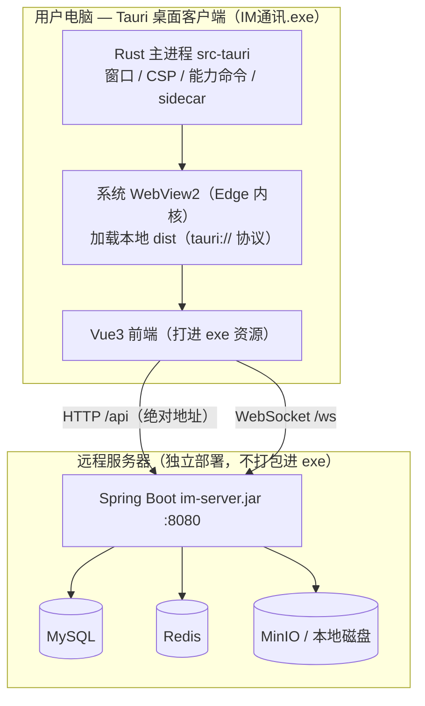

# IM 桌面端 — Tauri 打包指南（EXE / Windows）

> **适用**：想用一个**几 MB 的原生壳**（而非 Electron 自带 Chromium 的 ~90 MB）加载 `im-ui` 前端产物、
> 连远程 Spring Boot 后端，产出 Windows `.exe`（NSIS 安装包 + 免安装 exe）。
> **事实来源**：`im-ui/src/utils/env.js`、`im-ui/vite.config.js`、`im-ui/package.json`；
> 后端与中间件仍独立部署、**不进 exe**（与 Electron 方案同构，见 `./Electron打包指南.md` 第一节）。
> **Tauri 版本**：本指南按 **Tauri v2** 编写（`@tauri-apps/cli` 2.x、配置 schema `2`）。
> ⚠️ Tauri 是**换壳不换功能**的方案：本文第十节逐条列出了本项目现有功能里 **Tauri 会退化或缺失** 的点
> （屏幕共享直播、防截屏、远程被控端 Agent 等），**动手打包前务必先读那一节做取舍**。

---

## 目录

- [一、Tauri vs Electron：什么时候值得换](#一tauri-vs-electron什么时候值得换)
- [二、方案概览与数据流](#二方案概览与数据流)
- [三、前置环境（Rust + MSVC + WebView2 + 国内镜像）](#三前置环境rust--msvc--webview2--国内镜像)
- [四、初始化 Tauri（在 im-ui 内建 src-tauri）](#四初始化-tauri在-im-ui-内建-src-tauri)
- [五、前端「浏览器 / 桌面壳」两用适配（关键）](#五前端浏览器--桌面壳两用适配关键)
- [六、tauri.conf.json 完整配置（含 CSP）](#六tauriconfjson-完整配置含-csp)
- [七、Rust 侧能力补齐（下载 / 防截屏 / 被控端 sidecar）](#七rust-侧能力补齐下载--防截屏--被控端-sidecar)
- [八、打包命令](#八打包命令)
- [九、产物与验证](#九产物与验证)
- [十、能力差异与限制（务必先读）](#十能力差异与限制务必先读)
- [十一、踩坑与解决](#十一踩坑与解决)
- [十二、重新打包速查](#十二重新打包速查)

---

## 一、Tauri vs Electron：什么时候值得换

| 维度 | Electron（本仓库现状，已打包成功） | Tauri（本指南） |
|---|---|---|
| 产物体积 | 安装 ~90 MB / 免安装 ~195 MB | **安装 ~3~8 MB**（用系统 WebView2） |
| 渲染内核 | 自带 Chromium（版本可控、三端一致） | **系统 WebView2**（Win10/11 自带，随系统更新） |
| 工具链 | 纯 Node，**不编译原生代码** | **需要 Rust + MSVC C++ 生成工具链** |
| 主进程语言 | JavaScript（Node） | **Rust**（能力靠 crate，不能直接 `require`） |
| 后端地址注入 | `main.js` 的 `SERVER_BASE` → preload `contextBridge` | 编译期 Vite 环境变量 / Rust `initialization_script` |
| getUserMedia 安全上下文 | `file://` 非安全上下文，靠自签证书/额外处理 | 自定义协议 `tauri://` 注册为 secure，**天然安全上下文** ✅ |
| getDisplayMedia（屏幕共享） | Electron 自实现选择器，**可用** | **依赖 WebView2，Windows 上选择器缺失/受限** ⚠️ |
| 离线/弱网镜像 | `ELECTRON_BUILDER_BINARIES_MIRROR` + `NODE_TLS=0` | `rsproxy` cargo 镜像 + `CARGO_HTTP_CHECK_REVOKE=false` |

**结论**：只在乎「小体积的聊天/文件/语音观看端」→ Tauri 很香；只要用到**屏幕共享直播、防截屏闪照、随包被控端
Agent** 这类重度 Chromium / 原生能力 → **继续用 Electron**（见 `Electron打包指南.md`），别用 Tauri 自找麻烦。

---

## 二、方案概览与数据流



与 Electron 唯一的架构差异：**壳是 Rust，渲染靠系统 WebView2**。前端还是同一份 `im-ui`，
后端还是那套 Spring Boot，两者连法完全一样。

---

## 三、前置环境（Rust + MSVC + WebView2 + 国内镜像）

> ❌ Electron 教程里「不需要 GCC / Rust / VS」——那正是 Tauri **需要** 的东西。换 Tauri 就要认这套工具链。

| 需要 | 说明 |
|---|---|
| **Node.js / npm** | 构建前端（已装，v24） |
| **Rust（rustup + MSVC 工具链）** | Tauri 后端。Windows 用 `x86_64-pc-windows-msvc` |
| **Visual Studio Build Tools（C++ 工作负载）** | 提供 MSVC 链接器 `link.exe` 与 Windows SDK |
| **Microsoft Edge WebView2 Runtime** | Win11 / 更新后的 Win10 **已自带**；缺失时装 Evergreen _bootstrapper_ |
| **im-ui 依赖 `@tauri-apps/cli`** | `npm i -D @tauri-apps/cli@^2` |

**安装步骤（PowerShell，`;` 分隔，本机 PowerShell 不支持 `&&`）**：

```powershell
# ① 装 MSVC 生成工具（含 Windows SDK）。也可从 https://visualstudio.microsoft.com/visual-cpp-build-tools/ 手动勾「使用 C++ 的桌面开发」
winget install Microsoft.VisualStudio.2022.BuildTools --override "--quiet --wait --add Microsoft.VisualStudio.Workload.VCTools --includeRecommended"

# ② 装 rustup（默认 host 即 x86_64-pc-windows-msvc，工具链选 stable-msvc）
winget install Rustlang.Rustup

# ③ 关掉当前终端重开，确认工具链就位
rustc --version; cargo --version
```

**国内镜像（本仓库环境有 HTTPS 中间人拦截，crates.io 直连会失败——必配）**：

```powershell
# rustup 分发站走 rsproxy（镜像 rust 工具链本体）
$env:RUSTUP_DIST_SERVER="https://rsproxy.cn"
$env:RUSTUP_UPDATE_ROOT="https://rsproxy.cn/rustup"
rustup component list          # 验证网络通

# cargo 依赖走 rsproxy：写入 %USERPROFILE%\.cargo\config.toml
```

`%USERPROFILE%\.cargo\config.toml`：

```toml
[source.crates-io]
replace-with = 'rsproxy'

[source.rsproxy]
registry = "sparse+https://rsproxy.cn/crates.io-index/"

[registries.rsproxy]
index = "https://rsproxy.cn/crates.io-index"

# 证书被杀软/代理拦截时放行（等价于 Electron 的 NODE_TLS_REJECT_UNAUTHORIZED=0，谨慎用）
[http]
check-revoke = false
```

> ⚠️ 换电脑/重装后 `.cargo\config.toml` 与 `RUSTUP_*` 环境变量都要重设——它们是本机会话/用户级的，不跨机器。

---

## 四、初始化 Tauri（在 im-ui 内建 src-tauri）

Tauri 直接复用 Vite 前端，**在 `im-ui/` 里初始化最省事**（`src-tauri/` 与前端同目录，`frontendDist` 直接指 `../dist`）：

```powershell
cd d:\daima\Lianshi\spring-boot-duomokuia\im-ui

# 装 CLI（本地，devDependency，不动后端/其它模块）
npm i -D @tauri-apps/cli@^2

# 交互式初始化；按下面提示回答，别让它替你乱填
npx tauri init
```

`npx tauri init` 问询应答（对应本项目）：

| 问询 | 填什么 | 为什么 |
|---|---|---|
| `app_name` | `im-desktop` | 产物名 |
| `window_title` | `IM 即时通讯` | 窗口标题 |
| `webview_address`（devUrl） | `http://localhost:5173` | 指向 vite dev server |
| `dev_path`（frontendDist） | `../dist` | 指向 `vite build` 产物 |
| `before_dev_command` | `npm run dev` | 起 Tauri dev 前自动起 vite |
| `before_build_command` | `npm run build:tauri` | 见第五节，桌面模式构建 |
| `bundle_identifier` | `com.im.desktop` | 反向域名唯一 ID |

生成结构：

```
im-ui/
├── src-tauri/
│   ├── Cargo.toml              # Rust 依赖（tauri、插件）
│   ├── tauri.conf.json         # ★ 主配置
│   ├── build.rs
│   ├── icons/                  # 应用图标（.ico/.png）
│   ├── capabilities/           # v2 权限清单（default.json）
│   └── src/
│       ├── main.rs             # 入口（一般转调 lib.rs）
│       └── lib.rs              # 命令 / 初始化逻辑
├── package.json                # 加 @tauri-apps/cli + build:tauri 脚本
└── vite.config.js              # 加 mode 'tauri' 分支（见第五节）
```

---

## 五、前端「浏览器 / 桌面壳」两用适配（关键）

本仓库已有 `utils/env.js` 的**同源/Electron 双分支**逻辑：`isElectron()` 判 UA、`serverBase()` 读
`window.__IM_SERVER__.baseUrl`（preload 注入）。**Tauri 里没有 preload，UA 也不含 `Electron`**，
所以要让 `env.js` 认得 Tauri，并给它一条**编译期**后端地址来源（对齐 Electron 文档说的「编译期 SERVER_BASE」思路）。

### 5.1 用 Vite 环境变量提供后端地址（编译期注入，最省事）

新建 `im-ui/.env.tauri`（分发前改成真实后端地址）：

```ini
# 桌面壳里 axios / WebSocket / 直播媒体要连的远程后端根地址（不含 /api）
VITE_IM_SERVER_URL=http://192.168.1.10:8080
```

### 5.2 扩展 `utils/env.js`（加 Tauri 识别 + 地址回落，Web/Electron 行为零改动）

把「是否桌面壳」抽象成 `isNativeShell()`，`serverBase()` 增加 Tauri 回落：

```js
/** 是否运行在 Electron 壳里（UA 固定含 "Electron"） */
export function isElectron() {
  return typeof navigator !== 'undefined' && /electron/i.test(navigator.userAgent)
}

/** 是否运行在 Tauri 壳里（v2 无论 withGlobalTauri 与否都会注入 __TAURI_INTERNALS__） */
export function isTauri() {
  return typeof window !== 'undefined' && '__TAURI_INTERNALS__' in window
}

/** 是否任意桌面壳（Electron 或 Tauri）——凡是「非浏览器同源」的宿主都用它 */
export function isNativeShell() {
  return isElectron() || isTauri()
}

function serverBase() {
  // ① Electron：preload 注入
  if (typeof window !== 'undefined' && window.__IM_SERVER__ && window.__IM_SERVER__.baseUrl) {
    return window.__IM_SERVER__.baseUrl
  }
  // ② Tauri：编译期 Vite 环境变量（见 .env.tauri）
  if (isTauri()) {
    return (import.meta.env && import.meta.env.VITE_IM_SERVER_URL) || ''
  }
  return '' // ③ 浏览器 Web：空串 → 回落同源
}
```

然后把文件里其余 `isElectron()` 判断**统一改成 `isNativeShell()`**：
`apiBaseURL()` / `mediaBaseURL()` / `wsBaseURL()` / `webhookBase()` / `livePlayBase()`。
这些函数体不变，只是判定条件放宽到「Electron 或 Tauri」。这样：

- Web 部署：`__IM_SERVER__` 无、非 Tauri → `serverBase()` 空 → 全部走同源，**零影响**；
- Electron：仍走 preload 注入，**零影响**；
- Tauri：走 `VITE_IM_SERVER_URL` → 绝对地址连远程后端。

> `livePlayBase()` 特别说明：Electron 分支里它返回 `http://127.0.0.1:8088`（本机流媒体）。
> Tauri 同理——非连麦直播仍需要能连到媒体服务器。改法：
> ```js
> export function livePlayBase() {
>   if (isTauri()) return import.meta.env.VITE_IM_MEDIA_BASE || 'http://127.0.0.1:8088'
>   return isElectron() ? 'http://127.0.0.1:8088' : ''
> }
> ```
> 并在 `.env.tauri` 配 `VITE_IM_MEDIA_BASE=http://<流媒体服务器>:8088`。**连麦合成流依赖 getDisplayMedia，见第十节限制**。

### 5.3 路由：桌面壳用 hash 模式

Tauri 从自定义协议 `tauri://localhost`（Windows 是 `http://tauri.localhost`）加载静态资源，
**深层路由整页刷新会 404**（协议按资源找文件，没有 history 回退），与 Electron 的 `file://` 同因。
`router/index.js` 里把「Electron 才用 hash」的判断改为 `isNativeShell()`：

```js
import { isNativeShell } from '@/utils/env'
// ...
createRouter({
  history: isNativeShell() ? createWebHashHistory() : createWebHistory(),
  // ...
})
```

### 5.4 vite.config.js：加 `tauri` 模式（base 相对 + 产物落 dist）

现仓库 `base` 只区分 `electron`。Tauri 同样需要相对 base（自定义协议下 `/assets` 会解析到协议根之外）。
产物**留在 `dist`**（`src-tauri` 的 `frontendDist: ../dist` 直接吃它），无需像 Electron 那样另拷目录：

```js
// vite.config.js
base: (mode === 'electron' || mode === 'tauri') ? './' : '/',
// ...
build: {
  outDir: mode === 'electron' ? '../electron/dist' : 'dist',
  emptyOutDir: true,
  // ...
}
```

`package.json` 脚本加一条：

```jsonc
"scripts": {
  "build:tauri": "vite build --mode tauri",
  "tauri": "tauri"
}
```

> **运行时开发**用 `npm run tauri dev`：Tauri 起系统 WebView 指向 `devUrl=http://localhost:5173`，
> 而 vite dev server 的 proxy（`/api`→8080、`/ws`→8080、`/hls`→8088）照常生效，
> **dev 阶段同源即可连本机后端，不必先设 `VITE_IM_SERVER_URL`**（该变量只在打包产物里用）。

---

## 六、tauri.conf.json 完整配置（含 CSP）

`im-ui/src-tauri/tauri.conf.json`（v2 schema）：

```jsonc
{
  "$schema": "https://schema.tauri.app/config/2",
  "productName": "IM通讯",
  "version": "1.0.0",
  "identifier": "com.im.desktop",
  "build": {
    "beforeDevCommand": "npm run dev",
    "devUrl": "http://localhost:5173",
    "beforeBuildCommand": "npm run build:tauri",
    "frontendDist": "../dist"
  },
  "app": {
    "withGlobalTauri": false,
    "windows": [
      {
        "title": "IM 即时通讯",
        "width": 1200,
        "height": 800,
        "minWidth": 800,
        "minHeight": 600,
        "resizable": true,
        "center": true
      }
    ],
    "security": {
      "csp": "default-src 'self'; img-src 'self' blob: data: http: https:; style-src 'self' 'unsafe-inline'; script-src 'self' 'wasm-unsafe-eval'; connect-src 'self' ipc: http://ipc.localhost http://localhost:8080 ws://localhost:8080 http://127.0.0.1:8088 blob: http: https: wss:; media-src 'self' blob: http: https:; worker-src 'self' blob:; frame-src 'self' blob: data:;"
    }
  },
  "bundle": {
    "active": true,
    "targets": ["nsis"],
    "category": "SocialNetworking",
    "icon": ["icons/32x32.png", "icons/128x128.png", "icons/icon.ico"]
  },
  "bundle.windows": {
    "nsis": {
      "installMode": "currentUser",
      "languages": ["SimpChinese"]
    }
  }
}
```

**CSP 逐条为什么这么写**（本项目的真实依赖决定的）：

| 指令 | 放行 | 对应功能 |
|---|---|---|
| `connect-src` 加后端 `http/https` + `ws/wss` | axios + WebSocket 连远程后端 | 全局（打包后是绝对地址） |
| `connect-src` 加 `http://127.0.0.1:8088`、`blob:` | 直播 `fetch PUT`/`hls.js`/MSE 拉分片 | 直播播放 |
| `img-src`/`media-src` 加 `blob: data:` | 图片预览、语音 blob、礼物 emoji 图标 | 聊天/礼物 |
| `script-src 'wasm-unsafe-eval'` | **onnxruntime-web / tensorflow.js**（nsfwjs）、tesseract.js wasm | 图像识别/OCR |
| `worker-src blob:` | tesseract/onnx 的 Web Worker | 本地识别离线 |

> **偷懒兜底**：跑不通时开发期可先 `"csp": null` 关掉校验，验证是 CSP 卡的再逐条收紧；
> 但**发布包别长期 `null`**——Tauri 的 CSP 是它安全模型的一环，前端又注入了 `satoken`。
> 若前端有内联 `<script>`/样式被 CSP 拦，`beforeBuildCommand` 产物里 Vite 已把脚本外链化，一般只需保留上面这段。

---

## 七、Rust 侧能力补齐（下载 / 防截屏 / 被控端 sidecar）

Electron 靠主进程 JS 做的三件关键事，在 Tauri 里要换 **Rust + 插件**。按需实现，缺哪项对应哪个功能就失效。

### 7.1 文件下载（对应 Electron 的 `will-download`）

Tauri v2 核心不自动接管 `<a download>` / blob 下载。**推荐用官方 `dialog` + `fs` 插件**在 Rust 侧实现一个
`save_download(url, filename)` 命令，前端 `saveAs()` 调它：先 `plugin:dialog|save` 拿路径，再
`plugin:http|fetch` 下载或 `plugin:fs|write` 落盘（大文件走 `download` API 流式写，不占内存）。
或者用社区 `tauri-plugin-download`（内置下载条，最接近浏览器体验）。

`Cargo.toml`（Tauri v2 插件均走 crates.io `tauri-plugin-xxx`）：

```toml
[dependencies]
tauri = { version = "2", features = [] }
tauri-plugin-dialog = "2"
tauri-plugin-fs = "2"
tauri-plugin-http = "2"     # 允许前端 fetch 受 CSP/权限约束地下载
```

并在 `lib.rs` 注册、`capabilities/default.json` 授予对应权限（`dialog:default`、`fs:allow-write`、`http:default` 及远端 URL）。

### 7.2 防截屏（对应 Electron 的 `setContentProtection`，闪照功能）

Tauri 无现成开关。Windows 用 `SetWindowDisplayAffinity(WDA_EXCLUDEFROMCAPTURE)`，靠 `windows` crate 自写命令：

```rust
// Cargo.toml 加： [target.'cfg(windows)'.dependencies] windows = { version = "0.58", features = ["Win32_Foundation","Win32_Graphics_Gdi"] }
#[cfg(windows)]
#[tauri::command]
fn set_capture_protect(window: tauri::WebviewWindow, protect: bool) {
    use windows::Win32::Graphics::Gdi::{SetWindowDisplayAffinity, WINDOW_DISPLAY_AFFINITY, WDA_EXCLUDEFROMCAPTURE, WDA_NONE};
    let hwnd = window.hwnd().unwrap();
    let aff = if protect { WDA_EXCLUDEFROMCAPTURE } else { WDA_NONE };
    unsafe { let _ = SetWindowDisplayAffinity(hwnd, WINDOW_DISPLAY_AFFINITY(aff.0)); }
}
```

前端在原「桌面端才防截屏」的判断里，把「Electron 用 setContentProtection」并列加一条「Tauri 调此命令」。

### 7.3 被控端 Agent + 免装 JRE（对应 Electron 第十二节 extraResources）

Electron 用 `extraResources` 附带 `im-remote-agent.jar` + jlink JRE + `启动被控端.bat`，并开机后台拉起。
Tauri 的等价物是 **sidecar**：`bundle.externalBin` 声明随包的可执行文件，Rust 用
`tauri-plugin-shell` 的 `Command.sidecar()` 启动它。

> ⚠️ sidecar 要求**单个可执行文件**（`.exe`），不能直接跑 `java -jar`。要先用 `jpackage --type app-image`
> 把 Agent jar + 精简 JRE 封成一个 `im-remote-agent.exe`（`打包为EXE和Android指南.md` 第四部分有 jpackage 命令），
> 再作为 externalBin 附带。这比 Electron 直接塞 jar+bat 麻烦，属 Tauri 的额外成本。

---

## 八、打包命令

**先确保后端已在目标地址启动、`.env.tauri` 已改成该地址**。

```powershell
# 0. 首次：装 CLI 并初始化（见第四、五节），并配好 .cargo\config.toml 镜像
cd d:\daima\Lianshi\spring-boot-duomokuia\im-ui

# 1. 开发自测（起 vite + 系统 WebView，同源连本机后端）
$env:RUSTUP_DIST_SERVER="https://rsproxy.cn"
npm run tauri dev

# 2. 发布打包（beforeBuildCommand 会自动跑 npm run build:tauri）
#    证书被拦截时放行 cargo（等价 Electron 的 NODE_TLS=0）
$env:CARGO_HTTP_CHECK_REVOKE="false"
npm run tauri build
```

`npm run tauri build` 内部：跑 `build:tauri`（vite 桌面产物 → `dist`）→ cargo 编译 release（首次拉 tauri/wry/
webview2-com 等 crate，走 rsproxy）→ 用 `tauri-bundler` 生成 NSIS 包。

---

## 九、产物与验证

**产物位置**：`im-ui/src-tauri/target/release/bundle/`

| 路径 | 说明 |
|---|---|
| `nsis/IM通讯_1.0.0_x64-setup.exe` | NSIS 安装包（分发用户，**几 MB**） |
| `../IM通讯.exe`（`target/release/`） | 免安装可执行，**可直接双击测试** |
| `msi/…`（若加了 wix target） | MSI（企业分发，需装 WiX Toolset v3） |

**验证步骤**：

1. 确认 `.env.tauri` 的 `VITE_IM_SERVER_URL` 指向**已启动**的后端；
2. 双击 `target\release\IM通讯.exe`；
3. 依次测：登录 → 收发消息 → 图片显示 → 上传 → **下载大文件**（验证 7.1 是否接好）→ 语音播放（CSP `media-src blob:`）；
4. 图像识别/OCR 消息（验证 7.x 的 wasm CSP + Worker 通过）；
5. F12：生产包默认无 DevTools，调试期用 `npm run tauri dev`（vite 侧带 source map）。

---

## 十、能力差异与限制（务必先读）

本节是**决定要不要用 Tauri 的关键**。Tauri 用系统 WebView2 而非自带 Chromium，本项目的下列能力会受影响：

| 项目功能 | Electron 现状 | Tauri（Windows WebView2） | 影响/对策 |
|---|---|---|---|
| **屏幕共享开播 / 连麦合成**（getDisplayMedia + liveComposer） | 可用（Electron 自实现选择器） | **WebView2 的 getDisplayMedia 缺系统选择器，基本不可用** | 直播开播仍走 **Electron**；Tauri 包只做观看端（HLS/hls.js 播放没问题） |
| **麦克风/摄像头 1:1 通话**（getUserMedia） | 可用（需 https/安全上下文） | ✅ **可用**（`tauri://` 协议是安全上下文，getUserMedia 正常） | 通话可用，优于 Electron 的 file:// 预检坑 |
| **闪照防截屏**（setContentProtection） | 桌面端可用 | ⚠️ 需自写 Rust `SetWindowDisplayAffinity`（7.2） | 不实现则防截屏失效 |
| **被控端 Agent 随包免装 JRE** | extraResources 直接塞 jar+jre+bat | ⚠️ 需先 jpackage 成单个 exe 再走 sidecar（7.3） | 打包链更复杂 |
| **文件下载** | `will-download` 流式写盘 | ⚠️ 需 dialog+fs/http 插件或社区 download 插件（7.1） | 不实现则「点下载没反应」 |
| **本地 wasm 识别**（nsfwjs/tesseract/onnx） | 可用 | ✅ 可用（CSP 放行 `wasm-unsafe-eval` + `worker-src blob:`） | 见第六节 CSP |
| **视频压缩 ffmpeg.wasm** | SharedArrayBuffer 需 COOP/COEP | ⚠️ 需在窗口/协议层设交叉隔离头，Tauri 支持有限 | 该功能本就 TODO，暂缓 |
| **产物体积 / 依赖** | ~90 MB，纯 Node | **~3~8 MB，但要 Rust+MSVC** | 换体积就要扛工具链 |
| **跨平台** | Win/mac/Linux | Win/mac/Linux/（v2 移动 iOS/Android） | WebView 内核随系统，表现需逐平台验 |

**一句话建议**：**主聊天 + 文件 + 语音观看 + 通话** → Tauri 体积优势明显；**凡涉及屏幕共享直播 / 防截屏 / 被控端 Agent**
的桌面形态 → 这些是 Electron 的既有资产，别迁到 Tauri，继续用 `Electron打包指南.md`。两者可并存分发（Tauri 给轻客户端、
Electron 给全功能客户端）。

---

## 十一、踩坑与解决

| 现象 | 根因 | 解决 |
|---|---|---|
| `link.exe not found` / `failed to find tool link.exe` | 没装 MSVC C++ 工作负载，或 rustup 装的是 `-gnu` 工具链 | 装 VS Build Tools（含 Windows SDK）；`rustup default stable-msvc` |
| `cargo` 下载 crate 报 SSL/证书错 | 本机有 HTTPS 中间人拦截（与 Electron 同源问题） | 配 `.cargo\config.toml` 的 rsproxy 镜像 + `check-revoke=false`；设 `CARGO_HTTP_CHECK_REVOKE=false` |
| 白屏 / 资源 404 | 桌面产物用了绝对 base `/assets` | `vite build --mode tauri` 让 `base='./'`；产物引用应为 `./assets/…` |
| 深层路由刷新 404 | 自定义协议无 history 回退 | `isNativeShell()` 下用 `createWebHashHistory`（5.3） |
| 连不上后端 / WS 握手失败 | `VITE_IM_SERVER_URL` 没配或指错 | 打包前核对 `.env.tauri`；CSP `connect-src` 放行该 host 与 `ws:` |
| 图片/语音显示不出来（blob） | CSP 拦了 `blob:`/`data:` | `img-src`/`media-src` 加 `blob: data:`（第六节） |
| wasm 模型加载报 `Refused to evaluate…wasm` | CSP 缺 `wasm-unsafe-eval` | `script-src` 加 `'wasm-unsafe-eval'` |
| getDisplayMedia 直接 reject/无选择框 | WebView2 不支持屏幕选择器 | 屏幕共享/开播改用 Electron（第十节） |
| 点下载无反应 | 核心不接管下载 | 接 7.1 的 dialog+fs/http 或 download 插件 |
| 首次 `tauri build` 极慢 | cargo 冷编译 tauri 全依赖树 | 之后增量快；镜像配好避免反复重试 |
| 打包报 `WebView2 runtime not found` | 老 Win10/精简系统缺运行时 | 装 Evergreen WebView2 bootstrapper，或 `bundle.webviewInstallMode` 指定 |

---

## 十二、重新打包速查

**只改了前端代码**：

```powershell
cd d:\daima\Lianshi\spring-boot-duomokuia\im-ui
$env:CARGO_HTTP_CHECK_REVOKE="false"
npm run tauri build          # beforeBuildCommand 自动重跑 vite 构建
```

**改了后端地址（`VITE_IM_SERVER_URL`）**：改 `.env.tauri` 后同上重打包。

**只改了 Rust 命令（下载/防截屏）**：`cd im-ui; npm run tauri build`（cargo 增量编译）。

**换了电脑**：重装 VS Build Tools + rustup + WebView2，重配 `.cargo\config.toml` 与 `RUSTUP_*` 环境变量，
再 `npm install` 前端依赖，然后走第八节。

---

> 本文与 `./Electron打包指南.md`、`./打包为EXE和Android指南.md` 并存：
> Electron 是本仓库**已验证成功**的全功能桌面方案，Tauri 是其**轻量替代**（适合不含屏幕共享/防截屏/被控端 Agent 的客户端形态）。
