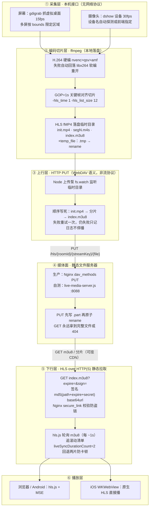
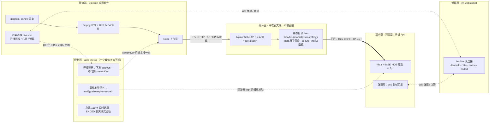
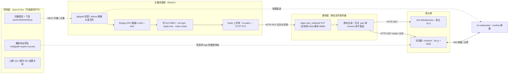
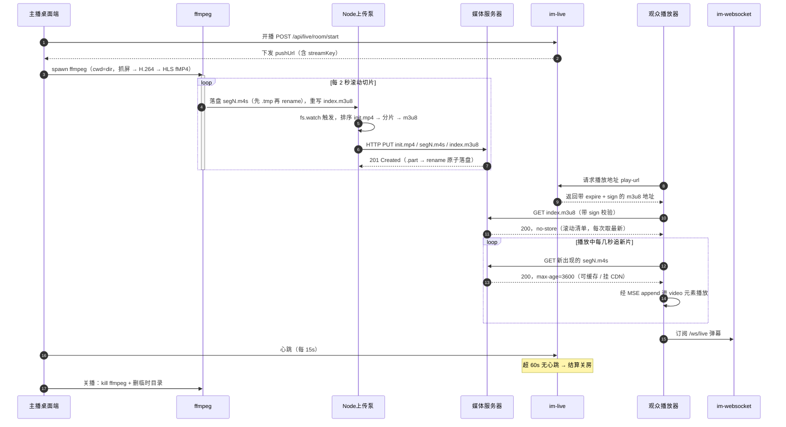

# 实现方案 腾讯云

| 方案                                                   | 产品                 | 适合场景                                                     | 延迟                                  | Web 端能力                                                   | 开发量 | 计费核心                                                     |
| ------------------------------------------------------ | -------------------- | ------------------------------------------------------------ | ------------------------------------- | ------------------------------------------------------------ | ------ | ------------------------------------------------------------ |
| 方案 1：标准云直播 CSS（推荐纯观看，无连麦）           | 云直播 CSS           | 网站直播、培训、发布会、OBS 推流，观众只看，不上麦           | 标准 HLS：10~30s快直播 WebRTC：<200ms | WebRTC 网页开播（TXLivePusher），TCPlayer 播放器播放         | 低     | **按直播 CDN 流量计费**，转码可选付费；主播上行不走你的服务器 |
| 方案 2：TRTC 互动直播（有连麦 / 问答）                 | TRTC 实时音视频 + IM | 直播间观众连麦、讲师答疑、多人上麦互动                       | <300ms                                | TUILiveKit / TUIPusher+TUIPlayer 含 UI 组件，Vue/React 直接嵌入 | 中     | **按时长计费**（房间内音视频时长），旁路直播可输出 CDN 给大量观众看 |
| 方案 3：低代码直播间（快速上线，几乎不用写音视频底层） | TRTC TUILiveKit      | 快速搭建完整直播间：弹幕、点赞、连麦、房间管理，直接嵌入网站 | 同上                                  | 开箱 UI 组件，一行代码嵌入 Web 页面                          | 极低   | TRTC 时长计费                                                |

## 腾讯云三方案选型前必须核实的九件事

1. **资质是前置条件，与用不用云无关**：国内上线直播需 ICP 备案 + 属地广电/文化部门许可
   （经营性直播涉及《网络文化经营许可证》）；云厂商只提供管道，资质与内容责任在运营主体。
   没资质先谈技术是空谈。
2. **内容审核是强制项且单独计费**：CSS 有直播审核（鉴黄/暴恐/政治），TRTC 需接内容安全 API；
   不开审核 = 平台连带责任。自建方案同样逃不掉（抽帧送审 + 人工巡审）。
3. **播放/推流地址必须开鉴权**：URL 时间戳防盗链 + 推流鉴权（A/B/C 方式）。
   裸地址上线被刷流量是按 CDN 单价无上限计费的，这是真实破产案例而非理论风险。
4. **表里「WebRTC 网页开播」要加兼容性注脚**：浏览器推流依赖 getDisplayMedia/getUserMedia + WebRTC，
   iOS Safari 与部分国产内置浏览器支持参差，摄像头推流在 iOS Web 端长期受限（通常要跳小程序或 App）。
   **纯观看端兼容性好，开播端不是**——选方案前先把目标用户的浏览器矩阵列出来。
5. **计费是叠加的，不是二选一**：CSS 流量费之外，转码、录制、截图、审核逐项单计；
   TRTC 时长费之外，「旁路直播」转 CDN 再叠一层 CSS 流量费。
   混合架构（上麦走 TRTC、纯观众走 CDN）是大直播间标准做法，但账单是两份。
6. **延迟档位按钱排序**：能忍 3~5s 选 HTTP-FLV 性价比最高；要弹幕同步体验选快直播 WebRTC（<200ms）但单价更贵；
   HLS 只留给 iOS Safari 兜底；互动连麦才需要 TRTC 的 <300ms。先定延迟预算再选产品，反过来选会多花钱。
7. **弹幕不在 CSS 里**：方案 1 不自带弹幕/点赞/礼物，需另配 TIM 或自建 WS。
   **本项目已有完整 IM 与群聊体系，弹幕自建零边际成本**——这是选方案 1 时表里没写的隐藏优势。
8. **量级决定计费模式**：月流量小按量付费；稳定大流量切「月 95 带宽计费」能省一个数量级。
   开发期先用免费额度（TRTC 每月赠时长、CSS 赠流量）验证链路，别一上来就包月。
9. **录制回放另算存储**：CSS 录制落 VOD 按存储 + 流量再计一次；自建则本项目 MinIO/本地存储现成。

# 自己实现

## 0. 先看清手里已有的牌

本项目已经有一套「把一台电脑的屏幕实时搬到别人屏幕上」的完整链路
（见《其他控制软件和远程会议实现原理.md》第三段），直播与它的技术重合度极高：

| 直播需要 | 本项目已有 | 复用方式 |
|---|---|---|
| 屏幕/摄像头采集 | `im-remote-agent` 的 `ScreenCapturer` / `H264Capturer` | Agent 直接当「屏幕直播推流端」 |
| H.264 硬编 | ffmpeg gdigrab + nvenc/qsv/amf，不满足回落 JPEG | 推流编码现成 |
| H.264 解码 | 控制端 WebCodecs `AvcDecoder` | 观众端解码现成 |
| 实时双向通道 | `im-websocket` WS + dispatch 推送 | 信令、弹幕、帧分发共用 |
| 房间与成员 | `im-group` / `im-conversation` | 直播间 = 群，观众 = 成员，弹幕 = 群消息 |
| 鉴权 | sa-token | 开播/关播/房管接口 |
| 回放存储 | `im-file` 的 FileStorage（local/minio） | 录制文件落地 |
| 空闲回收 | `RemoteIdleCheckTask` 模式 | 空房间回收 |

结论：**MVP 不需要引入任何新中间件**，缺的只有「一对多分发」和「GOP 缓存」两块。

## 1. 方案 A（推荐 MVP）：浏览器开播 + 服务端 fan-out（SFU-lite）

数据面只转发不解码，服务端不做媒体计算：Web 前端用 **WebRTC** 采集摄像头，发给媒体服务器（推荐，现代浏览器原生）

```
主播浏览器                          服务端(im-live)                观众浏览器
getDisplayMedia/getUserMedia 采集
   ↓
WebCodecs VideoEncoder 编 H.264
（强制每秒 1 个关键帧）
   ↓
帧打包(key/delta + pts) ──WS──→  房间转发器 ──WS──→  WebCodecs VideoDecoder → 画 canvas
                                 （只 copy 字节，        AudioDecoder → AudioContext
                                  不解码不转码）          音频为主时钟做音画同步
```

- **推流端**：`getDisplayMedia`（屏幕）或 `getUserMedia`（摄像头）→ `VideoEncoder`
  （H.264，强制每秒 1 个关键帧便于随时进房）→ 帧带 pts 与 key 标记经 WS 上行。
  Electron 桌面端可改走 agent 的 ffmpeg 硬编推「屏幕直播」，绕开浏览器编码能力差异。
- **服务端**：房间表（内存 ConcurrentHashMap + Redis 记在线数，同 `AgentRegistry` 模式）；
  转发器收到帧遍历房间观众 WS 发送——**只 copy 字节不解码**；
  GOP 缓存保留最近一个 IDR（+ SPS/PPS），新观众握手完成立即补发，否则要黑屏等到下一个关键帧。
- **观众端**：WS 收帧 → `VideoDecoder` → `VideoFrame` 直接画 canvas（复用 Remote.vue 的贴屏思路）；
  音频帧同理解码送 AudioContext，按 pts 对齐。
- **音频（与视频同链路，采集/编码/播放各有讲究）**：
  采集——`getUserMedia({ audio: true })` 取麦克风；系统/标签页声音靠 `getDisplayMedia` 授权弹窗里勾「分享音频」
  （Chrome/Edge 支持，平台差异大），两路可合并成一个 `MediaStream` 一起送编码；
  编码——WebCodecs `AudioEncoder` 编 **Opus**（实时首选：低延迟、抗丢包，语音音乐通吃；AAC 更通用但延迟偏高），
  每帧带 `timestamp`（pts），与视频帧走同一房间转发器、按 track 标记区分音视频；
  服务端——同样只 copy 字节不解码；音频帧小且能独立解码，不必像视频那样缓存 GOP，新观众从最新音频帧直接续上；
  播放与音画同步——观众端 `AudioDecoder` 解码后送 `AudioContext` 排队播放，**以音频为主时钟**
  （人耳对音频卡顿远比视频丢帧敏感），视频按 pts 对齐、追不上就丢帧，抖动缓冲（jitter buffer）吸收网络波动；
  坑——观众端 `AudioContext` 受浏览器自动播放策略限制，须在进房点击等交互后 `resume()`；主播本地监听要开
  `echoCancellation` 防啸叫；纯屏幕分享无麦克风时音频轨可能缺失，需容错。
- **弹幕**：直播间建一个群会话，弹幕就是群消息；未读/离线那一套全不用开（直播弹幕不需要离线补发）。
- **延迟**：单跳 WS，局域网 ~100ms、公网 ~200~500ms。
- **规模上限（诚实账）**：fan-out 出带宽 = 码率 × 在线观众。2 Mbps × 50 人 = 100 Mbps 持续，单机扛得住；
  × 1000 人 = 2 Gbps，自建不现实。**方案 A 的边界是每房间几十到一两百人**。

## 2. 方案 B（上千观众）：RTMP 推流 + SRS/ffmpeg 转 HLS / HTTP-FLV

```
主播(OBS) →【RTMP推流】→ SRS中转站 → 输出HLS / HTTP-FLV → 观众网页播放
```

- 推流端用 OBS 或 agent 的 ffmpeg 推 RTMP 到媒体服务器；
  **媒体服务器不要自己用 Java 写**，部署 SRS（或 nginx-rtmp），Java 只做事：
  房间管理、鉴权签名、接收 SRS 的 on_publish/on_play 回调更新房间状态。
- SRS 转 HTTP-FLV（2~5s 延迟，Web 端 flv.js 播放）+ HLS（10~30s，iOS Safari 兜底）。
- 观众侧从 WS 收帧变成 HTTP 拉流，服务端带宽压力转嫁给 CDN/静态分发；弹幕仍走自建 WS。
- 运维对象从「一个 Spring Boot」变成「Spring Boot + SRS + 存储」，是自建路线真正的成本拐点。

## 3. 共通关键工程点

1. **关键帧对齐**：编码器强制周期 IDR；服务端 GOP 缓存；观众花屏/进房时发 `request-keyframe`
   信令让主播端立即出 I 帧。
2. **音画同步**：所有帧带统一 pts（毫秒，开播时 0 起算）；观众端按 pts 渲染或交 `<video>`/AudioContext 对齐，
   不按到达顺序播放。
3. **弱网降级**：观众下行拥塞时丢 P 保 I（丢到只剩关键帧也能看幻灯片）；
   主播上行由 `VideoEncoder` 的 bitrateMode + 实测 RTT 动态调码率。
4. **主播断线续接**：房间保留 30~60s 宽限，重连后 pts 续接而非重开，观众无感；超时才结算关播（复用空闲回收任务）。
5. **合规与审核**：服务端对关键帧抽样落盘 + 接第三方审核 API（或腾讯云内容安全），巡审台看实时抽帧；
   录制文件保留期按监管要求配置。
6. **录制回放**：方案 A 在服务端把转发帧顺路 mux 成 fMP4/FLV 落盘（spawn ffmpeg，本项目有先例）；
   方案 B 直接用 SRS 录制。

## 4. 推荐路线

1. **MVP（1~2 周）**：方案 A + 群消息弹幕，房间 ≤ 百人；验证采集/编码/分发/渲染全链路。
2. **加固**：GOP 缓存、弱网降级、断线续接、录制回放、巡审抽帧。
3. **放量**：单房间观众破百或总出带宽逼近服务器上限时，切方案 B（SRS）或整体迁腾讯云 CSS——
   **自建媒体服务器到千人规模的运维与带宽成本会反超云**，这笔账与
   《其他控制软件和远程会议实现原理.md》1.8 节的中继成本是同一笔。

## 5. 自建 vs 腾讯云：一句话决策

- 要资质合规省心、千人以上观看、不想运维媒体服务器 → 腾讯云（方案 1 纯看 / 方案 2 连麦 / 方案 3 抢时间）。
- 要内网可用、零流量费、与现有 IM/远控能力复用、规模在百人内 → 自建方案 A。
- 两者不互斥：弹幕与房间管理永远自建（已有 IM），媒体分发按规模在「WS fan-out → SRS → 云 CSS」三档间升档。

---

# 定案：本地软件开播 + 浏览器/手机 App 观看 + 百人房间（抖音模式）

## 0. 结论先行

> 本项目**实际落地的既不是"方案A"（WS 帧分发 + WebCodecs），也不是"方案B"（SRS）**

**推流端用 Electron + 已捆绑的 ffmpeg 硬编 → 切 HLS(fMP4) 小片 → Nginx 静态分发 → 观看端一个 `<video>` + hls.js（iOS 原生直播），
房间/弹幕/礼物全部复用现有 IM。Java 不碰一个媒体字节。**

选 HLS 而不是前面方案 A 的 WS 帧分发，不是因为它先进，而是因为它是**唯一在三种观看端都能播的格式**（见 §1）。

## 1. 为什么不用 WS 帧分发（方案 A）做这个场景

| 硬约束 | WS + WebCodecs | HLS over HTTP |
|---|---|---|
| 手机 App = Android WebView / iOS WKWebView | WebCodecs 在 WebView 里可用性参差；**iOS WKWebView 长期不支持 MSE**（17.1+ 才有 ManagedMediaSource） | **iOS 原生支持 HLS**，`<video src="x.m3u8">` 直接播；Android/桌面用 hls.js |
| 百人 fan-out | 200 Mbps 持续从 JVM 出，背压/GC 风险高 | Nginx sendfile 发静态文件，百人千人一个样 |
| 能不能挂 CDN | 不能（长连接有状态，CDN 无法缓存） | 能，而且挂上后源站只服务回源那**一份**流 |
| 录制回放 | 要额外 mux | 切片天然可存，拼一下就是回放 |

一句话：**WS 帧分发适合内网、低延迟、少量观众（远控那种）；抖音模式要的是兼容性与可扩容，那是 HTTP 静态分发的地盘。**

## 2. 架构与数据流

抖音真实骨架是：主播 App → RTMP/SRT 推流 → 边缘接入 → 中心转码（多码率）→ CDN 分发 FLV/HLS/WebRTC → 播放器，弹幕走独立长连接。
自建百人房间把中间两层压缩成一台 Nginx：

```
【推流端】Electron 桌面软件                【服务端】                    【观看端】
屏幕 gdigrab ─┐                                    ┌→ 浏览器（hls.js）
摄像头 dshow ─┼→ ffmpeg 硬编 H.264+AAC          │
麦克风 dshow ─┘   │                              ├→ Android App WebView（hls.js）
                    └─ 切 HLS(fMP4) 小片 ─PUT─→ Nginx 静态目录 ─HTTP─┼→ iOS App WKWebView（原生 HLS）
                                                  │                    └→ 可挂 CDN（放量时）
              开播/关播/房间信息 ─REST─→ im-live（Java）
              弹幕/点赞/礼物  ←──WS──→ im-websocket（直播间 = 群）
```

**主播上行只需 2~6 Mbps（一份流），这是本地软件开播最大的优势；下行百人压力全在服务端分发层。**

## 3. 推流端：Electron + 已捆绑的 ffmpeg

### 3.1 已有资产（不用重写）

| 需要 | 现状 | 位置 |
|---|---|---|
| ffmpeg 可执行文件 | ✔ 已捆绑并随安装包分发 | `electron/bin/ffmpeg.exe` → `resources/ffmpeg/` |
| 硬编器探测与回落 | ✔ nvenc>qsv>amf>libx264 | `electron/main.js#detectEncoder` / `resolveFfmpegPath()` |
| 屏幕采集命令 | ✔ gdigrab 实跑过 | `im-remote-agent` 的 `H264Capturer` |
| spawn ffmpeg + 进度解析 + mux 落盘 | ✔ | `electron/recorder.js`（录屏）、`main.js#setupVideoCompress` |
| 老显卡 nvenc 版本坑 | ✔ 已踩过 | ffmpeg 构建版本必须匹配驱动（见已踩坑记录） |

缺的只有四样，**没有一样是媒体编解码**：开播面板 UI、切片上传/推流命令、`im-live` 房间接口、`Live.vue` 播放页。

### 3.2 采集与混流

- 屏幕直播：`-f gdigrab -framerate 25 -i desktop`（可选 `-offset_x/-offset_y/-video_size` 框选区域）
- 摄像头 + 屏幕画中画：`filter_complex "[0:v][1:v]overlay=W-w-20:20"`
- 纯摄像头（抖音典型形态）：`-f dshow -i video="USB Camera":audio="麦克风"`
- 多音源混音（麦克风 + 系统声音）：`-filter_complex amix=inputs=2:duration=first`

### 3.3 编码参数（直播专用，与录屏不同）

```
-c:v h264_nvenc -preset medium -rc vbr -cq 23 -b:v 0 -maxrate 2500k -bufsize 5000k
-pix_fmt yuv420p -g 50 -keyint_min 50 -sc_threshold 0 -bf 0 -profile:v high
-c:a aac -b:a 128k -ar 44100 -ac 2
```

几个参数为何不能省：
- `-g 50 -keyint_min 50 -sc_threshold 0`：**固定 GOP = 2 秒**。直播切片必须每片以 IDR 开头，否则切片边界花屏；`sc_threshold 0` 禁止场景切换提前插 I 帧，保证切片时长可预测。
- `-bf 0`：禁用 B 帧。B 帧引入重排序延迟，直播不要。
- `-maxrate/-bufsize`：约束峰值，避免画面剧烈变化时码率飙升把主播上行打爆。
- `-pix_fmt yuv420p` + `-profile:v high`：播放器兼容性底线（yuv444 很多解码器不认）。

码率档位（抖音同量级）：

| 档位 | 分辨率/帧率 | 视频码率 | 百人房间下行 |
|---|---|---|---|
| 流畅 | 720p / 25fps | 1.5 Mbps | 150 Mbps |
| 高清（推荐起步） | 720p / 30fps | 2.5 Mbps | 250 Mbps |
| 超清 | 1080p / 30fps | 4.5 Mbps | 450 Mbps |

### 3.4 切片与上传：ffmpeg 一条命令直接 PUT

```bash
ffmpeg -f gdigrab -framerate 25 -i desktop -f dshow -i audio="麦克风" \
  -c:v h264_nvenc -preset medium -rc vbr -cq 23 -b:v 0 -maxrate 2500k -bufsize 5000k \
  -pix_fmt yuv420p -g 50 -keyint_min 50 -sc_threshold 0 -bf 0 -profile:v high \
  -c:a aac -b:a 128k -ar 44100 \
  -f hls -hls_time 2 -hls_list_size 6 -hls_segment_type fmp4 \
  -hls_flags independent_segments+delete_segments+program_date_time \
  -hls_fmp4_init_filename init.mp4 -hls_segment_filename "seg_%05d.m4s" \
  -method PUT "http://push.example.com/push/live/ROOM/index.m3u8"
```

（Windows 下把 `\` 续行换成 `^` 或写成一行，由 Electron 主进程 `spawn` 时直接传参数数组。）

- `-method PUT`：ffmpeg 原生把每个切片 **HTTP PUT 到服务器**，Nginx 开 `dav_methods PUT` 就能收。
  **这一条省掉了整个媒体服务器**：不用 SRS、不用自己写上传器、不用管断点续传。
- `-hls_time 2 -hls_list_size 6`：2 秒一片、播放列表只留 6 片（滑窗 12 秒），`delete_segments` 自动删旧片，磁盘不涨。
- `-hls_segment_type fmp4`：用 fMP4 而非 TS，浏览器 MSE 与 iOS 都认，且后续升 LL-HLS 不用换封装。
- 录制回放：用 `-f tee` 同时开第二路输出全量 MP4（或保留全量切片），落到 `im-file` 的 FileStorage（local/minio）。
- 抽帧巡审：第三路 `-vf fps=1/30 -q:v 5` 每 30 秒一张 JPEG，送审核 API / 巡审台。

### 3.5 什么时候换成 SRS

需要下面任一项时，把 `-method PUT` 换成 `-f flv rtmp://server/live/ROOM`，服务端部署 SRS：
延迟要 < 3s（HTTP-FLV）、要多码率转码、要 WebRTC 连麦、要千以上观众。
SRS 是单二进制，Java 侧只需接它的 `on_publish/on_play/on_unpublish` HTTP 回调更新房间状态。

### 3.6 SRS 部署与集成（方案 B 落地）

> 承接 §3.5：当延迟要 <3s、要多码率、要连麦或要上千观众时，从当前的「HLS 切片 + `-method PUT`」（方案 A，见 §10/§11）切到 SRS（方案 B）。**SRS 本身是开源项目**（MIT 许可、GitHub `ossrs/srs`、约 28.5K Star、C++ 编写、当前稳定版 6.x），不用自己写媒体服务器，Java 仍旧一个媒体字节都不碰。

**（1）开源选型**：主流开源流媒体服务器对比——

| 方案 | 语言 | 协议 | GB28181 | 延迟 | 定位 |
|---|---|---|---|---|---|
| **SRS** | C++ | RTMP/HLS/HTTP-FLV/WebRTC/SRT | ✗ | FLV~500ms、RTC<300ms | 互联网直播标杆，中文文档极好、Docker 一键、集群成熟 → **本项目首选** |
| ZLMediaKit | C++ | +RTSP/GB28181 | ✓ | RTC 100~500ms | 多协议全能网关，内置 FFmpeg 转码，有 Java SDK，安防强 |
| MediaMTX | Go | RTSP/RTMP/HLS/LL-HLS/WebRTC/SRT | ✗ | 中 | 单文件零依赖，一行命令起服务，适合快速原型 |
| nginx-rtmp | C | RTMP/HLS | ✗ | 高 | 上古神器，FLV 弱，仅推荐学习 |
| Janus | C | WebRTC(SFU) | ✗ | <300ms | WebRTC 专用，连麦/会议 |

选 SRS 的理由：直播（RTMP 推 → HLS/FLV 分发）是它的主场，`http_hooks` 回调与本项目「Java 只管账」天然契合；要 GB28181 接安防或 C++/Java 深度嵌入再考虑 ZLMediaKit。

**（2）部署**（Docker 一键）：

```bash
docker run --rm -d --name srs \
  -p 1935:1935 -p 1985:1985 -p 8080:8080 -p 8000:8000/udp \
  -v /data/srs/conf:/usr/local/srs/conf \
  -v /data/srs/dvr:/usr/local/srs/objs/nginx/html/dvr \
  ossrs/srs:6 ./objs/srs -c conf/live.conf
```

| 端口 | 用途 |
|---|---|
| 1935 | RTMP 推流（ffmpeg / OBS 推这里） |
| 1985 | HTTP API（管理、查流状态） |
| 8080 | HTTP Server：HTTP-FLV / HLS 播放、WebRTC(WHEP)、控制台 |
| 8000/udp | WebRTC 媒体（连麦才需要） |

国内拉镜像慢换 `registry.cn-hangzhou.aliyuncs.com/ossrs/srs:6`。

**（3）配置** `conf/live.conf`（RTMP + HLS + 录制 + 回调）：

```nginx
listen              1935;
http_server { enabled on; listen 8080; dir [pwd]; crossdomain on; }
http_api    { enabled on; listen 1985; }

vhost __defaultVhost__ {
    hls {
        enabled on; hls_fragment 2; hls_window 12;
        hls_path ./objs/nginx/html; hls_cleanup on;   # 2s 一片、留 12s 滑窗、自动删旧片
    }
    dvr {                                              # 录制回放，替代方案A 的 spawn ffmpeg 录制
        enabled on; dvr_plan session;
        dvr_path ./objs/nginx/html/dvr/[app]/[stream]-[timestamp].flv;
    }
    http_hooks {                                       # ★ 与 Java 集成的关键
        enabled on;
        on_publish   http://127.0.0.1:8080/api/live/srs/on_publish;
        on_unpublish http://127.0.0.1:8080/api/live/srs/on_unpublish;
        on_play      http://127.0.0.1:8080/api/live/srs/on_play;
        on_stop      http://127.0.0.1:8080/api/live/srs/on_stop;
    }
}
```

**（4）推流端改造**（本项目改动极小）：`electron/live.js` 把 §3.4 的 `-f hls -method PUT` 输出段换成 `-f flv` 推 RTMP，采集/编码（gdigrab、nvenc、多屏 offset）全不动——

```bash
ffmpeg -re -f gdigrab -i desktop -c:v libx264 -c:a aac -f flv \
  "rtmp://srs-host:1935/live/{roomId}?sign={签名}&expire={ts}"
```

stream 名直接用 roomId，鉴权签名挂在 query，交给 `on_publish` 回调校验。OBS 主播填同一地址。

**（5）播放端**（按延迟选协议，前端在现有 hls.js 上加档）：

| 协议 | 地址 | 前端库 | 延迟 | 场景 |
|---|---|---|---|---|
| HTTP-FLV | `http://srs:8080/live/{roomId}.flv` | flv.js | 1~3s | Web 主力 |
| HLS | `http://srs:8080/live/{roomId}.m3u8` | hls.js（已用） | 6~15s | iOS Safari 兜底、大规模分发 |
| WebRTC | WHEP `http://srs:8080/rtc/v1/whep/?app=live&stream={roomId}` | 原生 | <300ms | 连麦/互动 |

**（6）Java（`im-live`）集成**：SRS 每个事件 POST 一段 JSON 到回调，**Java 返回 body 整数 `0` 放行、非 `0` 拒绝**（鉴权就在这步）：

```java
@PostMapping("/api/live/srs/on_publish")           // 主播推流：校验签名 + 置直播中
public Integer onPublish(@RequestBody SrsHookReq r) {
    boolean ok = liveRoomService.verifyPushSign(r.getStream(), r.getParam()); // param="sign=..&expire=.."
    if (ok) liveRoomService.markLiving(r.getStream());
    return ok ? 0 : 1;                              // 非 0 → SRS 断流
}
@PostMapping("/api/live/srs/on_unpublish")         // 主播断流：结算房间
public Integer onUnpublish(@RequestBody SrsHookReq r) {
    liveRoomService.closeRoom(r.getStream());       // status=ENDED, endTime=now
    return 0;
}
// on_play / on_stop：观众进/出 → 在线人数增减（比 Redis 心跳更准）
```

`SrsHookReq` 字段：`action, client_id, ip, vhost, app, stream, param, page_url`。房间状态改由 SRS 事件驱动后，§4.1 第 2 条的「15s 心跳 / 60s 超时结算」可弱化为兜底；推流鉴权复用现有 streamKey/签名，播放鉴权用 `on_play` 或 SRS 前置 Nginx `secure_link_md5`（同 §4.2）。

**（7）弹幕不变**：仍走自建 `im-websocket`（`/ws/live`），SRS 只管音视频流。

**（8）迁移与成本**：改动点 = 推流参数 PUT→RTMP + 前端加 flv.js + `im-live` 加 3 个回调，其余（房间/签名/弹幕）全复用。运维对象从「一个 Spring Boot」变成「**Spring Boot + SRS + DVR 存储**」——即 §2 说的成本拐点；到千人级带宽成本反超云时，直接迁腾讯云 CSS。想少写配置可用 SRS 团队的一体化方案 **Oryx**（含 SRS + 转码 + 录制 + WebRTC + 管理界面）。

## 4. 服务端：Java 只做事，Nginx 只发文件

### 4.1 `im-live` 模块职责（不碰媒体字节）

1. 开播接口 `POST /api/live/room/start`：sa-token 鉴权 → 建房（雪花 ID）→ **同时建一个群会话**（弹幕容器）
   → 下发推流地址 + 推流密钥（带过期时间）。
2. 关播/心跳：主播端每 15s 心跳，超时 60s 自动结算（复用 `RemoteIdleCheckTask` 的定时器模式）。
3. 播放地址签发 `GET /api/live/room/{id}/play-url`：返回带 `expire` + `sign` 的 m3u8 地址（校验进房权限/是否被禁）。
4. 房间列表/在线人数/封面标题：常规 CRUD，在线数走 Redis。**已结束且关播超过 `ended-room-visible-minutes`（默认 60 分钟）的房间不在列表返回**，避免大厅堆满早就散场的历史场次（直播中/已封禁不受限；房间详情与「我的直播」仍可按 id 取到，只隐藏列表）。
5. 录制索引与回放地址：~~复用 `im-file`~~ → **实际实现没有复用**（`im_file` 无 `bizId` 列、存不下「这份文件属于哪一场」），见 §15。
6. 巡审：抽帧图片列表 + 封禁/断播接口（断播 = 删掉服务器上的 m3u8，播放器自然停）。

### 4.2 Nginx：推流口与播放口必须分开

```nginx
# 推流口：只允许主播 PUT，密钥写在路径里
location /push/live/ {
    allow 1.2.3.4;            # 推流端出口 IP；不固定则改用校验推流密钥的 auth_request
    deny  all;
    limit_except PUT { deny all; }
    dav_methods PUT DELETE MKCOL;
    create_full_put_path on;
    client_max_body_size 20m;
    alias /data/live/;
}

# 播放口：签名鉴权 + 禁止缓存 m3u8 + 允许跳域
location ~ ^/live/.+\.(m3u8|m4s|mp4)$ {
    secure_link $arg_sign,$arg_expire;
    secure_link_md5 "$uri$arg_expire$live_secret";
    if ($secure_link = "") { return 403; }
    if ($secure_link = "0") { return 410; }   # 过期

    add_header Cache-Control "no-cache";
    add_header Access-Control-Allow-Origin *;  # hls.js 跳域拉流必需
    alias /data/live/;
}
```

签名由 Java 用同一把 `live_secret` 算（`md5(uri + expire + secret)`），有效期给 6~12 小时（一场直播内不用续签）。
**m3u8 必须 `no-cache`（否则观众停在旧列表上），切片反而应该可缓存（挂 CDN 就靠它）。**

## 5. 观看端：一个 video 标签，两条分支

```js
const video = document.querySelector('video')
const url = await fetchSignedPlayUrl(roomId)      // Java 签发的带 sign/expire 地址
if (Hls.isSupported()) {
  // ★ 先给 hls.js：只有它能锁档（currentLevel），且它对 MSE 浏览器的覆盖面比原生广
  const hls = new Hls({ liveDurationInfinity: true, maxBufferLength: 6 })
  hls.loadSource(url); hls.attachMedia(video)
} else if (video.canPlayType('application/vnd.apple.mpegurl')) {
  video.src = url                                  // 只剩原生（典型是 iOS：没有 MSE）
}
```

★ **两个分支的顺序不能反**（本节早期草稿就是反的，并且被抄进了代码，导致浏览器观众拿不到切档能力）：
`canPlayType('application/vnd.apple.mpegurl')` 回 `maybe` 不代表真能原生播，先判它会把能切档的浏览器推进没有档位 API 的分支。
实际实现与完整理由见 §18.6 的 `pickPlayerMode`，踩过的那一笔在 `md/已踩坑.md` 第 19 条。

- `maxBufferLength` 调小（默认 30s）才能把延迟压在低位；代价是弱网容易卡顿。
- Android App（WebView）走 hls.js 分支；iOS App（WKWebView）走原生分支——**这就是选 HLS 的回报**：一套代码两种引擎。
- WebView 里要确认两件事：硬件解码已开（Android `mediaPlaybackRequiresUserGesture=false`、允许自动播放），
  以及页面跑在 HTTPS 下（否则混合内容拦截 m3u8）。
- 播放器控件自己做：清晰度切换（多码率时）、全屏、音量；弹幕层用 `position:absolute` 盖在 video 上。

## 6. 弹幕/点赞/礼物：全部复用现有 IM

- 直播间 = 一个群会话（开播时自动建，关播不解散）；弹幕 = 群消息，**关掉未读计数与离线补发**（直播弹幕没有补发语义）。
- 点赞/礼物：新建一个轻消息类型（或自定义消息），走同一条 WS 推送，前端做飘屏动画。
- 房管/禁言：复用群成员角色与黑名单能力。
- 弹幕频率限制：单用户 1 条/秒、房间总量限流，否则百人房弹幕会把 WS 打成风暴。

## 7. 百人房间的带宽账（三种部署形态）

以高清档 2.5 Mbps、100 人同时在线计：下行 = **250 Mbps 持续**，1 小时 = **112 GB**。

| 部署形态 | 带宽成本 | 流量成本（1 小时） | 适用 |
|---|---|---|---|
| 局域网/内网直播 | 千兆 LAN 轻松 | **¥0** | 企业培训、内网发布会、演示 |
| 自建公网（服务器直发） | 250 Mbps 固定带宽 ≈ ¥2.0 万/月 | 按量 ¥0.8/GB ≈ **¥90** | 不建议：机器与账单都吃不住 |
| 自建源站 + CDN | 源站只服务回源**一份**流（2.5 Mbps） | CDN 单价 ¥0.2~0.4/GB ≈ **¥22~45** | **公网百人以上正解** |

两个结论：
1. **内网直播自建是零成本的**，这是相对腾讯云最硬的优势；
2. **公网直播必须挂 CDN**，否则 250 Mbps 固定带宽比直接把流交给云 CSS 贵得多。
   挂了 CDN 后自建与云的差价只剩运维人力，而 Nginx 发静态文件几乎不需运维。

（单价取大陆云厂商公开价目量级，与前文 1.8 节同一口径。）

## 8. 延迟档位选择

| 档位 | 做法 | 端到端延迟 | 观看端兼容 |
|---|---|---|---|
| 标准 HLS | `-hls_time 2` + 默认缓冲 | 8~15s | 全平台（iOS 原生） |
| 短切片 HLS | `-hls_time 1` + `maxBufferLength: 3~6` | **3~6s** | 全平台，**MVP 推荐落这一档** |
| LL-HLS | 分片 part + preload hint（ffmpeg 6+ 与播放器配合） | 2~4s | 支持面较窄，MVP 不上 |
| HTTP-FLV | SRS + flv.js | 2~5s | 仅 Android/桌面（靠 MSE，iOS WKWebView 不行） |
| WebRTC | SRS WebRTC / TRTC | <1s | 连麦、拍卖、考试监督才需要 |

直播带弹幕的场景，3~6s 已经够用（观众感知不到，弹幕靠时间戳对齐而不是靠画面同步）。

## 9. 落地顺序

1. **链路验证（几天）**：手动跑一条 §3.4 的 ffmpeg 命令 PUT 到本机 Nginx，浏览器用 hls.js 播出来。
   这一步不写任何 Java，先确认「采集 → 硬编 → 切片 → 静态分发 → 播放」全通。
2. **MVP（1~2 周）**：`im-live` 房间接口 + Electron 开播面板（选源/预览/码率档位/开播按钮）+ `Live.vue` 播放页
   + 弹幕接群消息。单码率、短切片 HLS、百人房间。
3. **加固**：签名鉴权与防盗链、断推重连（房间宽限 60s）、录制回放落 MinIO、抽帧巡审、在线人数与房间列表。
4. **放量**：挂 CDN；需要 <3s 或多码率或连麦时上 SRS；千人以上重新算一次自建 vs 云 CSS 的账。

## 10. 落地实现：与实际代码对齐的部署配置

> 本节是 `im-live` 模块 + Electron 推流桥 + `Live.vue` 真正落地后的**可部署**配置，
> 与 §4 的设计草图有两处关键修正，按本节为准。

### 10.1 两处必须知道的修正

1. **弹幕不再复用群消息，改走独立 `/ws/live` 通道**（§4.1/§6 的「直播间=群会话」草图作废）。
   理由：观众成群成员要写两张表、直播间会话会进所有观众会话列表且 `is_deleted` 被新弹幕重置、
   群消息每条要落库发号推离线，而弹幕是可丢弃的临时消息。独立通道不落库、不发号、断线即忘。
   REST 接口实际是 `/api/live/start`、`/api/live/{roomId}/stop`、`/api/live/{roomId}/heartbeat`、
   `/api/live/{roomId}`、`/api/live/page`、`/api/live/mine`（无 `/room`、无单独 `/play-url`，播放地址随详情下发）。
2. **只有主清单 `index.m3u8` 做 `secure_link` 签名，变体清单与分片都不签**（§4.2 草图把 `m4s|mp4` 也签了，实际会全线 403）。
   原因：hls.js 解析清单时按**相对路径**请求下一级（主清单 → 各档 `index_2k.m3u8` → 分片），
   **不会把播放列表 URL 上的 `?expire=&sign=` 带过去**，于是每一个都缺签名被判非法。
   多档阶梯上线后这条尤其致命：`location ~ \.m3u8$` 会把变体清单也拦掉，直播直接黑屏（写法见 §10.5）。
   不签的部分改由路径里**不可猜的 `streamKey`** 兜底——它每场随机生成、关播即置空作废，
   等价于一场一密的能力凭证；`streamKey` 只在开播响应里给主播一次，绝不出现在列表接口。

### 10.2 签名编码：base64url，不是十六进制

`ngx_http_secure_link_module` 把 `secure_link_md5` 指定的串做 MD5 后，**按 base64url（无 `=` 填充）编码**再与 URL 上的
`sign` 比对。后端 `LiveRoomServiceImpl.signedPlayUrl` 因此用
`Base64.getUrlEncoder().withoutPadding().encodeToString(md5(path+expire+secret))`；
若误用十六进制（`md5DigestAsHex`），`secure_link` 永远对不上、播放口一律 403。

### 10.3 磁盘与 URL 的对应

- 推流口与播放口共用同一份磁盘目录，Nginx `root /data;`，于是 URI `/live/...` 落到 `/data/live/...`。
- 每场直播的目录：`/data/live/{roomId}/{streamKey}/`，多档阶梯下里面是
  `index.m3u8`（主清单）+ `index_2k.m3u8`/`index_1k.m3u8`/…（各档变体清单）+ `init_{档}.mp4` + `seg_{档}_{n}.m4s`
  （滚动，每档只留最近 12 片）；回放定版在 `/data/live/{roomId}/replay/`（见 §15、§18）。
- 后端 `push-base-url` / `play-base-url` 都填到 `.../live` 这一层，例如：

| `im.live` 配置 | 示例值 | 说明 |
|---|---|---|
| `push-base-url` | `http://127.0.0.1:8088/live` | 桌面端主进程逐片 PUT 的目标前缀（内网口） |
| `play-base-url` | `https://live.example.com/live` | 观众端 m3u8 前缀，签名 path 即由此抠出 |
| `sign-secret` | 一串随机长字符串 | 必须与 Nginx `secure_link_md5` 里的 secret **逐字一致** |

### 10.4 推流口（WebDAV PUT，内网）

```nginx
server {
    listen 8088;
    server_name _;
    root /data;                       # URI /live/... → 磁盘 /data/live/...

    location /live/ {
        # ★ 只对内网/推流端出口开放；不固定 IP 就把它关在防火墙内网段里
        allow 127.0.0.1;
        # allow 203.0.113.0/24;       # 推流端公网出口（如固定）
        deny  all;

        limit_except PUT { deny all; } # 推流口只收 PUT
        dav_methods PUT DELETE;
        create_full_put_path on;       # {roomId}/{streamKey}/ 多级目录不存在时自动创建
        dav_access user:rw group:r all:r;

        client_max_body_size 32m;      # 单个分片上限
        client_body_temp_path /data/nginx/body_tmp;
    }
}
```

桌面端 `electron/live.js` 用 ffmpeg 采集屏幕/摄像头 → 一份源 `split` 后同时编出多档 H.264+AAC → 切 HLS(fMP4) 落本地临时目录，
再由文件监听泵逐个 `fetch(PUT)` 到 `push-base-url/{roomId}/{streamKey}/{文件名}`（顺序硬约束：init → 分片 → 变体清单 → 主清单最后，
见 §18.3）。

### 10.5 播放口（签名防盗链 + 静态分发 + 跨域）

```nginx
server {
    listen 443 ssl;
    server_name live.example.com;
    root /data;

    # HLS 相关 MIME（m4s 常缺，补齐；m3u8/mp4 多数发行版已内置）
    types {
        application/vnd.apple.mpegurl m3u8;
        video/iso.segment             m4s;
        video/mp4                     mp4;
    }

    location /live/ {
        # 跨域：观看端（浏览器 hls.js / App WebView）与播放口不同源时必需
        add_header Access-Control-Allow-Origin  * always;
        add_header Access-Control-Allow-Methods "GET, HEAD, OPTIONS" always;
        if ($request_method = OPTIONS) { return 204; }
        limit_except GET HEAD OPTIONS { deny all; }   # 播放口只读

        # —— 主清单（观众唯一拿到的签名入口，含 replay/index.m3u8）：签名鉴权 + 绝不缓存 ——
        location ~ /index\.m3u8$ {
            secure_link $arg_sign,$arg_expire;
            # ★ secret 与 im.live.sign-secret 逐字一致；变量用 ${} 包住防止与后面的字面量粘连
            secure_link_md5 "${uri}${arg_expire}把这里换成你的 sign-secret";
            if ($secure_link = "") { return 403; }   # 签名缺失/被篡改
            if ($secure_link = "0") { return 410; }  # 已过期
            add_header Cache-Control "no-store, must-revalidate" always;
            add_header Access-Control-Allow-Origin * always;
        }

        # —— 变体清单（index_2k.m3u8 / replay/2k.m3u8 这类）：绝不缓存，但**不能签名** ——
        # hls.js 从主清单里按相对路径拉变体，不会带上主清单的 ?expire=&sign=；
        # 这里要是也走 secure_link，多档一律 403（与分片不签是同一个道理，见 §10.1 第 2 条）
        location ~ \.m3u8$ {
            add_header Cache-Control "no-store, must-revalidate" always;
            add_header Access-Control-Allow-Origin * always;
        }

        # —— 分片：靠路径里不可猜的 streamKey 兜底（hls.js 不会把 m3u8 的 query 带过来，无法用同一套 sign）——
        location ~ \.(m4s|mp4|ts)$ {
            add_header Cache-Control "public, max-age=3600" always;   # 分片不可变，可长缓存/挂 CDN
            add_header Access-Control-Allow-Origin * always;
        }
    }
}
```

> `add_header` 不跨层继承：嵌套 `location` 里若写了任何 `add_header`，父层的就全失效，
> 所以 CORS 头在每个嵌套块里都重复了一遍——这不是冗余，是 Nginx 的继承规则要求的。

### 10.6 起播链路自检

1. 桌面端开播 → 后端返回 `pushUrl`/`streamKey` → `electron/live.js` 起 ffmpeg，几秒内 `/data/live/{roomId}/{streamKey}/` 出现分片并被 PUT 上去；
2. 观众进房 → `GET /api/live/{roomId}` 拿到带 `sign/expire` 的 `playUrl` → hls.js 拉**主清单**（过 `secure_link`）→ 拉**变体清单**与各档分片（不签，过 `streamKey` 路径）；
3. 弹幕连 `wss://…/ws/live?roomId=X&satoken=…`（握手把 token 挂 query，升级请求带不了自定义头）；
4. 主播端每 `heartbeat-seconds`（默认 15s）心跳续期，超时 `heartbeat-seconds × heartbeat-timeout-factor`（默认 60s）服务端自动结算关房、`streamKey` 置空，旧播放地址随即失效。

### 10.7 回放的保留期与源文件清理（默认只留 1 天）

一场直播落在盘上的字节不是儿戏：多档阶梯上线后，**一场 2 小时四档直播约占 8~10GB**（单档 720p/2500k 时代约 2.3GB）。
所以画面字节必须有寿命，而且寿命要跟入口寿命对上。

**一个值管两处**：`im.live.replay.retention-days`（默认 **1 天**，环境变量 `IM_LIVE_REPLAY_RETENTION_DAYS`）
既是 Redis 入口键 `im:live:replay:{roomId}` 的 TTL，也是媒体侧删源文件的清理线。

**为什么删除不在 Java 里做**：控制面进不到媒体磁盘（媒体机可能与后端不同机，Nginx 也只是个静态
文件服务），而 WebDAV `DELETE` 只能逐文件删、清单又列不出该删哪些名字（后端只知道 `segmentCount`）。
所以本仓库把清理放在**媒体面**：`electron/live-retention.js`（零依赖），它在媒体服务器那台机器上按文件系统删。

**判过期的口径是「房间目录里最新那一个文件的 mtime」，不是单个文件的 mtime**。这一条不能图省事写成
`find /data/live -mtime +1 -delete`：正在直播的房间一秒前与一小时前的分片同在一个目录里，按文件删
会把这一场的老分片抽走，关播时拼出的回放清单立刻残缺（直播滑窗只需要最近 12 片，**回放需要全部**）。
按房间整体判，只会删「已经不会再有人往里写」的场次；目录里一个文件都没有时回退到目录自身 mtime。

```powershell
# 扫一次就退（cron / 任务计划程序友好）
node electron/live-retention.js --root=/data/live --days=1
# 预演：只报要删什么、不动手（上线前先用它跑一遍，确认删的是哪些房间）
node electron/live-retention.js --root=/data/live --days=1 --dry-run
# 常驻：每 30 分钟扫一次（不想挂 cron 时的替代）
node electron/live-retention.js --root=/data/live --days=1 --interval=1800
```

```cron
# Linux 生产：每天 4:10 清一轮（媒体机上没 Node 就换成同逻辑的 shell，但一定按「房间目录整体」判）
10 4 * * * /usr/bin/node /opt/im/electron/live-retention.js --root=/data/live --days=1 >> /var/log/live-retention.log 2>&1
```

脚本自带的护栏（都是为了“宁可少删也不删错”）：只处理 `--root` **第一层的子目录**（散落文件与符号链接
一概不碰，也不跟着链接删到目录外）；`--root` 是文件系统根（`/`、`C:\`）直接拒绝执行；不带 `--root`
就只按自测目录 `electron/live-data/hls` 处理（不“猜”生产路径）；Windows 下播放器正拿着某个分片会 EBUSY，
本轮放弃、下一轮再删，不让整个清理任务挂掉。

**自测不用手工挂**：`live-media-server.js` 要动同一个目录，它已把同一函数内置为周期任务
（启动后 5 秒补一轮 + 每 30 分钟一轮），同样读 `IM_LIVE_REPLAY_RETENTION_DAYS`。

**两边不一致时的安全方向**：媒体侧**不短于**入口。入口先过期只是少一个「看回放」按钮（盘上多占几天盘）；
反过来文件先消失，就是挂出一个点开即 404 的回放（比没有入口更糟）。本脚本每轮最多滞后一个扫描周期（默认 30 分钟）
删除，所删的时刻总是 ≥ 入口 TTL 到期时刻，天然落在安全方向这一侧。

---

## 11. 本机实现原理：用 Node 脚本替代 Nginx（局域网自测）

> 生产按 §10 部署 Nginx。本节解决「本机没有 Nginx、只想在局域网里把开播→观看跑通」的自测场景，
> 对应实现文件 `electron/live-media-server.js`（零依赖，仅用 Node 内置 `http`/`fs`/`path`）。

### 11.1 为什么 `npm run dev` 顶不了

直播的控制面与媒体面彻底分离：Java 后端只管房间状态、播放地址签名、弹幕 WS，**一个媒体字节都不碰**；
真正收发流媒体的是一个独立的 HTTP 文件服务器（生产用 Nginx）。而 `npm run dev` 起的是 im-ui 的 Vite
前端页面服务器——只发页面、把 `/api`、`/ws` 代理到后端 8080，**既不接收 ffmpeg 的 PUT 落盘，也没有 m3u8
静态分发与 `secure_link` 签名**。所以它替代不了流媒体服务器：缺了它，开播时 ffmpeg 的 PUT 无处可去、
分片无处落盘，`im.live` 配得再对也跑不通。本节方案是——**流媒体服务器仍用 `live-media-server.js`（收 PUT、存分片），
但播放侧借 Vite 的 proxy 把 `/hls` 同源转发过去**，于是播放地址跟随前端访问地址，省掉写死局域网 IP 的麻烦（见 11.2）。

### 11.2 数据流（局域网多机观看）

```
本机 electron/live.js（ffmpeg 切 HLS 片）──HTTP PUT──►  live-media-server.js（本机 :8088，落盘 electron/live-data/hls/…）
                                                                   │
手机 / 别的电脑（观众，hls.js）◄──HTTP GET m3u8 + 分片──────────────┘
弹幕仍走后端  wss://…/ws/live?roomId=X （不经过本脚本）
```

- **推流走 `127.0.0.1`**：这条只对「推流端与流媒体服务器同在本机」成立（自测拓扑就是这样的），此时回环地址不受 DHCP 换 IP 影响。
  桌面端装在**另一台机器**上当主播时，后端原样下发的 `127.0.0.1` 会被前端 `remapPushUrl()` 换成媒体面真实 host（只换 scheme+host+port，path/query 逐字不动）。
- **播放走前端同源**：`play-base-url=/hls`（相对路径），前端 `livePlayBase()` 按访问源补全（Web 同源、Electron 取「注入的后端 host + 8088」），
  开发期由 `vite.config.js` 的 `proxy['/hls'] → http://localhost:8088` 转发。于是**播放地址永远跟随前端访问地址，换网/换 IP 零改动**，
  且与页面同源、复用 dev server 的 https 证书，不触发 mixed content。
  ★ 旧版在 Electron 分支直接返回写死的 `http://127.0.0.1:8088`，跨机安装后观众会去自己机器上要流，直播必挂（归因见 `md/已踩坑.md` 第 20 条）。
- **前缀用 `/hls` 不用 `/live`**：`/live`、`/live/:roomId` 是前端直播页路由，proxy 配 `/live` 会劫持页面导航。
- **不校验签名**：后端 `signedPlayUrl` 下发的 `?expire=&sign=` 被脚本忽略；防盗链仍由路径里不可猜的
  `streamKey`（每场随机、关播作废）兜底，等价于一场一密的能力凭证。
- 路径契约与后端逐字对齐：开播下发 `pushUrl = {push-base-url}/{roomId}/{streamKey}/index.m3u8`，
  `electron/live.js` 去掉文件名得到 `baseDir`，逐片 `PUT {baseDir}/{文件名}`；脚本按同一 path 落盘与回读。

### 11.3 代码：`electron/live-media-server.js`

> ★ 本节是文件的快照，**以 `electron/live-media-server.js` 为准**；改文件要同步改这里，否则读文档的人会以为自测服务器不管清理。过期回放的实际删除逻辑在本仓库另一个零依赖文件 `electron/live-retention.js` 里（见 §10.7），本文件只是周期调用它。

```javascript
'use strict'
/**
 * 本机直播流媒体服务器（Nginx 的局域网自测替身）。
 *
 * 直播架构里控制面与媒体面彻底分离：Java 后端只管房间状态、播放地址签名、弹幕 WS，
 * 一个媒体字节都不碰；真正收发流媒体的是一个独立的 HTTP 文件服务器（生产用 Nginx，
 * 见 md/直播.md §10）。本机自测没有 Nginx 时，这个零依赖脚本顶上：
 *   - PUT /hls/{roomId}/{streamKey}/{file} → 落盘 live-data/hls/…（先写 .part 再原子 rename）
 *   - GET /hls/{roomId}/{streamKey}/{file} → 静态返回（带 CORS、Range，m3u8 不缓存）
 *
 * 与 Nginx 方案的差异：局域网自测**不校验签名**——后端下发的 ?expire=&sign= 被忽略，
 * 防盗链仍由路径里不可猜的 streamKey 兜底（每场随机、关播作废）。上生产请换回 §10 的 Nginx。
 *
 * 回放的画面寿命：本进程自带一个周期清理（见 live-retention.js），默认只留 1 天，
 * 可用 IM_LIVE_REPLAY_RETENTION_DAYS 覆盖——它与后端 im.live.replay.retention-days 是同一个数。
 *
 * 用法：node electron/live-media-server.js     （可选 PORT=xxxx 覆盖端口，默认 8088）
 * 配套：im.live.push-base-url=http://127.0.0.1:8088/hls（本机推流，与 DHCP 换 IP 无关）；
 *       play-base-url=/hls（相对路径，观众经前端同源代理拉流，IP 免配，见 md/直播.md §11）
 */
const http = require('http')
const fs = require('fs')
const path = require('path')
const { sweepExpired, DEFAULT_DAYS } = require('./live-retention')

const PORT = Number(process.env.PORT || 8088)
const ROOT = path.join(__dirname, 'live-data') // URI /hls/… → ROOT/hls/…（与 Nginx root /data 同构）
const URL_PREFIX = '/hls/'
const ROOMS_ROOT = path.join(ROOT, 'hls')      // {roomId} 那一层的父目录
const RETENTION_DAYS = Number(process.env.IM_LIVE_REPLAY_RETENTION_DAYS || DEFAULT_DAYS) || DEFAULT_DAYS
const SWEEP_INTERVAL_MS = 30 * 60 * 1000       // 每 30 分钟扫一轮过期回放

// 与 electron/live.js 的 contentTypeOf、Nginx 播放侧 types 保持一致
const MIME = {
  '.m3u8': 'application/vnd.apple.mpegurl',
  '.m4s': 'video/iso.segment',
  '.mp4': 'video/mp4',
  '.ts': 'video/mp2t',
  // 连麦合成流：主播端 liveComposer PUT 的 WebM 分片与轻量清单（观众端 webmPlayer 拉取）
  '.webm': 'video/webm',
  '.json': 'application/json'
}

function contentTypeOf(file) {
  return MIME[path.extname(file).toLowerCase()] || 'application/octet-stream'
}

// 观众端（hls.js / WebView）与播放口不同源，CORS 头必给；add_header 不跨层继承的道理在这里也一样
function setCors(res) {
  res.setHeader('Access-Control-Allow-Origin', '*')
  res.setHeader('Access-Control-Allow-Methods', 'GET, HEAD, PUT, OPTIONS')
  res.setHeader('Access-Control-Allow-Headers', 'Content-Type, Range')
  res.setHeader('Access-Control-Expose-Headers', 'Content-Length, Content-Range')
}

/** 把 URL path 安全映射到磁盘绝对路径；越界（../ 目录穿越）返回 null */
function resolveSafe(pathname) {
  const rel = pathname.replace(/^\/+/, '')
  const abs = path.resolve(ROOT, rel)
  const rootAbs = path.resolve(ROOT)
  if (abs !== rootAbs && !abs.startsWith(rootAbs + path.sep)) return null
  return abs
}

function send(res, code, body) {
  res.writeHead(code, { 'Content-Type': 'text/plain; charset=utf-8' })
  res.end(body)
}

const server = http.createServer((req, res) => {
  setCors(res)
  // 只取 pathname：播放地址带的 ?expire=&sign= 在自测下被忽略（不校验签名）
  const url = new URL(req.url, `http://${req.headers.host || 'localhost'}`)
  const pathname = url.pathname

  if (!pathname.startsWith(URL_PREFIX)) return send(res, 404, 'not found')
  const abs = resolveSafe(pathname)
  if (!abs) return send(res, 403, 'forbidden')

  // 预检
  if (req.method === 'OPTIONS') {
    res.writeHead(204)
    return res.end()
  }

  // 推流口：PUT 落盘。先写 {file}.part 收完再 rename，保证 GET 永远看到完整文件或 404，不会读到半截
  if (req.method === 'PUT') {
    const part = abs + '.part'
    fs.mkdirSync(path.dirname(abs), { recursive: true })
    const ws = fs.createWriteStream(part)
    req.pipe(ws)
    ws.on('finish', () => {
      fs.rename(part, abs, (err) => {
        if (err) {
          console.warn('[media] rename 失败:', err.message)
          return send(res, 500, 'write failed')
        }
        console.log('[media] PUT', pathname)
        res.writeHead(201) // electron/live.js 判 ok||201||204 为成功
        res.end()
      })
    })
    ws.on('error', (err) => {
      console.warn('[media] 写盘失败:', err.message)
      send(res, 500, 'write failed')
    })
    return
  }

  // 播放口：GET/HEAD 静态返回，支持单段 Range（MSE/部分播放器会发）
  if (req.method === 'GET' || req.method === 'HEAD') {
    fs.stat(abs, (err, stat) => {
      if (err || !stat.isFile()) return send(res, 404, 'not found')
      const type = contentTypeOf(abs)
      // m3u8 清单与连麦 manifest.json 滚动更新绝不缓存；分片（.m4s/.webm）不可变可长缓存
      const rolling = abs.endsWith('.m3u8') || abs.endsWith('manifest.json')
      res.setHeader('Cache-Control', rolling ? 'no-store, must-revalidate' : 'public, max-age=3600')
      const range = req.headers.range
      if (range) {
        const m = /bytes=(\d*)-(\d*)/.exec(range)
        let start = m && m[1] ? parseInt(m[1], 10) : 0
        let end = m && m[2] ? parseInt(m[2], 10) : stat.size - 1
        if (isNaN(start) || start < 0) start = 0
        if (isNaN(end) || end >= stat.size) end = stat.size - 1
        if (start > end) {
          res.writeHead(416, { 'Content-Range': `bytes */${stat.size}` })
          return res.end()
        }
        res.writeHead(206, {
          'Content-Type': type,
          'Content-Range': `bytes ${start}-${end}/${stat.size}`,
          'Accept-Ranges': 'bytes',
          'Content-Length': end - start + 1
        })
        if (req.method === 'HEAD') return res.end()
        fs.createReadStream(abs, { start, end }).pipe(res)
        return
      }
      res.writeHead(200, { 'Content-Type': type, 'Content-Length': stat.size, 'Accept-Ranges': 'bytes' })
      if (req.method === 'HEAD') return res.end()
      fs.createReadStream(abs).pipe(res)
    })
    return
  }

  return send(res, 405, 'method not allowed')
})

// 监听 0.0.0.0：局域网里的手机/别的电脑才连得进来（只听 localhost 就只能本机看）
server.listen(PORT, '0.0.0.0', () => {
  console.log('[media] 直播流媒体服务器已启动（Nginx 局域网自测替身）')
  console.log(`[media] 监听 http://0.0.0.0:${PORT}   落盘根目录 ${ROOT}`)
  console.log(`[media] 后端 im.live：push-base-url=http://127.0.0.1:${PORT}/hls、play-base-url=/hls（前端同源，IP 免配）`)
  console.log('[media] 仅局域网自测：不校验签名、无 HTTPS；生产请改用 md/直播.md §10 的 Nginx')
  console.log(`[media] 回放源文件保留 ${RETENTION_DAYS} 天，每 ${SWEEP_INTERVAL_MS / 60000} 分钟清理一次过期房间`)
})

// 画面寿命不靠人记着删：启动后补一轮（上一次进程没跑时积下来的），之后周期扫。
// 口径是「整个房间目录里最新文件的 mtime」，正在直播的房间永远不会被误删（见 live-retention.js 头注释）
const runSweep = () => {
  try {
    const s = sweepExpired({ root: ROOMS_ROOT, days: RETENTION_DAYS })
    if (s.deleted || s.failed) {
      console.log(`[media] 过期回放清理：删 ${s.deleted} 个房间，释放约 ${(s.freedBytes / 1024 / 1024).toFixed(1)}MB`)
    }
  } catch (err) {
    console.warn('[media] 回放清理异常（不影响收流）:', err.message)
  }
}
setTimeout(runSweep, 5000)
setInterval(runSweep, SWEEP_INTERVAL_MS)
```

### 11.4 后端配置（`im.live`）

`application.yml` 已给本机默认值（仍可用环境变量覆盖）：

```yaml
im:
  live:
    enabled: ${IM_LIVE_ENABLED:true}
    push-base-url: ${IM_LIVE_PUSH_BASE_URL:http://127.0.0.1:8088/hls}   # 本机推流，IP 无关
    play-base-url: ${IM_LIVE_PLAY_BASE_URL:/hls}                        # 相对路径，前端同源补全
    sign-secret: ${IM_LIVE_SIGN_SECRET:im-live-dev-secret-change-me}    # 自测不校验，保持默认即可
    ended-room-visible-minutes: ${IM_LIVE_ENDED_ROOM_VISIBLE_MINUTES:60} # 已结束房间在列表的可见时长（分钟），超时长不显示
```

★ **这两个默认值不含任何会变动的局域网 IP，换网/换 WiFi 都不用改**（前提：客户端与媒体服务器同机，跨机场景见下条）：
- `push-base-url` 用 `127.0.0.1`——推流端（ffmpeg）与流媒体服务器同在本机，回环地址恒定。
- `play-base-url` 用相对路径 `/hls`——观众端由前端 `livePlayBase()`（`im-ui/src/utils/env.js`）按当前访问源补全，
  开发期经 `vite.config.js` 的 `proxy['/hls'] → http://localhost:8088` 转发到本机脚本。手机用什么 IP 打开前端，
  播放就自动走那个 IP，无需在后端写死。
- **Electron 桌面端装在另一台机器时**：相对地址无法靠同源代理，必须拼绝对地址。`livePlayBase()` 现在从 preload 注入的后端
  地址里取 host 拼 `:8088`（拿不到才回落 `127.0.0.1`），`remapPushUrl()` 把 pushUrl 的回环 host 换成同一个 host。
  这两个函数只在「后端与媒体服务器同机」的拓扑下推导；若不同机，直接把 `IM_LIVE_PLAY_BASE_URL` / `IM_LIVE_PUSH_BASE_URL`
  配成媒体服务器的绝对地址（下发了绝对地址就不经过这两个函数，连重打包都不必）。
- 生产环境把 `play-base-url` 配成绝对地址（`https://live.你的域名/hls`，与 §10 Nginx 的 location 一致），
  前端检测到 `http(s)` 开头即直接使用、不再拼接；签名 `path` 仍是 `/hls/...`，与 Nginx `secure_link_md5 "$uri..."` 逐字对应。
- `ended-room-visible-minutes`（默认 60）：已结束房间在大厅列表的可见时长。关播超过它的房间不再出现在 `GET /api/live/page`
  的结果里，免得观众翻到一堆早就散场的历史场次；直播中 / 已封禁的房间、以及房间详情与「我的直播」面板都不受此限。配 `0` 或负数则关闭该过滤。
  实现见 `LiveRoomServiceImpl.page()`：在分页条件上叠一层「非已结束 OR endTime 为空 OR endTime ≥ 现在−阈值」，与 status 过滤是 AND 关系。

### 11.5 起播步骤与自检

1. **建表**：执行 `sql/im_schema.sql` 里的 `CREATE TABLE im_live_room`（未建时后端巡检会持续报
   `Table 'im_db.im_live_room' doesn't exist`，并把 error.log 刷得飞快）。
2. **起流媒体服务器**：`node electron/live-media-server.js`（监听 `0.0.0.0:8088`，落盘 `electron/live-data/hls/`）。
3. **重启后端**加载 `im.live` 新值（`java -jar` 需重新 package；IDE 重启读源码 yml；或用环境变量覆盖）。
4. **起前端**：`npm run dev`（默认 https，vite proxy 已含 `/hls`）；手机与本机同一 WiFi，用控制台打印的
   `Network: https://<本机IP>:5173/` 打开。若自签证书 `SAN` 不匹配报警，先 `npm run gen:cert` 再重启 dev server。
5. **自检**：桌面端开播 → 几秒内 `electron/live-data/hls/{roomId}/{streamKey}/` 出现**主清单** `index.m3u8` 与各档的
   `index_{档}.m3u8` / `init_{档}.mp4` / `seg_{档}_{n}.m4s`（只选了单档时就是 `init.mp4` / `segN.m4s` / `index.m3u8`）
   → 手机进房，播放器请求 `https://<本机IP>:5173/hls/{roomId}/{streamKey}/index.m3u8`（经 vite proxy 落到本机 8088）→ 出画面
   → 弹幕连 `/ws/live`。脚本控制台打印每条 `PUT`；浏览器 Network 面板可看到 `/hls/...` 的 m3u8 与分片请求。

### 11.6 边界与生产迁移

- 本脚本仅供**局域网自测**：无签名防盗链、无 HTTPS、单端口、无 CDN。上生产务必换回 §10 的 Nginx
  （`secure_link` 签名 + 推流/播放分口 + 可挂 CDN），并把 `sign-secret` 改成随机长串经环境变量注入。
- **磁盘**：`electron/live-data/` 会随直播累积（每档各留最近 12 片的滑窗，但多场与多档会叠加；一场 2 小时四档约 8~10GB）。
  现在**不必手工清**：本服务器启动时自带保留期清理（默认只留 1 天，口径与命令见 §10.7，`IM_LIVE_REPLAY_RETENTION_DAYS` 可改）；
  想当场腾盘仍可整目录删除（正在播的那场会一起没）。该目录已在 `.gitignore` 内，媒体文件不会进版本库。
- **端口占用**：8088 若被占，用 `PORT=xxxx node electron/live-media-server.js` 换端口，并同步改 `vite.config.js`
  的 `proxy['/hls'].target` 与 `im.live.push-base-url`；`play-base-url=/hls` 是相对路径，Web 端不受端口影响，
  但 Electron 桌面端拼的是 `env.js` 里的常量 `LIVE_MEDIA_PORT = 8088`，换端口要么改这一行要么重打包，
  要么直接把 `IM_LIVE_PLAY_BASE_URL` 配成带端口的绝对地址（推荐，不用动代码）。

---

# 实现原理

## 上行 / 下行协议和采集

> 一句话：本项目客户端播放走 HLS，但**上行不是 RTMP/SRT 这类连续推流协议，而是普通 HTTP PUT 上传文件**——采集用 ffmpeg 的本机采集接口（gdigrab/dshow，不走网络），编成 HLS fMP4 分片落盘后逐个 PUT 到媒体服务器；下行才是标准 HLS over HTTP(S) 静态拉取。即：**上行是「上传」，下行是「HLS」**。

### 协议选型一览

| 环节 | 选择 | 具体参数 / 端点 | 为什么不用别的 |
|---|---|---|---|
| 屏幕采集 | **gdigrab**（Windows GDI 抓虚拟桌面） | `-f gdigrab -framerate 15`；多屏选某屏时用 `-offset_x/-offset_y/-video_size` 按 bounds 限定区域 | 本机采集零依赖；不需要 NDI/SDI 那类采集卡协议 |
| 摄像头采集 | **dshow**（DirectShow 设备） | `-f dshow -framerate 30 -i video={设备名}`，设备名来自前端 payload 或 `-list_devices` 自动探测第一个视频设备 | Windows 原生驱动栈，免装运行时 |
| 编码 | H.264 硬编（**nvenc > qsv > amf**，运行期失败自动回落 libx264 软编重开）+ AAC | `-g fps -keyint_min fps -sc_threshold 0`（GOP=1s，与切片对齐），`-hls_time 1 -hls_list_size 12`（12×1s=12s 滑窗） | 硬编不占 CPU；1s 片比 2s 片延迟降约 3~5s，代价是码率开销略涨 ~10% |
| 切片容器 | **HLS fMP4**（本地落盘临时目录） | 多档：主清单 `index.m3u8` + 逐档 `index_{档}.m3u8` / `init_{档}.mp4` / `seg_{档}_{n}.m4s`（单档时降回 `init.mp4` + `seg%d.m4s`，因为 `%v` 不展开）；滚动重写的直播清单带 `omit_endlist`，ffmpeg 开 `+temp_file` 先写 `.tmp` 再 rename，上传泵只认正式名 | fMP4 比 TS 省空间且是 iOS/Android 通吃的分段格式 |
| **上行** | **HTTP PUT（WebDAV 语义）**，文件级上传，非流协议 | `PUT /hls/{roomId}/{streamKey}/{file}`；生产 = Nginx `dav_methods PUT`，自测 = `live-media-server.js`(:8088) 先写 `.part` 再原子 rename | ffmpeg 原生只会把 HLS 写本地或经 HTTP POST 连续推流，做不出「一段一个对象」的静态文件；PUT 落盘后播放侧就是纯静态拉取，控制面/媒体面彻底分离，Java 一个媒体字节都不碰 |
| **下行** | **HLS over HTTP(S)**（静态文件 GET） | `GET /hls/{roomId}/{streamKey}/index.m3u8?expire=&sign=`；签名 = md5(path+expire+secret) 的 base64url，由 Nginx `secure_link` 校验防盗链（自测媒体服务器忽略签名）；浏览器/Android 用 hls.js+MSE，iOS WKWebView 用原生 HLS | HTTP 静态分发可挂 CDN、百人千人一个样；WS 帧分发（方案 A）在 iOS WebView 播不了且挂不了 CDN |
| 弹幕/点赞 | WebSocket（独立于媒体链路） | `/ws/live?roomId=&satoken=`，帧协议 danmaku/like/ping ↔ online/system/notice/pong/ended/error | 弹幕要低延迟长连接，与 6s 级的媒体分发天然解耦 |
| 控制面 | REST + sa-token | 开播建房下发 pushUrl（含不可猜 streamKey，关播置空）、心跳 15s×4 超时结算、播放地址签名 | 只传指令不传媒体 |

### 上行写入的三个硬规则（electron/live.js 上传泵）

1. **上传顺序写死**：`init` → 分片 → 变体清单 → **主清单最后**（多档时名 `index_{档}.m3u8`，主清单的名字固定为 `index.m3u8`）。init 存解码必需的 codec 信息，缺它所有分片都解不了码；主清单必须最后传，因为它引用的变体清单与分片要先就位——主清单先上去，观众拉下一级就 404。
2. **双端原子写**：推流端 `+temp_file`（`.tmp` → rename），服务端 PUT 先写 `.part` 收完再 rename——GET 永远看到完整文件或 404，读不到半截。
3. **失败不中断推流**：单文件 PUT 失败重试一次，仍失败只记日志；观众端 hls.js 会自动重试拉取，偶发丢一片最多卡那几秒，不值得停播。

### 流程图（采集 → 编码 → 上行 → 下行 → 播放，全链路协议标注）



### 架构图（四层分工：谁碰媒体字节、谁只发指令）



> 两张图的分工：**流程图**回答「一帧画面从屏幕到观众眼睛经过哪些协议」；**架构图**回答「四个面各自碰什么、不碰什么」——粗箭头是媒体字节流向（PUT 上行 / HLS GET 下行），细虚线全是控制与信令（REST/WS），媒体流全程不过 JVM。

## HLS 实现原理

> 一句话：HLS 把「实时直播流」降维成「一串关键帧对齐的 fMP4 静态小文件 + 一个不断被重写的滚动清单」，用 HTTP 静态文件的能力承载直播——推流端生产并 PUT 上传文件，媒体面只是「能收 PUT 的静态服务器」，观众端追着滚动的 m3u8 清单不停下载播放，控制面（Java）全程不碰媒体字节。下面用「流程图 + 时序图 + 关键代码」拆开讲。

### 流程图（组件与数据流）



### 时序图（一次直播：开播 → 推流 → 播放 → 关播）



### 关键代码

**① 推流端：ffmpeg 把采集流切成 HLS(fMP4)**（`electron/live.js`）

```javascript
const args = [
  '-hide_banner', '-loglevel', 'warning',
  ...inputArgs,                                // gdigrab 抓屏 / dshow 摄像头麦克风
  '-vf', `scale=-2:${height}`, '-r', String(fps),
  ...enc.args,                                 // 硬编优先 nvenc>qsv>amf，回落 libx264
  '-pix_fmt', 'yuv420p',
  '-g', String(gop), '-keyint_min', String(fps), '-sc_threshold', '0', // 固定 GOP，切片落在关键帧
  '-c:a', 'aac', '-b:a', '128k', '-ac', '2', '-ar', '44100',
  '-f', 'hls',
  '-hls_time', '2',                            // 2 秒一片
  '-hls_segment_type', 'fmp4',                 // fMP4：浏览器 MSE 与 iOS 都认
  '-hls_fmp4_init_filename', 'init.mp4',       // 初始化段(#EXT-X-MAP)，缺它全解不了码
  '-hls_segment_filename', path.join(dir, 'seg%d.m4s'),
  '-hls_flags', 'independent_segments+delete_segments+omit_endlist+temp_file',
  '-hls_list_size', '6',                       // 清单只留 6 片 = 12s 滑窗，旧片自动删
  playlist
]
// cwd 必设：init.mp4 是相对名，不设会落到 Electron 工作目录，上传泵找不到 → 观众黑屏
const proc = spawn(ffmpegPath, args, { windowsHide: true, cwd: dir })
```

要点：`-hls_flags` 里 `temp_file` 让分片先写 `.tmp` 再 rename（原子写，见 ②）；`delete_segments` + `-hls_list_size 6` 构成 12 秒滑窗让磁盘不涨；`-g / -keyint_min / -sc_threshold 0` 保证切片边界正好是关键帧、每片可独立解码。

**② 上传泵：原子写 + `init.mp4 → 分片 → m3u8` 顺序**（`electron/live.js` 的 `startUploader`，精简）

```javascript
// fs.watch 只报「文件变了」不报「写完」；靠 ffmpeg +temp_file（.tmp→rename）保证看到正式名即完整
async function pump() {
  // init.mp4 每轮主动探测：Windows 的 fs.watch 偶发漏掉这种一次性小文件的 create 事件
  if (!initSent && fs.existsSync(path.join(dir, 'init.mp4'))) pending.add('init.mp4')
  // 顺序写死：init.mp4 最先 → 分片 → index.m3u8 最后（清单引用的分片要先就位）
  let name = pending.has('init.mp4') ? 'init.mp4'
           : ([...pending].find(n => n !== 'index.m3u8') ?? [...pending][0])
  pending.delete(name)
  const ok = await putFile(`${baseDir}/${name}`, path.join(dir, name), contentTypeOf(name))
  if (ok && name === 'init.mp4') initSent = true
}
```

**③ 容错：单个分片上传失败不停播**（`electron/live.js` 的 `putFile`）

```javascript
async function putFile(targetUrl, filePath, contentType) {
  let data
  try { data = fs.readFileSync(filePath) } catch { return false } // 可能已被 delete_segments 清掉
  for (let attempt = 0; attempt < 2; attempt++) {                 // 失败重试一次
    try {
      const res = await fetch(targetUrl, {
        method: 'PUT',
        headers: contentType ? { 'Content-Type': contentType } : undefined,
        body: data
      })
      if (res.ok || res.status === 201 || res.status === 204) return true
    } catch { /* 网络抖动，重试 */ }
  }
  return false // 仍失败只记日志、不中断：hls.js 会自动重拉，偶发一片失败最多卡那几秒
}
```

**④ 媒体面：PUT 原子落盘 + 差异化缓存**（`electron/live-media-server.js`，生产为 Nginx）

```javascript
// PUT：先写 {file}.part 收完再 rename，避免观众 GET 到半截文件
// GET 缓存——m3u8 滚动更新须 no-store 每次取最新；分片内容不变可 max-age=3600 缓存/挂 CDN
res.setHeader('Cache-Control',
  name.endsWith('.m3u8') ? 'no-store, must-revalidate' : 'public, max-age=3600')
```

### 关键设计点（为什么这么设计）

| 设计 | 原理 |
|---|---|
| **原子写（.tmp / .part → rename）** | fs.watch 不保证「写完」、GET 也可能读到半截；rename 是原子的，看到正式名即内容完整 |
| **上传顺序 init → 分片 → m3u8** | init.mp4 存解码必需的 codec 信息，缺它所有分片解不了码；m3u8 引用的分片要先就位，故最后传 |
| **GOP 对齐关键帧** | 切片必须落在 IDR 帧，否则片头不是完整帧无法解码；`-sc_threshold 0` 禁止场景切换插帧打乱节奏 |
| **主播只推一份流（2~6Mbps）** | 上行一份，百人下行压力全在服务端静态分发层（Nginx sendfile，百人千人一个样） |
| **宁可卡几秒不停播** | 单片 PUT 失败不中断推流，交给 hls.js 自动重拉，避免因偶发抖动停整场 |
| **延迟换兼容与扩容** | 切片 2s × 播放器缓 2~3 片 + 上传 + 缓冲 ≈ 6~15s；换来三端兼容 + 可挂 CDN。要低延迟走 §3.6 的 SRS |

> 播放端原理：桌面 / Android 用 hls.js 拉 m3u8、下分片，经 **MSE** 把 fMP4 append 进 video 元素的 SourceBuffer；iOS 原生支持 HLS，直接播 m3u8（这正是选 HLS 而非方案A WebCodecs 的决定性原因——iOS WKWebView 长期不支持 MSE）。弹幕走独立的 im-websocket `/ws/live` 长连接，与音视频链路解耦。

## 12. 连麦与礼物（D 组第二项，本轮实现）

> 本节与前文的「非连麦直播」链路**并存且不相互干扰**：非连麦仍走 §3~§11 的 ffmpeg→HLS→hls.js；只有连麦才启用下述合成与 MSE 路径。PK（热度对比/投票）不在本轮。

### 12.1 连麦媒体拓扑：1:1 WebRTC P2P

主播↔嘉宾直接走点对点（复用现有通话引擎 `createCallPeer` 与 `buildIceServers` 下发的 ICE），**两方无需 SFU**。连麦协商信令走**主 `/ws` 长连接**（与通话同通道，握手/鉴权现成），新增帧型 `linkmic`（上行）/ `linkmic-signal`（下行），子类型用 `linkAction`：`request/accept/reject/offer/answer/ice/leave/failed`。房间信令端点（im-live `LiveController`）：`POST /{roomId}/linkmic/request`、`/linkmic/{callId}/respond`、`/linkmic/{callId}/stop`、`GET /{roomId}/linkmic`（在麦列表）、`GET /{roomId}/linkmic/config`。

后端 `LiveLinkSignalingService`（im-websocket）结构对标 `CallSignalingService`，但会话主键含 roomId、**放宽好友校验**为「被邀者是本场观众」即可；连麦态存 Redis（`link:state:{callId}` / `link:mic:{roomId}`），**不建表**。

> ★星型架构扇出：im-websocket 与 im-live 互不依赖，无法直接广播 `/ws/live`。故 `LiveRoomSpi` 新增默认方法 `publishLinkmic(roomId, active)`，由 im-live `LiveRoomSpiImpl` 实现为经弹幕通道 `broadcastLinkmic` 扇出 `linkmic` 帧；信令服务在 accept 后广播 `true`、cleanup 且无人在麦时广播 `false`，供观众实时切换播放器。

### 12.2 主播端合成推流：Canvas 合成 + WebAudio 混音 + MediaRecorder

观众看到的不是主播的原始摄像头，而是主播端把「主播画面 + 嘉宾画面」用 **Canvas 合成**、「主播麦 + 嘉宾音」用 **WebAudio 混音**后的一路流（`utils/liveComposer.js`）：

1. 离屏 `Canvas` 逐帧绘制：**无人连麦时主播铺满**；有人连麦时**左右分屏**——左半边给主播、右半边给嘉宾（1 位占满、2 位上下、3~4 位 2×2 网格；多于 4 位仍按 2 列继续增行，默认上限由 `im.linkmic.max-slots: 4` 卡住），中缝画分隔线、每格左下角画昵称胶囊，无画面时画「等待主播画面 / 嘉宾画面等待中」占位块。分屏格内一律 **contain** 等比居中（摄像头多为 16:9，塞进竖长格还按 cover 裁就只剩中间约 36% 宽、把人像切掉），且不得越出本格。优先 `requestVideoFrameCallback`、否则 `requestAnimationFrame`。
2. `AudioContext` + `MediaStreamAudioDestinationNode` 混多路音轨。**建完 ctx 必须 `await resume()`**：它可能以 `suspended` 状态创建，此时音频图不推进、destNode 恒输出静音，录出来的 WebM「有 opus 轨但全程无声」，症状恰是「有画面没声音」。
3. `canvas.captureStream(fps)` + 合成音轨拼成一个 `MediaStream` → `MediaRecorder`（`video/webm;codecs=vp9,opus`，回落 vp8/opus）。
4. `start(timeslice≈1000)` 产 **WebM 分片**：首块含 EBML header+CodecPrivate 作 **init 段**，后续每片 `fetch PUT` 上传到同源媒体端点，滚写 `manifest.json`。

**为何用 WebM 不用 MP4**：`MediaRecorder` 录 MP4 不按 timeslice 吐片（会憋到 `stop()` 才一次性产出），做不了直播分片上传；WebM 每片自含可解码数据，首块当 init、后续直接续接（无需 fMP4 的 `EXT-X-MAP`）。

**媒体目录基址前端推导**：不靠后端下发新字段。`playUrl` 形如 `/hls/{roomId}/{streamKey}/index.m3u8?…`，`webmBaseFromPlayUrl` 去文件名+查询即得目录 base，主播写、观众读都用它（分片存于 `{base}/webm/`）；Java 全程不碰媒体字节。

连麦链路让 **Web 端也能开播**（非连麦开播仍仅 Electron 不变，因合成与上传均渲染层 fetch 完成，无需主进程硬编）。

### 12.3 观众端 MSE/WebM 播放器（`utils/webmPlayer.js`）

连麦模式下观众不用 hls.js，而用 `MediaSource` + `SourceBuffer('video/webm;codecs=vp9,opus')`：

- 每 1500ms 轮询 `{base}/webm/manifest.json` 拿 `init` 与最新分片序号；首次拿到 init.webm 才建 MediaSource + SourceBuffer（`mode='sequence'`）。
- `appendQueue` 串行 `appendBuffer`（`updateend` 驱动），`removeRange` 移除旧缓冲控内存，lag > 3.5s 时跳直播边缘；分片 404 容错开播头几秒。
- `Live.vue` **双播放器分流**：据房间是否连麦选播放器——非连麦用 `Hls`（`index.m3u8`），连麦用 `webmPlayer`（`webm/` 清单）。进房 `fetchLinkmicList` 判初始态 + `/ws/live` `linkmic` 帧实时切换；两路互不干扰，退房/关播各自销毁。主播侧 guard 不自看合成流回显。
- 安全上下文预检：连麦依赖 `getUserMedia/getDisplayMedia`，非 https/localhost 直接 `ElMessage.error` 并给 `gen:cert` 指引。

> 代价：合成+MSE 为纯浏览器原生 API（零新增 npm 依赖），但长直播 CPU/内存开销高于 ffmpeg 硬编；观众侧音频在连麦模式下才有（来自混音），非连麦模式沿用现状。

### 12.4 礼物与钱包（飘屏与账本）

- 礼物经济：新建虚拟积分体系四表（`im_user_wallet`/`im_gift`/`im_gift_record`/`im_wallet_transaction`，详见 `md/数据库表解析.md` 十三）。送礼 `POST /api/live/{roomId}/gift`（`@RateLimit` 防刷）经 `WalletSpi.deduct` 原子扣款后，事务提交后（afterCommit）经 `LiveDanmakuService.broadcastGift` 广播 `gift` 飘屏帧，前端 `/ws/live` `case 'gift'` 渲染飘屏与收礼榜。
- 充值为**模拟支付桩**（`PaymentSpi` + `MockPaymentSpi`，`im.wallet.mock-when-unconfigured` 门控，dev 打开），接真实支付以 `@Primary` 覆盖，不改业务；本轮不接真实货币。

### 12.5 连麦时三方的「看得见 + 听得见」：三条独立出口

合成流只解决**观众**那一路，主播与嘉宾各自的本地视听走另外两条出口，漏掉任一条就是「连麦没声音 / 黑屏」（机理详见 `md/已踩坑.md` 第十二条）：

| 谁 | 画面 | 声音 |
| --- | --- | --- |
| 观众 | composer canvas → WebM 分片 → MSE | 混音后的 opus 轨 |
| 主播 | `Live.vue` 的分屏 `<video>`（`stageCells`，与 canvas 同构：左主播、右嘉宾） | 嘉宾那一格 `<video>` **不静音** |
| 嘉宾 | 同一套分屏 `<video>`（左主播、右自己） | 主播那一格 `<video>` 不静音 |

- composer 内部的 `<video>` 是**离屏 + 静音**的，只负责给 canvas 取帧；`gain → destNode` 是「录制用的那一路」，不通扬声器。本地监听刻意交给界面层未静音的 `<video>`——浏览器原生 AEC 能吃到 media element 的 render stream，比在 WebAudio 上直连 `destination` 更不易啸叫。
- 流由 store 以 `shallowRef` 暴露（`anchorSelfStream` / `anchorGuestStreams` / `guestSelfStream`），`MediaStream` 一旦被响应式深度代理就会破坏 WebRTC；界面用自定义指令 `v-src-stream` 绑 `srcObject`（不能用 `:src`，流对象不是 URL）。自己的画面那一格始终静音，避免自听回声。
- 分屏占位期间会**暂停背面 `<video>`**（HLS/MSE 仍在后台缓冲，继续解码等于白叠一份负载）。自动播放策略偶尔拒绝带声 `play()`，舞台上的点击与「静音/恢复声音」开关会补救一次。
- **断开连麦**：主播端舞台顶部工具条与侧栏「断开全部」→ 逐路发 `leave` 并本地拆引擎，服务端向房间扇出 `linkmic active=false`，观众自动从合成流切回 HLS；嘉宾侧只断自己那一路（「下麦」）。
- 嘉宾昵称/头像由**主播在 `onMic` 后补一次 REST**（`refreshGuestProfiles`，时机选在 `handleOffer`——服务端先写麦位集合再转 offer，此刻查 `GET /{roomId}/linkmic` 必然拿得到）：`linkmic-request` 帧里只有 `fromUserId`，不补就只能显示 ID 尾号。
- 主播画面固定挂在**最先建立的那一路**引擎本地流上；那一路被踢时改挂另一路仍活着的本地流，否则引擎 `close()` 会关掉摄像头轨、观众看到的「主播」那一格永久黑屏。

## 13. 弹幕房管：禁言名单与屏蔽词（按主播存，只落 Redis）

主播在一场直播里需要的治理动作只有两个：**把某个人闭麦**、**把某类词挡在门外**。两者都是「随开随用、随时可撤」的临时态，所以**不建表、零 DDL**，全部存 Redis（`LiveModerationService`）。

### 13.1 为什么键上是 anchorId，不是 roomId

`im_live_room` **一行 = 一场直播**：按 roomId 存禁言名单，等于主播每开一场就要把黑名单重新点一遍，而恶意观众恰恰是老账号。主播 id 稳定，禁言因此天然**跨场次生效**——这是「房管」和「本场临时静音」的分水岭。

| 键 | 类型 | 成员 |
|---|---|---|
| `im:live:mute:{anchorId}` | Hash | field = userId，value = `LiveMutePO` JSON（expireAt / mutedAt / nickname / avatar） |
| `im:live:words:{anchorId}` | Set | 折叠（fold）后的词 |

### 13.2 名单用「一个 Hash + 内嵌 expireAt」，不是每人一个 TTL 键

直觉做法是给每个被禁者单独 `SET key val EX 300`，但那样面板要列名单只能 `SCAN` 前缀（生产 Redis 上 `KEYS` 直接阻塞其他请求）。改成一次 `HGETALL`：

- **单人时长**靠读时比较 `expireAt`：`0` = 永久，`>0` = 到期时刻（毫秒时间戳）；查到已过期的成员**懒删**（读到就顺手 `HDEL`），不另起清理任务。
- **整键 TTL** 用 `im.live.moderation-retention-days`（默认 365 天）在每次写后滑动续期，防止主播弃号后留下永久垃圾键。
- 脏值（JSON 解析失败）按**放行**处理：宁可放过一条脏记录，也不能把一个活人永久锁死在名单里。
- 名单上限 `MAX_MUTE_ENTRIES = 500`：已满时**只允许给已在名单里的人改时长**，新增对象必须先清理掉别人，避免主播一键把 Redis 写成大 key。
- 昵称与头像存进 Hash 是为了面板**不用再查库**——500 人的用户简讯每次开面板都全量回查 `UserQuerySpi` 不值当，代价是面板显示的是禁言那一刻的快照（改名不会跟着变，可以接受）。

**必须知道的取舍**：Redis 是唯一存储。主播若要求「永久禁言在任何情况下都不失效」（例如 Redis 被清、换实例），得把名单落表；当前实现只保证保留期内可靠。

### 13.3 判定链插在哪、谁豁免

`LiveDanmakuHandler.onDanmaku` 里，**长度校验 + 限流之后、`broadcastDanmaku` 之前**：被禁的人既不占限流配额，也不会在广播前漏出一条。判定顺序（`LiveModerationService.inspect`）：

```
禁言名单 → 房间屏蔽词 → 全局敏感词遮罩（SensitiveWordFilter.mask）
```

- **主播豁免前两项**（那是他自己管的东西），但**全局遮罩对主播同样生效**——平台底线不能由主播自己豁免。
- 屏蔽词读走 `im.live.danmaku-words-cache-millis`（默认 5s）的本机缓存，写时 `wordCache.remove(anchorId)` 让本机**即时**生效；多实例部署最多滞后 5 秒，与本模块「房间连接表只在本机」是同一单实例约束。
- **禁言判定每次实读 Redis**，绝不缓存——主播点了禁言必须立刻见效，这是这类功能的唯一硬要求。

### 13.4 拒发文案故意不带命中词

屏蔽词命中时回给观众的固定是「弹幕包含主播设置的屏蔽词」，**不回传命中了哪个词**：带出词就等于给观众一把二分法尺子，逐条试就能把主播的词表完整量出来。REST 与 WS 的文案口径统一由 `ResultCode` 提供（`LIVE_USER_MUTED(11011)` / `LIVE_MUTE_SELF(11012)`），避免同一个错误在两个通道说两样话。

匹配前做 `fold()`：**全角转半角 + 转小写 + 去掉所有空白**，所以「加 微 信」也拦得住。词表规模只有几十条，直接 `contains` 即可，不值得上 DFA / AC 自动机；同理**不做干扰符跳过**（「微✦信」这类）——真要绕过点符号的人，任何关键词表都拦不住，那是举报闭环该管的事。

### 13.5 接口与前端

| 方法 & 路径 | 作用 |
|---|---|
| `GET /api/live/moderation/mutes` | 禁言名单（过滤已过期 + 集中 `HDEL`，按 `mutedAt` 倒序） |
| `POST /api/live/moderation/mute` | 禁言：`minutes` 默认 5，`0`/负数 = 永久 |
| `DELETE /api/live/moderation/mute/{userId}` | 解除（幂等，重复调用不报错） |
| `GET /api/live/moderation/words` | 屏蔽词列表 |
| `PUT /api/live/moderation/words` | **整表替换**（不做 PATCH） |

- **路径里没有 roomId**：当前登录者就是 anchorId，天然只能读写自己那份，越权面为零。限流 mute 60 次/分钟、words 20 次/分钟。
- 只做整表替换是因为词表就几十条，PATCH 要引入操作类型与顺序问题，收益为零；超长/超量（`danmaku-word-max-length=20` / `danmaku-words-max-count=50`）**报错而非静默截断**——静默截断会让主播以为词已生效。
- 禁言/解禁带 `roomId` 时，经新增的 `LiveDanmakuService.sendToUser(roomId, userId, frame)` 推一帧 `system` 告知当事人（按 session attributes 里的 `ATTR_USER_ID` 匹配，**一人多端全发**）；不带 `roomId` 就只改状态、不打扰。
- 观众进房时若已在名单里，`afterConnectionEstablished` 补一帧「你已被主播禁言，本场只能观看」——不让人对着一个发不出去的输入框困惑。
- 前端（`Live.vue`）：主播侧观众昵称变成可点（不给 `pointer`/`hover` 的话它看起来就只是段文字），点开就地弹禁言菜单（5 分钟 / 30 分钟 / 1 小时 / 永久），已禁言者昵称后挂「已禁言」标签；工具条「🛡 房管」开面板，两个页签分别是禁言名单与屏蔽词。名单与词表**打开面板才拉**（`Promise.all` 并行），主播面板不是高频入口，进房就发两次 REST 不值当。

## 14. 连麦 PK：两个在播房间比热度增量（零 DDL，只落 Redis）

抖音式 PK：主播拉另一个**正在直播**的主播对一局，时间窗内比双方房间的热度，观众投票站队。**没有一行新表**——一场 PK 只在几十分钟内有意义，为它建表等于养一张永远在写历史行的表（`LivePkService`）。

### 14.1 数据从哪来（四个 Redis 键 + 两个现成计数器）

| 键 | 内容 |
|---|---|
| `im:pk:session:{pkId}` | 会话 JSON（`LivePkPO`）：双方主播/房间/昵称头像、起止时间、**四个基线值**、结算后的定格结果 |
| `im:pk:room:{roomId}` | 房间 → 当前 pkId 的指针（判定「已在 PK 中」与进房补帧都靠它） |
| `im:pk:running` | 进行中的 pkId 集合，供每秒节拍遍历——**不用 `KEYS` 扫键** |
| `im:pk:vote:{pkId}` | 观众票：`field=userId`、`value=A|B`，改票就是覆盖 |
| `im:live:gift:heat:{roomId}` | 现成的礼物热度（送礼时按成交积分累加，`GiftServiceImpl` 早已埋下） |
| `im:live:like:heat:{roomId}` | 本轮新增的房间点赞总量：`LiveDanmakuService.flushLikes` 每 2 秒冲刷时顺手 `INCRBY` 落一份 |

点赞增量写在冲刷节拍里而不是每次点一下：内存计数只在本实例可见、重启即归零，而 PK 需要一个能按房间读到的总量；每房间每 2 秒一次 `INCRBY` 的量级可以接受。

### 14.2 为什么热度只算「增量」

两个房间的累计热度里含「PK 之前自己刷的那部分」，直接比累计值等于**奖励先开播的人**。所以开场那一刻采一次基线存进会话，之后每拍用 `当前计数 - 基线` 算增量，**负数一律按 0**——Redis 键被清或重启过，不该让某一方挂着负热度继续比，也不该让它凭空掉热度。

基线在**写会话之前**采：这中间几秒内的礼物可能被算进增量，但反过来（先写会话再采基线）会让开场第一拍读到未定义的基线，两害取其轻。

热度公式：`heat = 礼物增量 × giftWeight + 点赞增量 × likeWeight + 票数 × voteWeight`（默认 `10 / 1 / 2`）。礼物是真金白银所以占主导，点赞免费所以给得最小（百人房间每人 2 秒一点能刷出 50/秒，一记 100 积分的礼物是 1000 热度，**刷赞不能直接赢下对局**）。

### 14.3 为什么按 roomId 各算各的

嘉宾上麦后人在主播的房间里，但他自己那间房可以仍在直播——PK 比的是**两个房间各自的观众**，所以 A 方热度取自 A 房间、B 方取自 B 房间。也正因如此，对方必须在播（否则他那一路恒为 0，这局从一开始就是假的），发起时直接拒（`LIVE_PK_OPPONENT_NOT_LIVING`）。前端因此把候选**直接取自「直播中」列表**，不让人手填用户 ID。

### 14.4 帧：同一帧发给两个房间

`LivePkTask` **每秒一拍**（`fixedDelay = 1000`），每拍把进度帧同时 `broadcast` 给 roomA 与 roomB。三个相位：`start`（开场）/ `running`（每拍）/ `end`（结算）。

- 为什么单独开一个任务而不跟 `LiveCheckTask` 的 2 秒合流：倒计时是给人看的，节拍比显示粗一档就会出现「剩余 3 秒卡住然后突然归零」；分开也意味着 PK 出问题能单独关。
- 帧里同时带 `roomA`/`roomB`，因为**两个房间收到的是同一帧**：前端按自己所在的 `roomId` 认领自己站哪一边（`pkMySide`），否则进度条与胜负文案会左右镜像颠倒。给人看的面板一律「我方在左、对方在右」，A/B 只在投票时作为参数出现。
- 前端倒计时**不靠「每收到一帧就减一秒」**：弹幕通道抖动、页面切后台都会漏帧。实现是记住最近一帧的时刻与它报的剩余秒数（`pkExpireAt`），本地每秒算差值、帧到达时重设锚点——漏帧只是把锚点重新校准。跳到 0 就停表**等服务端的 `end` 帧**，本地不擅自判平局，否则会「先显示平局再跳出真结果」。
- 进房时若正有 PK，`sendCurrent` 补一帧当前态；刷新页面走 `GET /api/live/pk/current`。

### 14.5 投票与结算

投票只按人头计（`HSET` 一人一 field），**不校验「必须是本房间观众」**：跨房间串票的收益远低于为此每次投票都扫一遍连接表的成本。键 TTL 与会话对齐，避免「会话还在、票数先被回收」。限流 10 次/分钟——否则脚本可以按秒刷人头。

结算三种原因：`time`（到点，`status=FINISHED`）、`manual`（主播提前喊停，**只有对阵双方的主播能停**，`status=CANCELED`）、`room-ended`（任一方关播或被封，节拍里检出并按当时热度结算，不静默丢弃）。结算时把热度与票数**定格进会话**，事后回看就不必依赖那些会过期的计数器；已结束的会话重复调用直接返回定格值（幂等）。**已结算的快照不再重算热度**——那几个计数键可能在 TTL 之后被清，届时增量算成 0 会把定格好的胜负改写成平局。

### 14.6 接口与配置

| 方法 & 路径 | 作用 | 限流 |
|---|---|---|
| `POST /api/live/pk/start` | 发起（`{targetUserId, durationSeconds}`，不传用默认，超上限按上限取） | 5 次/分钟 |
| `GET /api/live/pk/current?roomId=` | 进行中快照或刚结束的定格结果，无则 `null` | — |
| `POST /api/live/pk/{pkId}/vote?side=A\|B` | 观众站队，改票即覆盖 | 10 次/分钟 |
| `POST /api/live/pk/{pkId}/stop` | 对阵主播提前结束 | — |

进度**不走 REST**，走 `/ws/live` 的 `pk` 帧。

`im.live.pk.*`（承载于 `LiveProperties.Pk`）：`enabled`（默认 true，关掉后前端按钮照旧显示、点下去拿到「PK 功能未开启」，**刻意不为这一个运维旋钮再加一个配置接口**）、`duration-seconds=300`、`max-duration-seconds=900`（不设上限可以让主播开一场永久 PK 把两个房间的观众锁死）、`gift-weight=10`、`like-weight=1`、`vote-weight=2`、`session-retention-minutes=1440`。错误码沿用直播 11xxx 段：`LIVE_PK_NOT_FOUND(11013)` / `LIVE_PK_RUNNING(11014)` / `LIVE_PK_OPPONENT_NOT_LIVING(11015)` / `LIVE_PK_DISABLED(11016)`。

### 14.7 已知边界

- **单实例约束**：扇出经 `LiveDanmakuService.broadcast`，只认本进程的连接表——与弹幕、连麦、房管是同一约束。会话与计数在 Redis 所以**状态是全局的**，只是「看不到帧的人」需要重进房才能拿到快照。
- 一个房间同时只能有一场 PK（否则两个 PK 的帧互相覆盖，进度条来回跳）。
- 节拍任务吞掉一切异常：调度线程里抛出未捕获异常会让后续执行静默停摆，表现为「进度条再也不动、PK 永远不结算」，而日志里没有线索。
- Redis 是唯一存储：对局结束后 `session-retention-minutes` 一过，这场 PK 就没有任何痕迹（回看与主播数据面板属于下一批）。
- 前端（`Live.vue`）：主播侧工具条「⚔ PK」开发起弹窗（从直播中列表选对手 + 时长 3/5/10 分钟单选，上限由 `max-duration-seconds` 夹住）；面板挂在画面上沿居中，正好压在分屏那条中缝上方，两个房间收到的内容相同、位置相同；进行中一排热度对冲条（宽度 = `ratioA`）+ 倒计时 + 票数，**观众侧**是「挺我方 / 挺对方」两个按钮（投过的一边高亮），**主播侧**同位置是「提前结束」；结果帧到达后面板留 15 秒再自动收起（观众要看清谁赢了，但下一场直播里不该挂着一块上场的比分牌）。

## 15. 直播回放存档（零 DDL，画面本体早就在盘上）

主播关播后这场还能回看，可拖进度条。**没有新表、没有新的媒体写入路径**：Java 只搬运「这一场有回放」这个事实，
清单文件由推流端直接 PUT 到媒体服务器（`LiveReplayService` + `electron/live.js`）。

### 15.1 为什么回放几乎是免费的

分片从推流那一刻起就已经在媒体服务器上了。ffmpeg 把 1 秒一片的 HLS 分片 PUT 上去，推流端那条
`-hls_flags ...+delete_segments` 清的是主播本机的临时目录，不是服务器——服务器上的副本才是回放的内容。
（这些副本不是永远留着：默认只活 1 天，到期由媒体侧清理任务整目录删除，见 §10.7。）

真正缺的只有「一份不滚动的清单」：直播中的 `index.m3u8` 是 `-hls_list_size 12` 的滑窗且带 `omit_endlist`，
永远看不了历史。所以关播时由推流端把整场的分片名定版成一份 VOD 清单再 PUT 上去，回放就成立了。

### 15.2 台账：为什么只能记在推流端内存里

媒体服务器只有 PUT/GET，没有 PROPFIND 之类的列目录能力（就算有也区分不出「传了一半」与「传完了」），
问不到「服务器上有哪几片」。所以 `startUploader` 里维护一份 `segs: Map<文件名, {seq, seconds, bytes}>`，
**只记真正 PUT 成功的那些**：

- `seq` 从文件名 `seg(\d+)\.m4s` 里解，`bytes` 在 PUT 成功后 `statSync` 取（取不到也算传成功，它只是展示统计）；
- `seconds` 只能从本地那份滚动清单里抓（`noteDurations()`，每次 `index.m3u8` 传完跑一遍）——分片一旦被
  `delete_segments` 清掉，它这一片的真实 EXTINF 就再也问不到了。

**代价**：主进程中途挂掉就丢了台账，那一场的回放出不来。可接受——分片本身还在盘上，不丢画面，只是没人生成清单。

### 15.3 定版清单的写法（几个不能错的细节）

```m3u8
#EXTM3U
#EXT-X-VERSION:7              ← EXT-X-MAP 是协议 7 的标签，写低了 hls.js 会忽略 MAP、解不了码
#EXT-X-PLAYLIST-TYPE:VOD
#EXT-X-INDEPENDENT-SEGMENTS
#EXT-X-TARGETDURATION:2       ← 取各片秒数向上取整的最大值
#EXT-X-MEDIA-SEQUENCE:0       ← 用第一片的 seq，不是恒 0
#EXT-X-MAP:URI="../{streamKey}/init.mp4"
#EXTINF:1.000000,
../{streamKey}/seg0.m4s
#EXT-X-ENDLIST
```

- **按 seq 数值序排**，不能字典序：`seg10` 排到 `seg2` 前面，画面顺序就乱了。
- 序号有跳空（那片没传上去）时插 `#EXT-X-DISCONTINUITY`：告诉播放器「这里时间轴断了」，不插的话 hls.js 会
  把后面的片当成连续时间轴接上去，表现为画面倒退或卡住。
- 结尾必须有 `#EXT-X-ENDLIST`，这就是「点播」与「12 秒滑窗直播」的唯一区别。

### 15.4 路径与签名

| 东西 | 在哪 |
|---|---|
| 分片 | `{play-base-url}/{roomId}/{streamKey}/segN.m4s`（推流时就在，一动不动） |
| 直播清单 | `{play-base-url}/{roomId}/{streamKey}/index.m3u8`（12 秒滑窗，关播即作废） |
| **回放清单** | `{play-base-url}/{roomId}/replay/index.m3u8`（**不带 streamKey** 的持久地址） |

回放清单里用相对 URI `../{streamKey}/segN.m4s` 引回分片（base 是 `.../{roomId}/replay/`，`..` 正好回到 `.../{roomId}/`），
所以清单落的位置可以和分片不同，而**主播不需要记住那个随机目录名**。

签名口径与直播一致（抽到 `LiveUrlSigner` 里共用一套）：**只签清单，分片不签**（§10.1 修正 2 的同一条理由：hls.js 不会把
query 带到分片）。回放清单的路径是**可从 roomId 推出**的，所以它的门禁只有那层签名——取地址接口要求登录、
签名 `sign-ttl-seconds`（默认 6 小时）过期，前端每次点「看回放」都现取一次，不缓存。

好消息是 §10.5 那段生产 Nginx **不用改**：它嵌的 `location ~ \.m3u8$` 是正则匹配、按后缀命中，天然覆盖
`{roomId}/replay/index.m3u8`；分片那一路 `~ \.(m4s|mp4|ts)$` 同理。

### 15.5 为什么不用 `im_file`、也不用 `im_live_video`

- `im_file` **没有 `bizId` 列**：它能说「这个文件叫什么、多大、在 MinIO 哪个桶」，说不了「这份清单属于哪一场直播」。
  补这一列就是 DDL，且会诱导把 HLS 分片也往 MinIO 里灌——那是几十万个小文件的写入，MinIO 不是为这个用的。
- `im_live_video` 是**短视频信息流**（一个 fileId 对应一个 mp4/webm，有封面、能点赞），与「一份 m3u8 + 一堆分片」形态不同，
  塞进去只会让两个功能互相污染。

所以回放元数据进 Redis：`im:live:replay:{roomId}` 存 `LiveReplayPO` 的 JSON（分片数/时长/字节数/上报时刻），TTL 即入口寿命。

**关键设计：可播性不依赖 Redis**。清单路径由 roomId 确定性推导，键丢了回放照样能播，只是没人找得到入口——
因此不需要事务、不需要补偿任务、也没有「键写成功但文件丢了」这种不一致要处理（反过来「文件在但键没写」也只是少个入口）。

### 15.6 接口与前端

| 方法 & 路径 | 作用 | 限流 |
|---|---|---|
| `POST /api/live/{roomId}/replay` | 主播关播后上报定版统计，写入口标记（可重复上报，后写覆盖前写） | 10 次/分钟 |
| `GET /api/live/{roomId}/replay` | 现签一份 VOD 地址 + 时长/体积；无入口时返 `null`（不报错） | — |
| `GET /api/live/replays?anchorId=&limit=` | 可回看场次列表（房间视图，不随带地址） | — |

为什么还要第三个列表：入口标记活 `retention-days`（默认 1 天），而大厅对「已结束房间」只展示 60 分钟（`ended-room-visible-minutes`），
两者不同量级。不进这条横条就等于「关播一小时后回放再没人找得到」。它是**一次 SQL（按 `end_time` 倒序取候选）
+ 逐行 Redis EXISTS**：库里没有「这场有没有回放」这一列（零 DDL 的代价），所以候选多取四倍再筛，筛不满是正常的。

前端（`Live.vue`）：

- 已结束房间的黑屏遮罩上挂「▶ 看回放」（`LiveRoomVO.hasReplay` 控制，直播中恒 false——那时看的是直播本身）；
- 主播关播瞬间仍留在房里的观众看不到按钮（上报发生在 `stopLive` 之后），所以收到 `ended` 帧后 **10 秒探一次**
  `GET /{roomId}/replay`，探到了就把按钮挂上来，不让人为了看回放退出去再进；只探一次，不做轮询；
- 大厅「🎬 可看回放」横条点进去带 `?replay=1`，进房直接起播放器，不让人再点一次；
- VOD 与直播共用 `setupPlayer(playUrl, { vod: true })`：点播分支**关低延迟、不做「等首片」的 30 次重试**
  （回放清单是定版落盘的，进得来就一定读得到，重试只是白等），网络错直接提示。

上报链路是软的：清单 PUT 成功后前端才上报一次，**上报失败不阻断关播**（静默）；ffmpeg 自己崩掉时没有 stopPush
返回值可用，统计经 `im:live-state` 的 `stopped` 事件带上来，前端缓存一份 `lastReplay` 兜住。

### 15.7 配置与错误码

`im.live.replay.*`（承载于 `LiveProperties.Replay`）：`enabled`（默认 true；关掉则上报/取地址全拒，
**开播响应里 `replayEnabled=false` 会一路传到推流端，连清单都不生成**，不白写一份没人看的文件）、
`retention-days=1`（**入口与画面共用这个保留期**：既是 Redis 入口键的 TTL，也是媒体侧删源文件的线，见 §10.7）、
`max-duration-hours=12`（上报值夹取上限，不报错只截）。
错误码沿用直播 11xxx 段：`LIVE_REPLAY_DISABLED(11017)` / `LIVE_REPLAY_NOT_FOUND(11018)`。

关播侧的时序（`closeLivePush` 因此从同步改为 async）：

```
kill ffmpeg → uploader.finalizeReplay() → uploader.close() → 延时 rmSync(临时目录) → 发 stopped 事件（带 replay）
                   ↑ 先 stopping=true 软停、关 watcher、手动起一次泵把队里残存的传完 → 拼清单 → PUT
```

排空阶段带 **8 秒上限**（`Promise.race`）：本地环回 PUT 一次十毫秒量级，真卡住时宁可少几秒画面，
也不能把关播的 `await` 挂死——主播点「结束直播」等了半分钟没反应，比缺一个回放严重得多。

### 15.8 已知边界（有意为之，不是遗漏）

- **连麦分屏的合成画面不进回放**。回放只覆盖 HLS 那一路原始画面（主播推什么就是什么），
  因为合成流是 `MediaRecorder` 产出的 WebM，本来就不切片落盘（§12）；要进回放得另开一路录制，不在这一批。
- **回放只活 `retention-days`（默认 1 天），到期后入口与源文件一起消失**。两者共用同一个配置与同一个环境变量
  `IM_LIVE_REPLAY_RETENTION_DAYS`，但删除不在 Java 里做（控制面进不到媒体磁盘），而是由媒体侧的
  `electron/live-retention.js` 按「房间目录最新 mtime」整目录清理（自测替身已内置周期调用）。
  为什么不能按单个文件 mtime 删、以及挂载命令，见 §10.7。不挂这个清理任务就等于把旧版本的行为留着：
  入口消失了但盘上一直涨（一场 2 小时四档直播约 8~10GB）。
- **硬编失败回落软编重开的那一场，回放只覆盖重开之后的部分**：ffmpeg 的 `-hls_segment_filename seg%d.m4s`
  序号从 0 重来并**覆盖同名文件**，新上传泵的台账也从空开始。重开前的分片已被同名覆盖，找不回来了。
- 主进程中途挂掉（本机断电、任务管理器强杀）丢台账 → 那一场出不来。
- 入口标记过期后盘上还有什么：正常情况下**什么都没了**——媒体侧清理任务按同一个保留期把整个房间目录（分片、
  init、各档清单、回放目录）一起删了。只有「运维没挂上 §10.7 那个清理任务」时才会回到旧行为：
  入口消失了但字节还在占盘，而且知道 roomId 的人手工拼签名地址仍能看（入口寿命 ≠ 画面寿命）。
- 封禁场不留入口：`closeRoom` 的 ban 分支会 `drop` 回放键，`report` 也拒绝已封禁的房间；字节不提前特删，
  等到保留期到了由清理任务整目录抹掉（没有地址指向它们，但占盘要到清理线才回收）。
- 与弹幕/连麦/PK/房管同源的**单实例约束**在这里不构成约束：回放是静态文件，任何实例都能签出同一个地址。

---

## 16. 主播数据面板（零 DDL：不建一张表、不建一个键、不改一条写入链路）

主播在直播大厅点「📊 我的数据」，拿到的是**自己**窗口内的概览、逐场明细、金主榜、礼物种类榜，以及此刻正在播那场的实时数据。

### 16.1 数据从哪来：全部现成的，一个都不新建

| 要的东西 | 出处 | 为什么刚好够用 |
| --- | --- | --- |
| 场次、标题、开播/关播时间、关播原因 | `im_live_room` 每场一行 | 关播时 `closeRoom` 已把 `peakOnline`/`viewerTotal` 定格落库，主播维度查它只要 `anchor_id` + `start_time` |
| 每场收了多少礼物、多少人送、几笔 | `im_gift_record` 的 `SUM(total_price)` 等聚合 | 表上的 `idx_room_time(room_id, create_time)` 正好供「按场次聚合」，`idx_receiver_time(receiver_id, create_time)` 正好供「按主播 + 时间窗聚合」——**这两个索引当初就是为今天的回看留的**，一条 DDL 不用补 |
| 本场实时在线、点赞热度 | `im:live:online:{roomId}`、`im:live:like:heat:{roomId}` | 与 PK 读的是同一批键，读法照抄 `LivePkService.counter(key)` |
| 本场实时峰值与累计人次 | `LiveDanmakuService` 的内存统计注册表 | 新增一个**只读**方法 `peekStats`（见 §16.3） |
| 金主榜的昵称头像 | `UserQuerySpi.listByIds` 批量补齐 | 星型架构，SQL 里绝不 join `im_user`（§3 的约束） |

### 16.2 为什么不建「主播日汇总」表

常规做法是加一张 `im_anchor_daily_stats` 加一个定时任务。这里刻意不做，理由三条：

1. **读侧规模太小**：一个主播窗口内的场次是几十的量级，礼物流水按主播索引扫一遍就是几毫秒，汇总表省下的开销在这个量级上测不出来。
2. **汇总表必然引入一个「不一致窗口」**：要么上调度（多一个失效面，且当天数据永远是旧的），要么把送礼链路写重（`sendGift` 在扣款事务里再 UPDATE 一行聚合，给资金链路加负载）——为了一个看板上没必要动钱的链路。
3. **口径会变**：这一轮加了三个口径（礼物按流水聚合、平均峰值按场简单平均、窗口截断），有汇总表就得先回答「口径改了历史行重不重算」，而这道题没有正确答案。

将来真要做大盘（全平台排行、运营报表），得先把刷新口径写进文档再动手，别顺手加个 `@Scheduled`。

### 16.3 `peekStats` 为什么不能复用 `drainStats`

`drainStats(roomId)` 是关播落库用的，语义是**读一次就把表项抹掉**。面板要是拿它去显示「本场峰值」，主播刷新一次页面，峰值就归零了，下一次关播落库的 `peakOnline` 就成了错数——这不是显示问题，是会污染数据库的一行。所以新增：

```java
public int[] peekStats(Long roomId) {   // 只读不清，返回副本
    int[] stat = stats.get(roomId);
    if (stat == null) { return new int[]{0, 0}; }
    synchronized (stat) { return new int[]{stat[0], stat[1]}; }
}
```

返回的是**副本**：调用方拿到的是数组，若直接返回内部引用，面板这边读、弹幕那边写就成数据竞态。两个局限同时写在 javadoc 里：统计注册表在**本实例内存**里，重启即归零；只在有人进过房之后才存在，无记录返回 `{0,0}`。

### 16.4 三个「做不到」是直接印在面板上的

面板里的数字很容易被当成「收入」和「全量」，所以这三条不是脚注式的客套，而是与数据同屏的四行说明：

- **礼物价值是虚拟积分，且不进主播钱包**。`GiftServiceImpl.sendGift` 只 `walletSpi.deduct(送礼人)`，**没有给主播 credit 的那一步**，所以「礼物积分 12.3 万」既不是余额也不能提现。想让它变成钱，要在钱包侧补一条收礼入账 + 对账，那是另一批的事。
- **点赞只活 24 小时**（`HEAT_TTL`），所以只有「直播中」那行有点赞，历史场次取不到；**弹幕条数服务端从来没存过**，不提供这一列而不是显示一个 0 装成有数据。
- **不含 PK 战绩**。PK 会话按 `pkId` 寻址、只活一天、没有主播维度索引，要历史必须建表——建表就得说清谁写谁删，这条本轮不做。

### 16.5 窗口截断必须显形

概览与明细只统计「窗口内最近 `SESSION_MAX=100` 场」。判定截断用的是**多取一条**（`limit 101`）而不是 `COUNT(*)`，省掉一次查询；被截断时 `sessionsCapped=true`，前端在面板顶部拉出一条黄色警告，而不是让主播把局部数当全量。窗口参数 `days` 服务端夹到 `[1,366]`、默认 30，前端切窗口就是换一次服务端聚合范围——**本地不做二次过滤**，本地只有这一页数据，前端过滤出来的「近 7 天」其实是「近 30 天里的近 7 天」，看着精确而口径是错的。

### 16.6 MyBatis 注解式动态 SQL 的几个坑

四个聚合查询写在 `GiftRecordMapper` 的 `@Select` 里，用的是 Java 文本块 + `<script>`：

- 文本块会剥掉开定界符后的**首个换行**，所以 `"""` 之后第一行必须正好是 `<script>`，否则 MyBatis 认不出这是动态 SQL；
- `<if test="since != null">AND create_time &gt;= #{since}</if>` 里的 `>=` **必须转义**成 `&gt;=`；
- 列名 `count` 是保留字倾向，聚合要写 `` SUM(`count`) ``；`GROUP BY` 的列要全部出现在选择列里，不然 `ONLY_FULL_GROUP_BY` 直接报错；
- 传空集合必须在 Service 层挡掉，否则渲染出 `IN ()` 是语法错。

### 16.7 接口与前端

```
GET /api/live/anchor/stats?days=30   →  Result<LiveAnchorStatsVO>
```

只取 `SecurityUtil.getUserId()` 作 `anchorId`，**不接受外部传主播 ID**（面板看的是自己的，越权面为零）；限流 `@RateLimit(count=30, seconds=60, USER, key="live.stats")`，防的是有人把面板当轮询接口刷。

前端 `AnchorStatsDialog.vue`（挂在 `Live.vue` 大厅）：窗口 radio 7/30/90/366 + 刷新、截断警告条、直播中实时行、八格概览、逐场表格（可进房 / 看回放）、金主榜与礼物种类榜双列、四行口径说明。两个小取舍：直播时长自写 `fmtLen` 输出「X 小时 Y 分」，不复用 `utils/format` 的 `formatDuration`（那是语音的 `mm:ss`，两小时会显示成 `120:00`）；`fetchAnchorStats` 走 `silent: true`，刷失败时**留旧数据在屏上**，不刷成空白。

### 16.8 已知边界

- 直播中的峰值/人次来自本实例内存，**后端重启归零**（关播定格的数不受影响）；与 §12/§13/§14 同源的单实例约束在这里同样成立。
- 平均峰值是按「场」简单平均，不是按秒加权——一场挂两小时没人看和一场十分钟爆满在这里等权，这一点写在 `buildOverview` 的注释里。
- 礼物在「逐场明细」与「本场实时行」两处**同口径**（都取 DB 流水聚合，不读 Redis 热度键），否则同一个数在同一个面板上会出现两个值。
- ★ 未做浏览器端到端实测（需真实主播账号播过至少一场才有数据可看）。

---

## 17. 付费 / 密码直播（零 DDL：配置与解锁态都只落 Redis）

主播开播时除了标题 / 分辨率，还能选一个「门禁」：填**房间密码**或设**入场积分价**。设了之后，没解锁的观众既拉不到画面、也进不了弹幕。不建表、不给 `im_live_room` 加列，与 §13/§14/§15 同构。

### 17.1 真正的闸门在哪：不是前端弹不弹窗，而是下不下发 playUrl

一句话未解锁的人拿不到 `playUrl` 与 `danmakuWs`——这两个字段都在 `LiveRoomServiceImpl.toVO()` 里拼，分片 path 带 `streamKey`（能力凭证，每场随机、关播作废）+ `md5(path+expire+secret)` 签名。拿不到地址就物理上拉不到流，拿不到合法签名 Nginx/媒体服务也不给分片。前端只是根据后端随 detail 下发的 `gate`（`{type,price}`）与 `unlocked` 决定要不要弹解锁框，**锁不锁由服务端说了算**，把弹窗绕过去也变不出一个 playUrl。

弹幕 WS 侧 `LiveDanmakuHandler.afterConnectionEstablished` 再补一道纵深防御：`!anchor && gateService.isLockedFor(roomId, userId)` 时直推一帧系统提示「该直播需解锁后才能进入」并 `closeQuietly`。不靠这道也能看个空聊天室，但锁着的房间连聊天都不该能进。

### 17.2 存哪：两个 Redis 键，都 12 小时、都靠心跳续期

| 键 | 内容 | 写入 / 续期 / 失效 |
| --- | --- | --- |
| `im:live:gate:{roomId}` | JSON `LiveGatePO{roomId,anchorId,mode,pwdHash,price}` | 开播 `seed`（一次），`heartbeat` `touch` 续 TTL，`closeRoom`/`abort` `drop` |
| `im:live:unlock:{roomId}:{userId}` | 固定值 `"1"`（存在即已解锁） | `unlockByPassword`/`unlockByPay` 成功时 `markUnlocked`，靠 TTL 自然消失 |

TTL 取 12 小时（`GATE_TTL`）：一场直播撑死几小时，12 小时足够覆盖「直播 + 观众中途离场再回来」，又不会在主播早已停播后把门禁态留在 Redis。`touch` 只在 `hasKey` 时才 `expire`，不存在的键不凭空造出一个公开房。

### 17.3 密码：SHA-256 摘要，明文绝不落 Redis

`seed` 里就把明文 `password.trim()` 过一道 `sha256Hex`（十六进制小写），Redis 里只存摘要；`unlockByPassword` 把用户输的再算一次比对。故意**不加盐**：房间密码是低价值门锁（不是账户凭证），一个字典弱密码加不盐都扛不住碰库，加盐只多一个需要另存的随机串。`sha256Hex` 的 `NoSuchAlgorithmException` 不可达（JDK 强制提供 SHA-256），真抛了就包成 `SYSTEM_ERROR` 而不是吞掉——**密码摘要算不出来绝不能退回明文比较**。

### 17.4 付费：只扣观众、不给主播入账（与礼物同口径）

`unlockByPay` 只走 `walletSpi.deduct(userId, price, ImConstants.WALLET_TX_LIVE_PAY="live_pay", roomId, "付费直播入场")`，**没有给主播 credit 的那一步**——与 `GiftServiceImpl.sendGift` 完全一致（都是虚拟积分、不可提现），不发明提现路径。三个分枝：

1. **已解锁幂等**：`isUnlocked` 命中直接 return，付费房重进 / 前端重复点击都不会二次扣款（与 `gateBusy` 锁两道相叠）。
2. **主播本人恒免**：`userId.equals(po.getAnchorId())`（anchorId 开播时就进了 PO）→ 不扣自己那份象征性入场费。
3. **非付费房拒**：`mode != MODE_PAID` 回 11021；`walletSpi.enabled()` 为假回 `WALLET_DISABLED`；`price <= 0` 回 11022。

扣款与解锁**不成同一事务**（解锁是 Redis 写）：先扣钱、扣成功才种标记；反过来「先解锁后扣钱」会出现没付钱就能看，余额不足直接抛异常不写标记。

### 17.5 生命周期：seed / touch / drop 跟直播同生死

- **`seed`**（`start` 里，insert 之后）：先 `delete` 一个干净起点，再判 `hasPassword`/`hasPrice`——都空就什么也不写（公开房）。**密码与价同时给时按密码优先**（price 被忽略），与 DTO 约定一致。故意不并入开播事务：真写丢了这房间就成公开房（宁放人进来也不把主播自己锁在门外），与写心跳同量级可接受。
- **`touch`**（`heartbeat` 里）：随 15 秒一次心跳续 TTL，让配置与直播同生命周期。
- **`drop`**（`abort` / `closeRoom`）：配置随关播作废（unlock 标记靠 TTL 自然消失，不逐个删）。下一场是新 roomId、需重新设。

### 17.6 接口与错误码

```
POST /api/live/{roomId}/unlock   body {password}   → 密码比对，成功回 detail（带 playUrl）
POST /api/live/{roomId}/pay                         → 扣积分解锁，成功回 detail
```

两端点都 `@RateLimit(count=10, seconds=60, USER)`。新增 `ResultCode` 四个（直播 11xxx 段）：`LIVE_GATE_PASSWORD_WRONG(11019)` / `LIVE_GATE_NOT_PASSWORD(11020)` / `LIVE_GATE_NOT_PAID(11021)` / `LIVE_GATE_PRICE_INVALID(11022)`。`LiveStartRequest` 加 `password`（@Size max 32）与 `price`（@Min 0）；`LiveRoomVO` 加 `gate`（`LiveGateVO{type,price}`）与 `unlocked`（Boolean）。

### 17.7 前端交互

- **开播面板**：新增「门禁」密码与「入场价」两个输入（有密码时价格输入置灰，直观反映“密码优先”）。
- **进房拦截**：`openRoom` 把门禁检查排在「已结束」判断**之前**（`gate.type!=='none' && unlocked===false && !mine`）——锁着的房间后端不下发 playUrl/danmakuWs，应走解锁弹窗而不是当成已结束黑屏。保留房间外壳（标题/封面），只不拉播放器、不连弹幕。
- **解锁弹窗**：paid 走 `payLiveRoom`、否则 `unlockLiveRoom`，成功后重走一遍 `openRoom`（这次带 playUrl）；`gateBusy` 锁整个提交防付费房双击二次扣款；gateCancel 回大厅。
- **大厅锁徽标**：房间卡左下角 🔒（付费显示价、密码显示「密码」），`gate` 仅 status===1 时有值。

### 17.8 已知边界（如实标注）

- ★ **回放（VOD）本期不设门禁**：replay 入口保留 `retention-days`（默认 1 天）而 unlock 键仅 12h，量级不匹配；给回放另设一套长期解锁体系，就破坏了「可变态只活 12h」的约束。付费房若不想让回放被免费看，现阶段只能关回放。
- ★ **前端向后兼容**：`unlocked===false` 才拦，`undefined`（旧后端不返该字段）按放行处理。
- ★ **门禁靠的就是 Redis**（与回放不同——回放的可播性不依赖 Redis）：gate 键丢了房间自动降为公开房（宁放不锁）。单实例约束与 §12/§13/§14 同源。
- ★ 未做真机验证（需开播一个密码/付费房 + 另一个账号当观众走一遍解锁）。

---

## 18. 多档清晰度阶梯（2K 推流 + 观众端真切档）

主播只选一个「原画」分辨率，推流端把**一份源同时编成多档**（2K/1K/720P/480P）写成标准 HLS 阶梯；网页端与桌面端（共用 `im-ui` 代码，同一套实现）在直播间和回放里都能切档。观众拿到的 `index.m3u8` 是**主清单**，各档是平级放在同一目录下的变体清单，所以后端签名、接口、表结构一项都没动（原因见 §18.4）。

### 18.1 阶梯怎么派生（`electron/live.js`）

| 档位名 | 高度 | 码率（相对原画） | 观众端标签 |
|---|---|---|---|
| `2k` | 1440 | ×1（= 主播设的 bitrateKbps） | 1440p |
| `1k` | 1080 | ×0.55 | 1080p |
| `720p` | 720 | ×0.3 | 720p |
| `480p` | 480 | ×0.16 | 480p |

标签一律用 p 记法（`electron/live.js` 的 `qualityLabel()` 与 `im-ui/src/utils/quality.js` 同一口径）：
主播开播面板里选的是 `1440p`，观众选择器和主播面板「档位 …」展示就必须也是 `1440p`，
不应一边写 2K/1K 一边写 1440p/1080p——同一个东西两个名字，观众问「该选哪个」时没人对得上。

- `buildLadder(height, bitrateKbps, capHeight)`：**只向下派生**。选 720p 就只出 720P/480P 两档，不会凭空冒出一个比源还高的 2K。每档码率下限 400k，再低不如不出这一档。
- `capHeight` 来自 `sourceHeight(display)`：`display.bounds.height × scaleFactor` 的**物理像素**高度。高于采集源的档位直接砍掉——1080p 的屏放大到 2K 没有信息增量，白烧一路编码还更糊。缩放 150% 的 4K 屏 DIP 高度只有 1440，不乘 `scaleFactor` 会误砍掉 2K 档。
- 摄像头（`dshow`）给什么分辨率不可预知，`capHeight=0`（不砍档），也不保证真能到 2K。
- 阶梯**默认开启、不加开关**：本机实测四档阶梯 libx264 `veryfast` 15fps 编码速度 4.20× 实时、NVENC 3.61× 实时，普通机器同时压四档也追得上采集。
- 总账：四档合计码率 ≈ 原画的 **2.01 倍**（1 + 0.55 + 0.3 + 0.16），主播上行带宽、媒体服务器磁盘与观众侧下载都按这个比例涨。

### 18.2 ffmpeg 命令要点（实测所得，不靠猜）

一条命令出阶梯：`[0:v]split=N` → 每路 `scale=-2:{高度}` → `-map [v{i}]` × N → `-var_stream_map "v:0,name:2k v:1,name:1k …"` → `-master_pl_name index.m3u8`。

- **`-var_stream_map` 只认 `v:i,name:x`**：手写 `bandwidth=`/`resolution=` 会报 `Invalid keyval` 并以 -22 退出。主清单里的 `BANDWIDTH`/`RESOLUTION`/`CODECS` 由 ffmpeg 自己算，本来就更准。
- **码率按输出流序号逐档绑定**：`-b:v:0 8000k -maxrate:0 8000k -bufsize:0 16000k` 对应 `v:0,name:2k`，以此类推。高细节源（`testsrc2`）下四档实测带宽 7.29/3.29/1.69/0.90 Mbps 与设定的 6000/3000/1500/800k **单调对应**，绑定正确。（若用 `testsrc` 平坦画面测，2K 档带宽可能低于 1K——那是 x264 ABR 在无事可编码时大幅下探，不是绑错流。）
- **输出清单名必须含 `%v`**（`index_%v.m3u8`），否则各档互相覆盖同一个文件；主清单靠 `-master_pl_name` 另起名字。
- **单档时 `%v` 在 `-hls_fmp4_init_filename` 里不展开**：会写出字面量文件名 `init_%v.mp4`。所以 `n > 1` 才给 `init_%v.mp4`，单档直接给字面名 `init_{档}.mp4`。
- `-hls_time 1 -hls_list_size 12`：每档各留 12 秒滑窗（与单档时代的 6×2s 等长）。
- `detectLiveEncoder()` 只给「编码器本体」、不带码率：码率写在探测器里就只有一个档位能用。硬编运行期失败要**整条重建命令**（`buildFfmpegArgs({..., encArgs: SOFT_ENC_ARGS})`），不在原 args 里定位替换 `-c:v` 段，两处共用一个构建器。
- `cwd` 必须是临时目录：`init_%v.mp4` 是相对名，ffmpeg 按进程 cwd 落盘，不设 cwd 会落到 Electron 工作目录，上传泵在临时目录里永远找不到它。

### 18.3 上传泵的三条硬规矩

一场直播现在写四类文件：每档 `init_{档}.mp4`、每档 `index_{档}.m3u8`、分片 `seg_{档}_{n}.m4s`、主清单 `index.m3u8`。

1. **顺序强约束**（`pickNext()`）：init → 分片 → 变体清单 → 主清单最后。主清单先于变体上去，观众拿到主清单去拉变体就 404。
2. **`noteDurations(tier)` 读的是变体清单**：阶梯下 `index.m3u8` 是主清单，里面根本没有 `EXTINF`，读它等于时长台账全空。
3. **init 按档位记账**：`initFiles` Map（文件名 → 档位名）+ `initSent` Set。某一档的 init 从没传上去，它的回放清单就解不了码，`finalizeReplay` 跳过该档、不写进回放主清单。

`SEG_NAME_RE = /^seg_([a-z0-9]+)_(\d+)\.m4s$/i` 故意不用 `\w`：`\w` 含下划线，会把 `seg_2k_0` 里的分隔符吃掉导致错分档位。

### 18.4 为什么后端一个字节都不用改

- `LiveUrlSigner` 只签 `{roomId}/{streamKey}/index.m3u8` 与 `{roomId}/replay/index.m3u8` 这两个名字 → 阶梯主清单**沿用同名**，签名、接口、Redis 键、表结构全不动（变体清单与分片本来就不签，见 §10.1）。
- `im_live_room.resolution` 是 `VARCHAR(16)`、注释写明「推流端声明，服务端只存不校验」→ `1440p` 装得下；`LiveStartRequest` 的分辨率/码率只是标签。
- 主播上报的档位列表（`startPush` 返回值与 `pushing` 事件里的 `tiers`）只用于界面展示，不进库。

★ **生产 Nginx 必须照 §10.5 改**：原来 `location ~ \.m3u8$` 把所有清单都签名，多档下 hls.js 拉变体清单（不带主清单的 query）会一律 403、直播直接黑屏。现在只对 `~ /index\.m3u8$` 签名，其余 `.m3u8` 只设 no-store + CORS。局域网自测的 `live-media-server.js` 本就不校验签名，所以自测看不出这个问题。

### 18.5 回放也是多档

关播时 `finalizeReplay()`：排空队列 → 按档位分组台账 → 逐档 `buildVodPlaylist()` PUT 到 `replay/{档}.m3u8` → `buildReplayMaster()` PUT 到 `replay/index.m3u8`。

- `BANDWIDTH` 用台账实测均值（字节×8÷时长），拿不到才回落到该档设定码率——`BANDWIDTH=0` 会让 hls.js 的自适应排序完全失去意义；
- `RESOLUTION`/`CODECS` 从本地直播主清单沿用（`readLiveMasterAttrs()`）：`scale=-2` 按实际宽高比取偶数，非 16:9 的屏靠 16:9 估算会算错，ffmpeg 已经算好的就用它的；
- 上报给后端的 `segmentCount`/`durationSeconds` 取**第一档**（原画）作对外口径，`bytes` 是各档总和。

### 18.6 观众端交互（`im-ui/src/views/Live.vue` + `im-ui/src/utils/quality.js`）

判定逻辑（去重 / 匹配 / 哪档可点 / 回落）全部住在 `utils/quality.js` 这个**零依赖纯函数模块**里：
SFC 里的代码只能靠真人开播才能验，而「哪一档可点」错一次就是给观众一排死按钮，
抽成纯函数后 `node tmp/quality-test.mjs` 直接跑十一组断言就能钉住。

- 选择器挂在画面右上角浮层，选项**固定五个**：自动 / 480p / 720p / 1080p / 1440p（与开播面板同名字同顺序）。
  不论本场出了一档还是四档，观众看到的选项个数不变——需求是「所有观看的人都能调整，和开播界面一样」。
- 本场没铺到的那几档**置灰且标出原因**，而不是从列表里抹掉：`本场无`（只推到 720p）/
  `单档`（连麦合成流）/ `不支持`（只能走原生 HLS 的浏览器，即没 MSE 的 iOS）/ `未标注`（清单里读不到高度）。
  藏掉会让人误以为「这个直播间压根不能切」，而给一个点了没反应的假可选项更糟——灰掉 + 一句原因才是真相。
  旁边再挂一句汇总（`qualitySummary`）：`本场 1440p/1080p/720p/480p` / `本场仅 1080p` / `连麦合成画面，只有原画一档`。
- `dedupeTiers()` 把 `hls.levels` 按高度去重（同高度留码率大的那一路，否则两个同名选项会让 el-select 的 value 撞车）再从高到低排；
  高度匹配留 8px 容差（个别编码器把 1440 写成 1438），选项标签与档位序号都由 `buildQualityChoices()` 一并给出。
- 选「自动」= `hls.currentLevel = -1`（交回 ABR），选具体档 = 该 level 序号（锁档，hls.js 在下一个分片边界切换）。
- 偏好写 `settings.liveQuality`（`stores/settings.js` 新键，默认 `auto`，落 `localStorage.im_settings`）：**存高度不存序号**，序号在不同场次之间不保证一致。本场没有那一档时 `resolveQualityChoice()` 返回 null → 回落自动，
  绝不锁到一个不存在的档上——那会无流可拉直接黑屏；同时选择器的显示值拨回「自动」，不停在一个灰着的选项上冒充已生效。
- 两个不为同一个目的的防递归变量：`qualityPushed` 记录上次**下发的目标**（直播清单每秒重读一次，不判就会反复重设 `currentLevel` 打断 ABR）；
  `qualityTiersSig` 记录上次的**档位集特征串**，开播头几秒逐档补齐、或单档流解析时高度还是 0 后来才补上，
  档位集一变就强制重下发一次（否则 `qualityPushed` 会让 applyQuality 直接早退，观众锁的 1080p 永远停在自动上）。
  重算的三个触发点：`MANIFEST_PARSED` / `LEVELS_UPDATED` / `LEVEL_UPDATED`。
- ★ **播放引擎的判定顺序：先试 hls.js（MSE），只有 `Hls.isSupported()` 为假才退回原生 HLS**（`pickPlayerMode({ mse, native })`）。
  这个顺序不能反：`canPlayType('application/vnd.apple.mpegurl')` 回 `maybe` 不代表真能原生播——不少国产浏览器 / Android WebView /
  内置带 HLS demuxer 的 ffmpeg 的 Chromium 系（含 Electron）都会回个非空值，但它们没有 Apple 那套 HLS 栈、也没有档位 API，
  先判它就是把能切档的浏览器推进不能切档的分支（踩过，详见 `md/已踩坑.md` 第 19 条）。
  反过来的额外收益是 **macOS Safari 也能锁档**（它支持 MSE）；只剩原生的只有 iOS。
  注意走 hls.js 后清单与分片请求变成 XHR，**媒体侧必须带 CORS**（自测 `live-media-server.js` 与 §10.5 的 Nginx 配置已带）。
- 播放器形态决定能不能真切：`qualitySource` 取 `mse`（hls.js，可锁档）/ `webm`（连麦合成流，无档可切）/ `native`（无 MSE 只能原生播，没有档位 API），
  空串表示还没起播放器（此时不渲染选择器）。黑屏态、未进房不给一个悬空的控件。
- 换房/退出回放走 `destroyPlayer()`，档位状态与 `qualitySource` 一并清空——清晰度属于「这一场流」而不是全局，不清就会把旧档位挂到新流上。

### 18.7 开播面板与主播可见信息

- 分辨率下拉加 `1440p (2K)`；码率上限按档位动态放宽（480p 2000 / 720p 4000 / 1080p 8000 / 1440p 16000），换分辨率时自动拨到该档建议码率（900/2500/4000/8000，拨完仍可手改）——留一个与分辨率不匹配的码率只会让观众看一屏马赛克。
- 面板里明确写着「自动同时转出多档（最多 1440p / 1080p / 720p / 480p）；观众端始终能看到自动/480p/720p/1080p/1440p 五个选项，本场没铺到的档在观众那边置灰」，主播面板再显示主进程上报的**实际**铺开档位（同为 p 记法），选 1440p 而屏只有 1080p 时能一眼看出只出了三档。

### 18.8 已知边界（有意为之，不是遗漏）

- ★ **点播短视频（`im_live_video`）不做多档**：它是一行一个原文件、上传时不转码。要真多档得新增列/表存多路产物 + 上传期逐档转码 + N 倍存储与流量，而且转码只有桌面端能做（Web 上传无法起 ffmpeg）。本轮只在播放条如实显示 `宽×高` 真实分辨率，不给假选择器。
- ★ 阶梯提高 CPU / 上行带宽 / 存储约 2 倍（见 §18.1 总账）；机器实在扛不住时主播选低一档的原画即可（阶梯随之少出一档）。
- ★ 硬编回落软编重开时，`seg_{档}_{n}` 序号从 0 重新计数会覆盖服务器上同名旧分片，那一场回落在开头缺几秒——与单档时代同一行为，未额外处理。
- ★ 未做真人多端切档体验验证（档位产物与清单已用脚本端到端核对：真 gdigrab 采集 → PUT → 关播出回放，四档/单档两条路径都跑过）。

