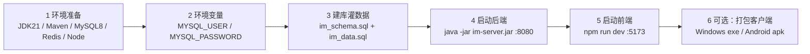

# IM 即时通讯系统 — 项目启动流程

> 本文是「从零把项目跑起来」的最短路径，按顺序照抄即可。
> 每一步的完整细节（环境变量清单、日志目录、已知坑、验证清单）都在根目录 [`README.md`](../README.md) 里，
> 本文只给「先跑起来」必需的动作，遇到疑问按文末的「延伸文档」索引深入。

---

## 零、整体启动顺序（一句话）

**装环境 → 配环境变量 → 建库灌数据 → 起后端（8080）→ 起前端（5173）→（可选）打包成客户端。**
后端必须先起来，前端的 Vite 代理才有目标；直播 / 远程控制等能力另需各自的附加进程（见第六节）。



---

## 一、环境准备

| 依赖 | 要求 | 检查命令 |
|---|---|---|
| JDK | 21 | `java -version` |
| Maven | 3.9+ | `mvn -v` |
| MySQL | 8.x | `mysql --version` |
| Redis | 5+，本地 6379 起着 | `redis-cli ping` |
| Node.js | ≥ 20（前端 / 打包用） | `node -v` |
| npm | ≥ 10 | `npm -v` |
| MinIO | 可选，不装也能跑（默认走本地磁盘） | — |

> MySQL 与 Redis 必须先启动。Redis 没起后端会启动失败；MySQL 没建库会在第一次访问数据时报错。

---

## 二、配置环境变量

**数据库凭据只从环境变量读取，代码与配置里没有任何明文密码。** 本地开发最少只需设 `MYSQL_USER`、`MYSQL_PASSWORD` 两个，其余都有默认值。

PowerShell：

```powershell
$env:MYSQL_USER = 'root'
$env:MYSQL_PASSWORD = '你的密码'
$env:SPRING_PROFILES_ACTIVE = 'dev'   # dev 会把验证码明文回显在登录页，方便自测
```

Bash：

```bash
export MYSQL_USER=root
export MYSQL_PASSWORD=你的密码
export SPRING_PROFILES_ACTIVE=dev
```

常用可选变量（`REDIS_HOST/PORT`、`IM_FILE_STORAGE`、`IM_JWT_SECRET`、`IM_LOG_HOME`、`ALI_BABA_API_KEY`、
`IM_LIVE_*` 等）的完整清单与默认值见 [`README.md` 四、环境变量](../README.md)。
**生产环境务必把 `SPRING_PROFILES_ACTIVE` 改成 `prod`，并替换 `IM_JWT_SECRET` / `IM_TICKET_SECRET`。**

---

## 三、初始化数据库

在项目根目录执行两个脚本（先建表、后灌演示数据）：

```powershell
# 1. 建库建表（含索引、虚拟生成列）——仅限全新库
mysql -u $env:MYSQL_USER -p --default-character-set=utf8mb4 im_db -e "source sql/im_schema.sql"

# 2. 灌入演示数据（3 个用户、角色权限、一对好友、1 个会话、若干历史消息、面试演示会话）
mysql -u $env:MYSQL_USER -p --default-character-set=utf8mb4 im_db -e "source sql/im_data.sql"
```

> ⚠️ **`im_schema.sql` 头部是 `DROP TABLE IF EXISTS` + 重建，重跑会清空全库数据**。已有真实数据的库不要重跑，
> 改用 [`README.md` 五、数据库初始化](../README.md) 里的增量 `ALTER` 升级方式。
> ⚠️ **PowerShell 5.1 不要用 `<` 重定向导入 SQL**（会把中文转成 `?`），一律用上面的 `-e "source 文件"` 写法。

演示账号（密码统一 `123456`）：`admin` / `alice` / `bob`。

---

## 四、启动后端（:8080）

```powershell
# 方式一：打整包再运行（推荐，最接近生产）
mvn clean package -DskipTests
java -jar im-bootstrap/target/im-server.jar

# 方式二：开发热跑（只跑 im-bootstrap 一个模块）
#   注意：跨模块依赖从本地仓库 ~/.m2 解析，改过 im-common 等模块必须先 install，否则跑的是旧 jar 且不报错
mvn -f .\pom.xml install -DskipTests
mvn -f im-bootstrap\pom.xml spring-boot:run
```

启动成功标志是控制台打出这段横幅（端口 / profile / 存储实现均取自实际生效配置）：

```
----------------------------------------------------------
  IM 即时通讯系统启动完成
  生效 Profile : dev
  接口文档     : http://localhost:8080/doc.html
  WebSocket    : ws://localhost:8080/ws
  文件存储     : local
----------------------------------------------------------
```

| 地址 | 用途 |
|---|---|
| http://localhost:8080/doc.html | Knife4j 接口文档（按模块分组） |
| http://localhost:8080/api/ | 全部 REST 接口 |
| ws://localhost:8080/ws | WebSocket 端点（需先取票据） |

---

## 五、启动前端（:5173）

前端是**完全独立的工程**，不参与 Maven 构建。**必须先启动后端**（Vite 会把 `/api`、`/ws`、`/hls` 代理到 8080）。

```powershell
cd im-ui
npm install          # 首次或依赖变动后执行
npm run dev          # 开发启动，访问 http://localhost:5173
```

- 浏览器打开 **http://localhost:5173**，用 `alice` / `bob`（密码 `123456`）登录，开两个不同浏览器即可对聊。
- 手机真机访问：`vite.config.js` 已设 `server.host: true`，控制台会多打一行 `Network: http://<电脑IP>:5173/`，
  手机同 WiFi 直接打开该地址（远程控制等需要 WebCrypto 的功能要 HTTPS，见「延伸文档」）。
- 生产构建：`npm run build`（产物在 `im-ui/dist`），`npm run preview` 本地预览。

---

## 六、可选的附加进程

这些能力不是启动必需，用到时才起：

| 能力 | 附加动作 | 说明 |
|---|---|---|
| 直播（im-live） | `node electron/live-media-server.js`（:8088） | HLS 媒体面服务器；主播侧需 Electron 桌面端 + ffmpeg。见 [`md/直播.md`](直播.md) |
| 远程控制被控端 | `java -jar im-remote-agent/target/im-remote-agent-jar-with-dependencies.jar` | 独立 fat jar，跑在被控机；桌面客户端已内置自启 |
| MinIO 存储 | `minio.exe server D:\minio\data --console-address ":9001"` + 设 `IM_FILE_STORAGE=minio` | 不设则默认走本地磁盘 |
| AI 面试 / 全网检索 | 设 `ALI_BABA_API_KEY` | 不设则仅面试功能返回「API Key 未配置」，其余照常 |

---

## 七、打包成客户端（可选）

前端同一份代码支持两种分发形态，详细步骤见 `md/打包/` 下两份文档：

- **Windows 桌面客户端（Electron）**：把 Vue 前端打进原生窗口壳，内置被控端 Agent 与裁剪 JRE，连远程后端。
  本项目已在 Windows 上实际打包成功，照抄流程见 [`md/打包/Electron打包指南.md`](打包/Electron打包指南.md)。

  ```powershell
  cd im-ui; npm run build:electron          # 相对 base './' + hash 路由，产物直接进 electron/dist
  cd ..\electron; npm install; npm run build # 产物：electron\release\IM通讯 Setup 1.0.0.exe
  ```

  > ⚠️ 分发前先改 `electron/main.js` 的 `SERVER_BASE` 为实际后端地址。

- **Windows EXE + 安卓 APK 总览**：EXE（Electron / Tauri 方案）与 Android（Capacitor WebView 壳）两条打包路线的
  软件准备、命令与常见问题，见 [`md/打包/打包为EXE和Android指南.md`](打包/打包为EXE和Android指南.md)。

---

## 八、启动后自检

按 [`README.md` 十七、验证清单](../README.md) 逐项走一遍：构建 → 建库 → 启动 → 文档分组 → 接口串测 →
WebSocket → 前端交互 → 远程控制 → AI → 全网检索 → 直播。核心链路（登录 → WS 握手 → 双向收发 → 未读数 →
已读回执 → 顶下线）跑通即代表后端与前端已正常联动。

---

## 延伸文档

| 文档 | 内容 |
|---|---|
| [`README.md`](../README.md) | 总说明：技术栈、模块结构、环境变量全表、接口一览、已知坑、验证清单 |
| [`md/架构与请求链路图.md`](架构与请求链路图.md) | 三层架构、HTTP / WebSocket 链路、登录鉴权、文件上传下载、直播链路图集 |
| [`md/多端入口与缓存全链路图.md`](多端入口与缓存全链路图.md) | 手机浏览器 / 安卓 / PC / Electron 四端入口与各级缓存全链路 |
| [`md/打包/Electron打包指南.md`](打包/Electron打包指南.md) | Windows 桌面端 Electron 打包实操（含踩坑） |
| [`md/打包/打包为EXE和Android指南.md`](打包/打包为EXE和Android指南.md) | Windows EXE 与 Android APK 打包总览 |
| [`md/手机真机调试HTTPS配置指南.md`](手机真机调试HTTPS配置指南.md) | 手机真机联调（远程控制需 HTTPS）自签证书配置 |
| [`md/直播.md`](直播.md) | 直播完整部署、生产 Nginx 迁移与排障 |
| [`md/已踩坑.md`](已踩坑.md) | 踩过的坑与修复方式 |
